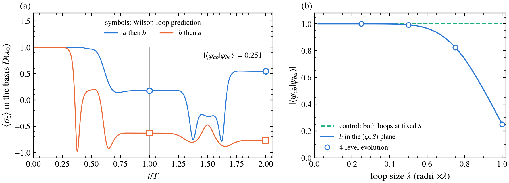
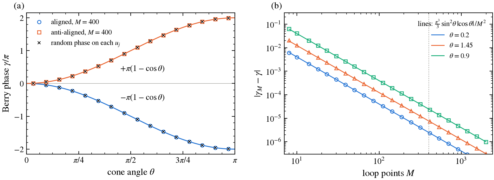
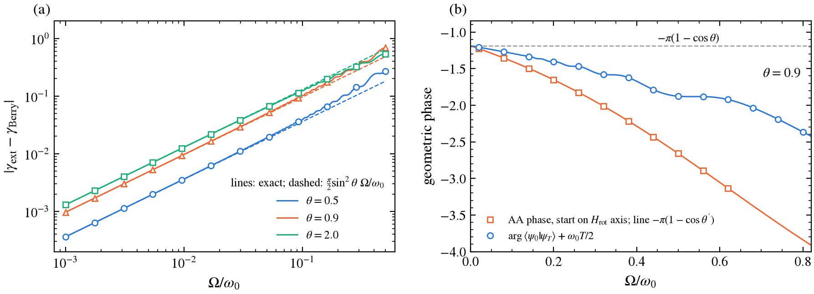
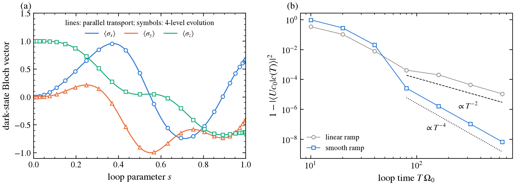

# Berry Phase and Non-Abelian Holonomy

*From a spin in a rotating field to the tripod's U(2) gauge field.*

<p align="center">
  
</p>

<p align="center">
  <a href="#quick-start">Quick start</a> •
  <a href="#summary-of-results">Results</a> •
  <a href="Berry-phase.pdf">Report (PDF)</a> •
  <a href="#references">References</a>
</p>

A NumPy/SciPy implementation of geometric phases computed without ever differentiating an eigenvector.

- **Part A** computes the Berry phase of a spin-1/2 in a precessing field from the gauge-invariant discrete formula. It checks the result four ways: against the solid angle, against a closed form at finite discretisation, against direct time evolution, and against the exact rotating-frame solution, including the non-adiabatic correction.
- **Part B** builds the dark subspace of the tripod atom and computes its U(2) holonomy as a Wilson loop. It confirms the holonomy by integrating the full four-level Schrödinger equation, and shows that two loops traversed in opposite order leave the atom in different states.

> [!NOTE]
> Every number on this page is produced by `scripts/make_figures.py` and saved in [`figures/results.txt`](figures/results.txt). Every claim in the table is checked by a unit test (87 tests in `tests/`, about 1 s). Derivations are in the report, [`Berry-phase.pdf`](Berry-phase.pdf).

## Quick start

`berry_phase` is installed as part of the repository's Poetry environment, and pytest is in the `dev` group.

```bash
poetry install                                        # from the repository root
poetry run pytest Berry-phase/tests                   # ~1 s
poetry run python Berry-phase/scripts/make_figures.py # ~6 s
```

## Summary of results

| Quantity | Result | Expected |
|---|---|---|
| Berry phase, $M = 400$, five cone angles | max error $2.49\times10^{-5}$ (at $\theta = 2.2$) | $-\pi(1-\cos\theta)$ within $10^{-4}$ |
| Discretisation error | $(\pi^3/3)\sin^2\theta\cos\theta/M^2$, matches to 4 digits | $O(M^{-2})$ |
| Random phase on every $u_j$ | change $\le 2.2\times10^{-15}$ | gauge invariant |
| Reversed loop | $\|\gamma_{\rm rev} + \gamma\| \le 1.3\times10^{-15}$ | sign flips |
| Chern number, aligned / anti-aligned | $-1.000000000000$ / $+1.000000000000$ | $\mp1$ |
| Magnus integrator vs exact rotating frame, $\Omega/\omega_0 = 0.1$ | $8.2\times10^{-9}$ (1000 steps), $5.2\times10^{-10}$ (2000) | $< 10^{-8}$ |
| Non-adiabatic error, log-log slope ($\theta = 0.5,\,0.9,\,2.0$) | $1.003,\ 1.003,\ 0.999$ | linear in $\Omega/\omega_0$ |
| Non-adiabatic coefficient at $\theta = 0.9$ | $-0.9643$ | $-(\pi/2)\sin^2\theta = -0.9638$ |
| Aharonov–Anandan phase, $\Omega/\omega_0 \le 0.8$ | equals $-\pi(1-\cos\theta')$ to $3.1\times10^{-7}$ | exact at any speed |
| Tripod $\|[A_\varphi, A_S]\|$ at $\theta = 1.3$ | $0.351231$ | $\sqrt2\cos\theta\sin^2\theta = 0.351231$ |
| Small loop, $-i\log U/\text{area}$ vs $F_{\mu\nu}$ | $2.9\times10^{-6}$, $1.2\times10^{-5}$, $3.4\times10^{-3}$ at $r = 0.005$ | $U \approx 1 + iF\,\text{area}$ |
| Four-level evolution vs Wilson loop ($T\Omega_0 = 200$) | $1 - F = 6.9\times10^{-7}$, leakage $1.2\times10^{-10}$ | $\to 0$ adiabatically |
| Loop order, overlap of final states | $0.2523$ (Wilson), $0.2508$ (evolution) | $< 1$ |
| Same, Abelian control (all couplings real) | $1.000000000000$ | $1$ |

## 1. The models

**Spin-1/2.** $H(t) = \tfrac{\omega_0}{2}\,\hat n(t)\cdot\boldsymbol\sigma$ with $\hat n = (\sin\theta\cos\varphi, \sin\theta\sin\varphi, \cos\theta)$ and $\varphi = \Omega t$. The aligned eigenstate, in a gauge single-valued in $\varphi$, is $|+\rangle = (\cos\tfrac\theta2,\ e^{i\varphi}\sin\tfrac\theta2)$, with energy $+\omega_0/2$.

**Tripod.** Three ground states coupled to one excited state by resonant lasers. In the basis $(|0\rangle, |1\rangle, |2\rangle, |3\rangle)$,

$$
H = \sum_{j=1}^{3} \Omega_j\,|0\rangle\langle j| + \text{h.c.},\qquad
\Omega_1 = \Omega_0\sin\theta\cos\varphi,\quad \Omega_2 = \Omega_0\sin\theta\sin\varphi,\quad \Omega_3 = \Omega_0\cos\theta\,e^{iS}.
$$

The spectrum is $\{0, 0, \pm\Omega_0\}$ for all parameters. The two zero-energy dark states span the null space of the row $(\Omega_1, \Omega_2, \Omega_3)$, and the gap to the bright pair is $\Omega_0$ everywhere. Only the phase $S$ of laser 3 is varied: the parameter space is $x = (\theta, \varphi, S)$.

**Conventions** (fixed once, [`Berry-phase.pdf`](Berry-phase.pdf) §0). $\hbar = 1$; $A = i\langle u|\nabla u\rangle$; $\gamma = \oint A\cdot dR$; the adiabatic factor is $e^{+i\gamma}$; $U = \mathcal P\exp(i\oint A)$ acts on dark-state components with later times to the left.

## 2. Method

### 2.1 Discrete Berry phase

$$
\gamma = -\,\mathrm{Im}\ln\prod_{j=0}^{M-1}\langle u_j|u_{j+1}\rangle,\qquad u_M \equiv u_0 .
$$

Each $u_j$ appears once as a bra and once as a ket, so an arbitrary phase on any $u_j$ cancels. The sign follows from $\langle u_j|u_{j+1}\rangle \simeq e^{-iA\,\delta R}$. On the cone all links are equal, which gives the formula at finite $M$ in closed form, $\gamma_M = -M\arg(\cos^2\tfrac\theta2 + \sin^2\tfrac\theta2\,e^{2\pi i/M})$. Its expansion predicts the error

$$
\gamma_M - \gamma = \frac{\pi^3}{3}\,\frac{\sin^2\theta\cos\theta}{M^2} + O(M^{-4}).
$$

The tests use this to check the code to machine precision at every $M$, not only in the $M\to\infty$ limit. `berry_phase` raises if two neighbours are orthogonal, where the formula is undefined.

**Chern number.** Fukui–Hatsugai–Suzuki plaquettes on a pole-to-pole $(\theta, \varphi)$ grid. Each plaquette flux is in $(-\pi, \pi]$, so the total is exactly $2\pi C$.

### 2.2 Time evolution

`magnus4` is a fourth-order Magnus integrator with two Gauss nodes per step:

$$
\psi_{n+1} = e^{-iK}\psi_n,\qquad K = \tfrac h2(H_1 + H_2) - i\,\tfrac{\sqrt3}{12}h^2\,[H_2, H_1].
$$

Each step is exactly unitary, so norm loss cannot masquerade as leakage. The exponential is taken by `eigh` for all steps at once. It is checked against `expm` for constant $H$ and against the exact rotating-frame solution $\psi(t) = e^{-i\Omega t\sigma_z/2}e^{-iH_{\rm rot}t}\psi(0)$, $H_{\rm rot} = H(0) - \tfrac\Omega2\sigma_z$. Its order of convergence is checked too: halving $h$ cuts the error by 16.

**Geometric phase from dynamics.** Following the brief, $\gamma_{\rm ext} = \arg\langle\psi(0)|\psi(T)\rangle + \tfrac{\omega_0}{2}T$ after one period $T = 2\pi/\Omega$. Because $R(T) = -1$, the rotating-frame solution gives $\gamma_{\rm ext}$ in closed form at any $\Omega$ (`spin_geometric_phase_exact`). Expanding it in $\varepsilon = \Omega/\omega_0$:

$$
\gamma_{\rm ext} = -\pi(1-\cos\theta) - \tfrac\pi2\sin^2\theta\;\varepsilon + O(\varepsilon^2).
$$

**Aharonov–Anandan phase.** Start instead on the axis of $H_{\rm rot}$, tilted to $\tan\theta' = \sin\theta/(\cos\theta - \varepsilon)$. The motion is then exactly cyclic, and the total phase minus the true dynamical phase $-\int\langle\psi|H|\psi\rangle dt$ is $-\pi(1-\cos\theta')$ at any speed.

### 2.3 Wilson loop and holonomy

The frames $D_j$ are $4\times2$ dark bases at $M$ points of the loop, and the links are $M_j = D_j^\dagger D_{j+1}$. The components of an adiabatically transported state obey $c_{j+1} = M_j^\dagger c_j$, so

$$
U = (M_0 M_1\cdots M_{M-1})^\dagger = W^\dagger,\qquad W \to G_0^\dagger W G_0 \text{ under a gauge change.}
$$

The raw product $W$ is not unitary: each link has singular values $1 - O(M^{-2})$, so $W$ shrinks by $1 - O(M^{-1})$ (logged: $9.2\times10^{-3}$ at $M = 2000$). `holonomy` therefore multiplies the polar (unitary) parts of the links. This is exactly unitary, identical to parallel transport (`parallel_transport`, tested to $10^{-13}$), and converges as $M^{-2}$. Its eigenphases are the same in the smooth analytic gauge and in the arbitrary gauge returned by `scipy.linalg.null_space`.

**Connection and curvature.** In the smooth gauge of Ruseckas *et al.* the connection is known in closed form: $A_\theta = 0$, $A_\varphi = \cos\theta\,\sigma_y$, $A_S = -\mathrm{diag}(1, \cos^2\theta)$. The code computes $A_\mu = i D^\dagger\partial_\mu D$ by central differences and $F_{\mu\nu} = \partial_\mu A_\nu - \partial_\nu A_\mu - i[A_\mu, A_\nu]$ from those, and checks both against the closed forms. The normalisation and sign of $F$ are fixed by the small-loop identity $U = 1 + iF\cdot\text{area}$, which is tested for all three planes. $F_{\varphi S} = -\cos\theta\sin^2\theta\,\sigma_x$ comes entirely from the commutator, so it tests the sign of the non-Abelian term.

**Four-level dynamics.** The atom starts in $D_1(x_0)$ and the full $4\times4$ Hamiltonian is integrated along the loop. The loop parameter follows a smooth ramp $s(u) = u - \sin(2\pi u)/2\pi$, so the lasers start and stop with zero velocity. The result is projected onto the dark basis at $x_0$ and compared with $U c_0$.

## 3. Results

### 3.1 Abelian Berry phase



**Figure 1.** (a) Discrete Berry phase at $M = 400$ for the aligned (circles) and anti-aligned (squares) states against cone angle, with $\mp\pi(1-\cos\theta)$ (lines). Crosses repeat the calculation with a random phase on every $u_j$. The anti-aligned phase is the negative of the aligned one; at the south pole the aligned phase reaches $-2\pi \equiv 0$. (b) Error against $M$ (symbols) and the predicted leading term $\tfrac{\pi^3}{3}\sin^2\theta\,|\cos\theta|/M^2$ (lines, no fit). The dotted line marks $M = 400$.

| $\theta$ | $\gamma$ exact | error $M = 20$ | $M = 50$ | $M = 400$ | predicted, $M = 400$ |
|---|---|---|---|---|---|
| 0.3 | $-0.140315$ | $2.15\times10^{-3}$ | $3.45\times10^{-4}$ | $5.389\times10^{-6}$ | $5.389\times10^{-6}$ |
| 0.9 | $-1.188747$ | $9.90\times10^{-3}$ | $1.58\times10^{-3}$ | $2.464\times10^{-5}$ | $2.464\times10^{-5}$ |
| 1.5 | $-2.919365$ | $1.84\times10^{-3}$ | $2.91\times10^{-4}$ | $4.547\times10^{-6}$ | $4.547\times10^{-6}$ |
| 2.2 | $-4.990423$ | $-9.99\times10^{-3}$ | $-1.59\times10^{-3}$ | $-2.485\times10^{-5}$ | $-2.485\times10^{-5}$ |
| 2.9 | $-6.191948$ | $-1.43\times10^{-3}$ | $-2.30\times10^{-4}$ | $-3.590\times10^{-6}$ | $-3.590\times10^{-6}$ |

The error is $O(M^{-2})$, and its coefficient matches $\tfrac{\pi^3}{3}\sin^2\theta\cos\theta$ to every printed digit. It changes sign at $\theta = \pi/2$, where the $M^{-2}$ term vanishes. That is why $\theta = 1.5$ is five times more accurate than $\theta = 0.9$. **Correction to the brief:** at $\theta = 0.9$, $M = 400$, the agreement is $2.46\times10^{-5}$, not the quoted $10^{-5}$. The random gauge changes $\gamma$ by at most $2.2\times10^{-15}$, and reversing the loop flips the sign to $1.3\times10^{-15}$. The lattice Chern number is $-1$ for the aligned and $+1$ for the anti-aligned state, to 12 digits, even on a $6\times8$ grid with a random gauge.

### 3.2 Non-adiabatic corrections



**Figure 2.** (a) Deviation of the extracted phase $\gamma_{\rm ext}$ from the Berry phase against precession rate. Symbols are the Magnus integration, solid lines the exact rotating-frame result, dashed lines the predicted leading term $\tfrac\pi2\sin^2\theta\;\Omega/\omega_0$. (b) At $\theta = 0.9$: $\gamma_{\rm ext}$ (circles, line exact) and the Aharonov–Anandan phase for a state started on the rotating-frame axis (squares), with $-\pi(1-\cos\theta')$ (orange line). The dashed line is the adiabatic Berry phase.

| $\theta$ | log-log slope ($\varepsilon \le 0.007$) | $(\gamma_{\rm ext} - \gamma)/\varepsilon$ at $\varepsilon = 10^{-3}$ | $-(\pi/2)\sin^2\theta$ |
|---|---|---|---|
| 0.5 | 1.0034 | $-0.36132$ | $-0.36105$ |
| 0.9 | 1.0028 | $-0.96434$ | $-0.96384$ |
| 2.0 | 0.9989 | $-1.29813$ | $-1.29877$ |

The extracted phase tends to the Berry phase, with an error linear in $\Omega/\omega_0$ and a slope fixed analytically. The remaining $0.05\%$ difference is the $O(\varepsilon^2)$ term. The integration agrees with the closed form to $1.4\times10^{-7}$ everywhere. The steps above $\Omega/\omega_0 \approx 0.1$ are the $\sin^2 d$ admixture of the other rotating-frame eigenstate, beating at frequency $\lambda\omega_0$.

Panel (b) reframes the "error". The state does not follow the field; it follows the effective field of the rotating frame, tilted to $\theta'$. Measured against the path it actually takes, and with the true dynamical phase removed, the geometric phase is exactly half the solid angle: $-\pi(1-\cos\theta')$ to $3.1\times10^{-7}$ up to $\Omega/\omega_0 = 0.8$, far from adiabatic.

### 3.3 Wilson loop versus four-level evolution



**Figure 3.** Loop $b$: a circle of radius 1.5 in the $(\varphi, S)$ plane at $\theta = 1.3$. (a) Bloch vector of the dark-subspace state in the local basis $D(x(s))$ along the loop. Lines are the parallel-transport prediction ($M = 2000$), symbols the full four-level evolution with $T\Omega_0 = 200$. (b) Infidelity of the evolved state against the holonomy prediction for a linear and a smooth ramp, with $T^{-2}$ and $T^{-4}$ guides.

| Check | Result |
|---|---|
| holonomy eigenphases, loop $b$ | $\pm1.349018$ |
| $\|\mathrm{polar}(W)^\dagger - U\|$, $M = 250 \to 2000$ | $5.5\times10^{-4} \to 8.5\times10^{-6}$ ($M^{-2}$) |
| $1 - F$ at $T\Omega_0 = 200$, smooth ramp | $6.9\times10^{-7}$ |
| leakage out of the dark subspace | $1.2\times10^{-10}$ |
| fitted exponent of $1 - F$, linear / smooth ($T\Omega_0 \ge 80$) | $-1.80$ / $-3.97$ |

The state rotates through most of the Bloch sphere, with no energy difference driving it, and the four-level evolution follows the parallel-transport prediction at every point. The holonomy contains no time scale: the same $U$ predicts the final state for every $T$ and both ramps, and the deviation vanishes as $T$ grows. The ramp sets how fast. A linear ramp switches the velocity on and off abruptly, so leakage is $\propto (v/\Omega_0)^2 \propto T^{-2}$. It oscillates around that envelope because the start and stop kicks interfere, which is why the fit gives $-1.80$. The smooth ramp removes those kicks and reaches $T^{-4}$: at $T\Omega_0 = 640$ it is $7\times10^{-9}$, against $1.1\times10^{-5}$ for the linear ramp. At $T\Omega_0 \lesssim 20$ the evolution is not adiabatic, and the smooth ramp, with twice the peak speed, does worse.

### 3.4 Loop order: non-Abelian holonomy


**Figure 4.** Loop $a$ circles in $(\theta, \varphi)$ (radius 0.6), loop $b$ in $(\varphi, S)$ (radius 1.5), both from $x_0 = (1.3, 0, 0)$. Every loop keeps $0 < \theta < \pi/2$. (a) $\langle\sigma_z\rangle$ of the dark state, in the fixed basis $D(x_0)$, during the four-level evolution: $a$ then $b$ (blue) and $b$ then $a$ (orange), $T\Omega_0 = 200$ per loop. Symbols are the Wilson-loop predictions after each loop. (b) Overlap of the two final states as both radii are scaled by $\lambda$. Line from Wilson loops, symbols from the four-level evolution. Dashed: control pair with $S$ fixed.

| | $a$ then $b$ | $b$ then $a$ |
|---|---|---|
| $1 - F$ vs $U_bU_ac_0$ or $U_aU_bc_0$ | $2.9\times10^{-8}$ | $2.7\times10^{-6}$ |
| overlap $\|\langle\psi_{ab}\|\psi_{ba}\rangle\|$, Wilson | $0.2523$ | |
| overlap, four-level evolution | $0.2508$ | |
| $\|[U_a, U_b]\|_F$ | $1.770$ | |
| control (both loops at fixed $S$): $\|[U_a, U_{b'}]\|_F$, overlap | $7.4\times10^{-14}$, $1.000000000000$ | |

Traversing the same two loops in opposite order leaves the atom in states with overlap $0.25$, so they are mostly orthogonal. This is the defining property of a non-Abelian gauge field. The four-level simulation agrees with the Wilson-loop number to $1.5\times10^{-3}$, consistent with its infidelity: an error $1 - F \sim 3\times10^{-6}$ moves amplitudes by $\sim\sqrt{1-F}$. As predicted in [`Berry-phase.pdf`](Berry-phase.pdf) §6, the brief's warning is right: with all couplings real, every $A_\mu$ is a multiple of $\sigma_y$, and the control loops commute to $10^{-13}$. Panel (b) shows the effect is small for small loops. The commutator scales as $[U_a, U_b] \approx -[F_a, F_b]\,\text{area}_a\,\text{area}_b \propto \lambda^4$, so $1 - |\langle\psi_{ab}|\psi_{ba}\rangle| \propto \lambda^8$. From $\lambda = 0.5$ to $0.75$ it grows from $0.0068$ to $0.175$, a factor $25.7$ against $1.5^8 = 25.6$. It becomes order one only when the loops enclose a large curvature flux.

## 4. Discussion

1. **Why is the Berry phase gauge invariant for a closed loop but not an open path?** Under $u \to e^{i\alpha(R)}u$, $\gamma$ changes by $\alpha(\text{end}) - \alpha(\text{start})$. On a closed loop this is $2\pi n$. On an open path it is anything. In the discrete formula, every $u_j$ on a closed loop appears as both bra and ket; on an open path the end states appear once and their phases survive. Fig. 1(a) (crosses) and the reversed-loop test are the numerical form of this.
2. **Chern number of the spin-1/2 sphere.** $C = -1$ for the aligned state and $+1$ for the anti-aligned one in our convention (§3.1). It counts the monopole charge enclosed by the sphere of field directions: the degeneracy at $\vec B = 0$. It is the obstruction to a single smooth gauge: $|+\rangle = (\cos\tfrac\theta2, e^{i\varphi}\sin\tfrac\theta2)$ is singular at the south pole, and any other choice is singular somewhere.
3. **Relation to the Zak phase in the SSH project.** The Zak phase is this calculation with the loop parameter being crystal momentum: $k$ runs over the Brillouin zone, a closed loop because $H(k+2\pi) = H(k)$. [`SSH-model`](../SSH-model/README.md) uses the same discrete formula (`zak_phase`). There chiral symmetry quantises the phase to $0$ or $\pi$; here the solid angle varies continuously with $\theta$.
4. **Why does a degenerate level give a matrix-valued phase?** Inside a $d$-fold degenerate level, adiabatic transport fixes the subspace but not a basis in it, so the gauge freedom is $U(d)$. Transport around a loop returns the subspace to itself, rotated by a $d\times d$ unitary. Different loops give different unitaries, and in general they do not commute: figs. 3–4.

## Project layout

<details>
<summary>Files and what they contain</summary>

```text
Berry-phase/
├── berry_phase/
│   ├── geometry.py         discrete Berry phase, Wilson loop, holonomy, parallel transport, plaquette flux
│   ├── spin.py             spin-1/2 Hamiltonian and states, closed forms, Chern number
│   ├── dynamics.py         4th-order Magnus integrator, rotating-frame solution, extracted and AA phases
│   └── tripod.py           tripod Hamiltonian, dark states, connection, curvature, loops, four-level evolution
├── tests/                  87 pytest tests, ~1 s
├── scripts/make_figures.py figures and figures/results.txt, ~6 s
├── figures/
├── docs/report.tex         LaTeX source of Berry-phase.pdf
└── Berry-phase.pdf         the project report
```

</details>

## References

1. M. V. Berry, *Quantal phase factors accompanying adiabatic changes*, Proc. R. Soc. Lond. A **392**, 45 (1984).
2. F. Wilczek, A. Zee, *Appearance of gauge structure in simple dynamical systems*, Phys. Rev. Lett. **52**, 2111 (1984).
3. B. Simon, *Holonomy, the quantum adiabatic theorem, and Berry's phase*, Phys. Rev. Lett. **51**, 2167 (1983).
4. Y. Aharonov, J. Anandan, *Phase change during a cyclic quantum evolution*, Phys. Rev. Lett. **58**, 1593 (1987).
5. D. Xiao, M.-C. Chang, Q. Niu, *Berry phase effects on electronic properties*, Rev. Mod. Phys. **82**, 1959 (2010).
6. J. Ruseckas, G. Juzeliūnas, P. Öhberg, M. Fleischhauer, *Non-Abelian gauge potentials for ultracold atoms with degenerate dark states*, Phys. Rev. Lett. **95**, 010404 (2005).
7. J. Dalibard, F. Gerbier, G. Juzeliūnas, P. Öhberg, *Colloquium: Artificial gauge potentials for neutral atoms*, Rev. Mod. Phys. **83**, 1523 (2011).
8. T. Fukui, Y. Hatsugai, H. Suzuki, *Chern numbers in discretized Brillouin zone*, J. Phys. Soc. Jpn. **74**, 1674 (2005).
9. S. Blanes, F. Casas, J. A. Oteo, J. Ros, *The Magnus expansion and some of its applications*, Phys. Rep. **470**, 151 (2009).
