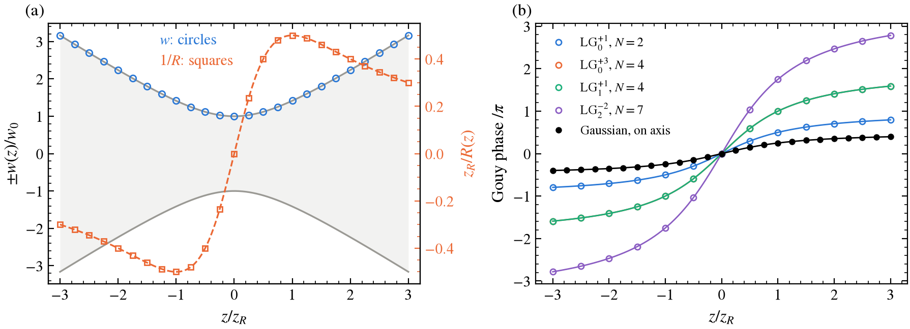
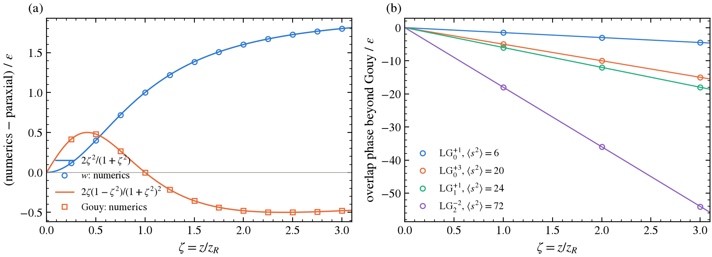
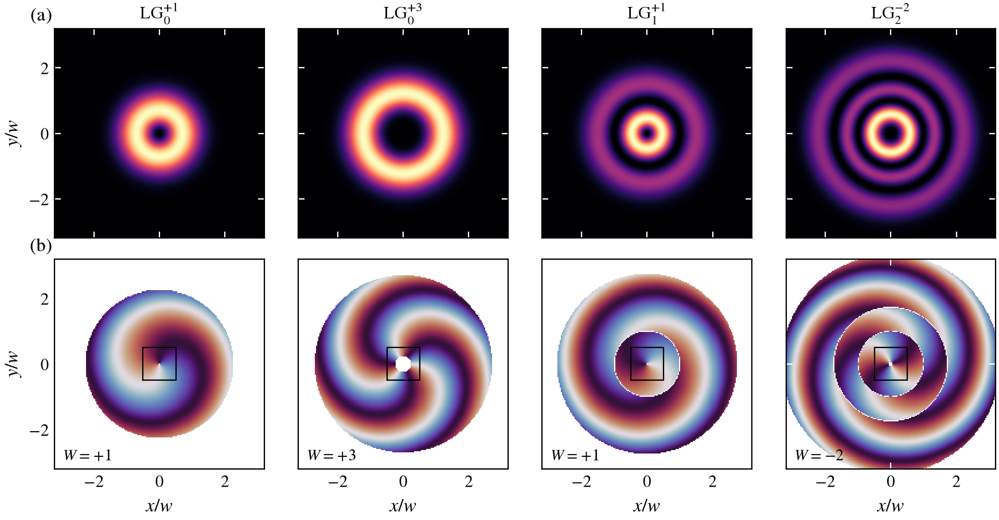
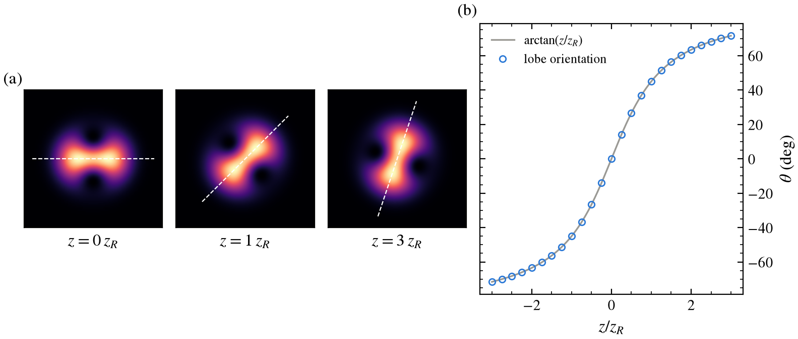
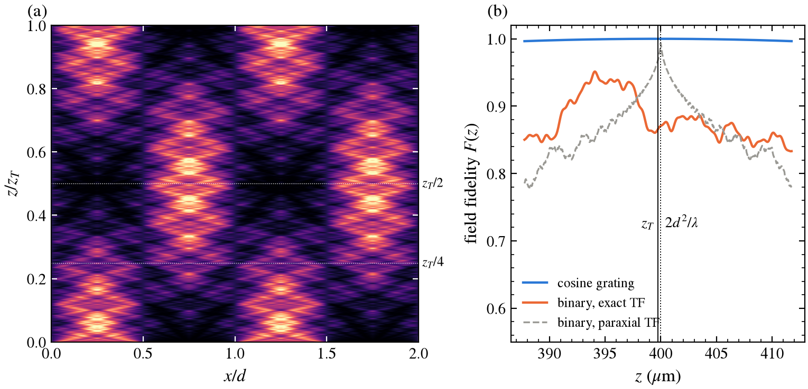
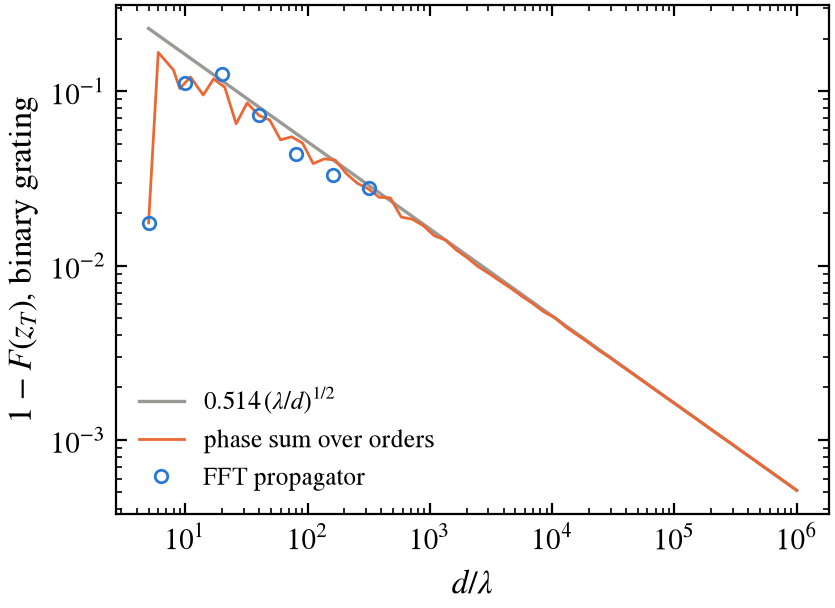
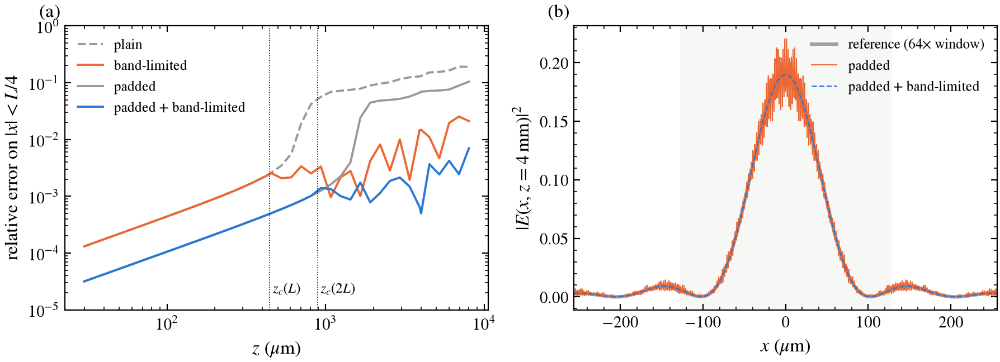
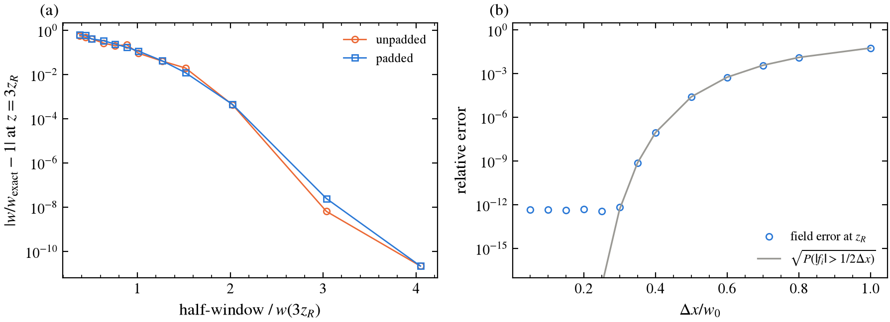

# Fourier Optics and Structured Light
### Band-limited angular-spectrum propagation, Gaussian and Laguerre–Gauss beams, the Talbot carpet, and where the method fails

A monochromatic field in a plane is a sum of plane waves, and free propagation only multiplies each one by $e^{ik_z z}$. This project builds that propagator (with the band limit of Matsushima and Shimobaba, optional zero padding and a paraxial switch). It tests the propagator against plane waves, Parseval and an exact Hankel integral, then uses it on four problems: the Gaussian beam's width, curvature and Gouy phase; Laguerre–Gauss vortex modes with their winding, OAM and mode-order-dependent Gouy phase; the Talbot self-images of gratings; and the sampling limits of the method. Where the numerics differ from the paraxial formulas, the difference is derived and checked, with no fitted parameters: the nonparaxial width, Gouy and LG overlap terms, and the $\sqrt{\lambda/d}$ defect of a binary grating's Talbot image.

Every number on this page is produced by `scripts/make_figures.py` and saved in [`figures/results.txt`](figures/results.txt). Every row of the summary table is checked by the named test (136 tests in `tests/`). Derivations and the full report are in [`Fourier-optics.pdf`](Fourier-optics.pdf).

---

## Summary of results

$\lambda = 0.5\ \mu$m, $w_0 = 10\ \mu$m ($z_R = 628.3\ \mu$m, $\varepsilon = 1/(kw_0)^2 = 6.33\times10^{-5}$) unless stated.

| Quantity | Result | Expected | Test |
|---|---|---|---|
| Power after $z = 10\ \mu$m … $10$ cm, propagating field | $\|P(z)/P(0)-1\| \le 10^{-15}$ | $< 10^{-10}$ | `test_power_conserved_for_propagating_field` |
| Plane wave at $70°$ after $123\ \mu$m | $\le 2\times10^{-14}$ from $E_0e^{ik_zz}$ | plane wave | `test_plane_wave_stays_plane_wave` |
| On-axis field vs exact Hankel integral, $\|z\| \le 3z_R$ | $\le 10^{-9}$ | exact | `test_gaussian_matches_exact_helmholtz_on_axis` |
| Gaussian width vs $w_0\sqrt{1+\zeta^2}$, $0 \le z \le 3z_R$ | $1.14\times10^{-4}$ | $< 5\times10^{-3}$ | `test_gaussian_width` |
| … vs $w_0\sqrt{1+\zeta^2(1+4\varepsilon+24\varepsilon^2)}$ | $\le 2\times10^{-11}$ | derived, [§3.1](Fourier-optics.pdf) | `test_gaussian_width_nonparaxial_term` |
| Curvature $1/R$ from a phase fit | $\le 1.6\times10^{-4}$ relative | $z/(z^2+z_R^2)$ | `test_gaussian_curvature` |
| On-axis Gouy $kz - \arg E(0,z)$ vs $\arctan\zeta$ | $3.2\times10^{-5}$ rad | $< 0.01$ rad | `test_gaussian_gouy` |
| … vs $\arctan\zeta + 2\varepsilon\zeta(1-\zeta^2)/(1+\zeta^2)^2$ | $\le 10^{-8}$ rad | derived, [§3.2](Fourier-optics.pdf) | `test_gaussian_gouy_nonparaxial_term` |
| LG Gouy, 4 modes, $N = 2p+\|l\|+1$ up to 7, $\|z\| \le 3z_R$ | $\le 3.4\times10^{-3}$ rad from $N\arctan\zeta$ | $< 0.01$ rad | `test_lg_gouy` |
| … that residual vs $-\zeta\varepsilon\langle s^2\rangle/4$ | agrees to $\le 2.5\times10^{-6}$ rad | derived, [§4.2](Fourier-optics.pdf) | `test_lg_nonparaxial_phase_and_shape` |
| LG shape: $1 - \|\langle\mathrm{LG}(z)\|E(z)\rangle\|^2$ at $3z_R$ | $1.9\times10^{-7}$ … $1.2\times10^{-5}$ | $(\zeta\varepsilon/4)^2\mathrm{Var}(s^2)$, within 1% | same test |
| Phase winding, 4 modes, $z = 0, z_R, 3z_R$ | $l$ to $10^{-12}$ | $l$ | `test_lg_phase_winding` |
| $\langle L_z\rangle/\hbar$ at $z = 0$ and $3z_R$ | $l$ to $10^{-12}$ | $l$, conserved | `test_oam_per_photon_is_l_and_conserved` |
| Lobe rotation of $\mathrm{LG}_0^0 + \mathrm{LG}_0^2$ | $\arctan\zeta$ to $2\times10^{-16}$ (paraxial TF), $9.9\times10^{-5}$ (exact) | $\arctan\zeta$ | `test_gouy_phase_rotates_mode_superposition` |
| Cosine-grating revival, $d = 10\ \mu$m | at $399.749846\ \mu$m, $F = 1 - O(10^{-15})$ | $z_T = 399.74984$; paraxial $400$ | `test_cosine_grating_self_image_at_exact_talbot_distance` |
| Same, $d = 2\ \mu$m | at $15.74586\ \mu$m | $z_T = 15.74597$; paraxial $16$ | same test |
| Half-Talbot shift of the intensity's first harmonic, both gratings and periods | $0.500000000000\,d$ | $d/2$ | `test_half_talbot_image_shifted_by_half_period` |
| Binary grating $F(z_T)$, $d = 10\ \mu$m | $0.866$; paraxial TF: $1 - O(10^{-15})$ | $1$ (brief) | `test_binary_grating_self_images_only_paraxially` |
| Binary-grating defect $1-F(z_T)$ for $d/\lambda \to \infty$ | $0.5137\sqrt{\lambda/d}$, ratio $1.0000$ at $d/\lambda = 10^5$; slope $-0.495$ | $\frac{4}{\pi^2}\mathrm{Re}J\sqrt{\lambda/d}$, derived [§5.2](Fourier-optics.pdf) | `test_binary_talbot_defect_scales_as_sqrt_lambda_over_d` |
| Slit at $z = 4$ mm, padded, no band limit / band-limited | $6.9\%$ / $0.05\%$ error | wrong / right | `test_band_limit_needed_beyond_critical_distance` |
| Unlimited error first $> 1.5\times$ band-limited | $z = 526\ \mu$m unpadded, $1243\ \mu$m padded (scan) | after $z_c = 443$, $887\ \mu$m | `test_critical_distance` |

**Corrections to the brief** (details in the sections below):

1. **Gouy sign.** With $e^{i(kz-\omega t)}$, the on-axis phase minus $kz$ is $-\arctan(z/z_R)$, a lag, not $+\arctan$ (§3.1).
2. **The "exact" Talbot distance belongs to the first harmonic only.** $\lambda/(1-\sqrt{1-\lambda^2/d^2})$ is where orders $0$ and $\pm1$ rephase. Order $m$ rephases at a different distance, so only a grating with harmonics $0, \pm1$ (a cosine grating) self-images exactly. A 50% binary grating with $d = 10\ \mu$m has field fidelity $0.866$ at $z_T$, and its best revival nearby is at $394.08\ \mu$m with $F = 0.951$. With the paraxial transfer function it self-images perfectly at $2d^2/\lambda$ (§3.5).
3. **Half-Talbot.** The first harmonic of the intensity is shifted by exactly $d/2$ for every grating. The whole image is shifted by $d/2$ only for the cosine grating; for the binary one the fidelity with the shifted grating is $0.914$ ($d = 10\ \mu$m) and $0.906$ ($d = 2\ \mu$m).
4. **The paraxial $z_T$ is always too long by $\lambda/2$**, independent of $d$: $z_T = 2d^2/\lambda - \lambda/2 + O(\lambda^3/d^2)$. The brief's $399.75$ vs $400\ \mu$m is right.
5. **Band limiting must be switched off for a periodic window.** Its argument is about light leaving a finite window. With one grating period as the window, $f_\text{lim}(z_T) = 0.025\ \mu\text{m}^{-1} < 1/d$ would delete every diffraction order.
6. The measured deviations from the paraxial formulas ($10^{-4}$ in width, $3\times10^{-5}$ rad in Gouy, $3\times10^{-3}$ rad for $\mathrm{LG}_2^{-2}$) are not numerical error. They are nonparaxial physics with closed forms, and the numerics match those to $10^{-11}$, $10^{-8}$ and $2.5\times10^{-6}$ rad.

---

## 1. Model and conventions

The field carries $e^{i(kz-\omega t)}$ with $k = 2\pi n/\lambda$. Spatial frequencies $f$ are in cycles per length (`numpy.fft.fftfreq`), and $x = 0$ sits at array index $N/2$. The propagator is

$$
E(x, y, z) = \mathcal F^{-1}\Big[\mathcal F[E(x,y,0)]\;e^{ik_zz}\;\Theta(f_\text{lim} - |f_x|)\,\Theta(f_\text{lim} - |f_y|)\Big], \qquad k_z = 2\pi\sqrt{(n/\lambda)^2 - f_x^2 - f_y^2},
$$

and evanescent components decay as $e^{-\kappa|z|}$. It works on 1D arrays (fields invariant in $y$) and 2D arrays. Beams have their waist at $z = 0$; $w$ is the $1/e^2$ intensity radius, $\zeta = z/z_R$, $\psi = \arctan\zeta$.

| Function | Meaning |
|---|---|
| `propagate(E0, dx, wavelength, z, n=1, bandlimit=True, paraxial=False, pad=False)` | the propagator above |
| `lg(x, y, p, l, w0, wavelength, z)` | unit-power $\mathrm{LG}_{pl}$, Gouy factor $e^{-i(2p+\|l\|+1)\psi}$ |
| `second_moment_width` | $2\sigma$ of $\|E\|^2$ along one axis, $= w$ for a Gaussian |
| `winding_number` | $\frac{1}{2\pi}\sum\mathrm{wrap}(\Delta\arg E)$ on a square pixel loop |
| `oam_per_photon` | $\langle -i(x\partial_y - y\partial_x)\rangle$ with spectral derivatives |
| `fidelity(a, b)` | $\|\langle a\|b\rangle\|^2/(\langle a\|a\rangle\langle b\|b\rangle)$ |

---

## 2. Method

### 2.1 Propagator

There is no `fftshift` anywhere in the propagation. The transfer function depends only on $f$, and `fftn`/`ifftn` use the same grid, so the position of the origin cannot matter. `test_translation_equivariance_needs_no_fftshift` checks this. `test_fftshifted_transfer_function_gives_phase_ramp` is the negative control for the brief's pitfall: building $H$ on a shifted grid is wrong by $O(1)$.

The band limit $f_\text{lim} = 1/(\lambda\sqrt{(2z/L)^2+1})$ is Nyquist sampling of the transfer function's phase in frequency space ([derivation §2](Fourier-optics.pdf)). In real space it says that a plane wave moving sideways by more than $L/2$ over the distance $z$ would wrap around the window. The limit removes nothing until $z_c = \frac L2\sqrt{(2\Delta x/\lambda)^2 - 1}$ (`test_critical_distance`). `pad=True` doubles the window with zeros, propagates and crops, as in the original paper.

Checks of the propagator itself: power conservation for fields inside the passband (≤ $10^{-15}$ at $z$ up to $10^5\ \mu$m, with and without the band limit); a field with evanescent content keeps exactly its propagating power; plane waves up to $70°$ only pick up $e^{ik_zz}$ (including $n = 1.5$); forward then backward is the identity; $H(z_1)H(z_2) = H(z_1+z_2)$; 1D equals a $y$-invariant 2D field; and the Fresnel transfer function differs from the exact one by at most three times the quartic-term estimate.

### 2.2 Observables

- **Width.** $w = 2\sqrt{\langle x^2\rangle}$ of $|E|^2$, exact for a Gaussian. It is not a fit, and it is not the FWHM ($w = \mathrm{FWHM}/\sqrt{2\ln 2}$).
- **Curvature.** A weighted least-squares fit of $a + kx^2/2R$ to the unwrapped phase of the central line over $|x| < w$.
- **Gaussian Gouy phase.** $kz - \arg E(0, z)$ at the centre pixel.
- **LG Gouy phase.** $\mathrm{LG}_{pl}$ vanishes on axis for $l \ne 0$, so the phase is read from $-\arg\langle\mathrm{LG}_{pl}(z)|_{\psi=0}\,|\,E(z)\rangle$, the overlap with the analytic mode without its Gouy factor. Samples $0.25z_R$ apart keep the step below $\pi$ for $N = 7$, so the phase can be unwrapped without using the prediction.
- **Exact reference.** For the Gaussian, $E(0,z)/E(0,0) = 2\int_0^\infty e^{-s^2+ik_zz}s\,ds$ (2000-node Gauss–Legendre). It is independent of the grid.

### 2.3 Talbot

One period of the grating is the whole window ($M = 512$ samples), so the DFT holds the exact Fourier series of an infinite grating and the band limit is off. Self-imaging is measured by the field fidelity $F(z)$ with the input. The peak is located from 11 samples spaced $0.002z_T$ apart and centred on the *paraxial* guess $2d^2/\lambda$; the vertex of a parabola through the top three gives $z_\text{peak}$. The half-Talbot shift is measured from the phase of the intensity's first Fourier harmonic. For the defect scan, a 50% binary grating is built from its propagating Fourier orders only. Its fidelity is then a closed-form phase sum over orders (`talbot_fidelity_series`), and the FFT propagator matches that sum to $4\times10^{-13}$.

---

## 3. Results

### 3.1 Gaussian beam



**Figure 1.** (a) Second-moment width (circles) and fitted curvature $z_R/R$ (squares) of a $w_0 = 10\ \mu$m Gaussian propagated from the waist in both directions, against $w_0\sqrt{1+\zeta^2}$ and $z/(z^2+z_R^2)$ (lines). (b) Gouy phase: on axis for the Gaussian (filled), from overlaps for four LG modes (open), against $(2p+|l|+1)\arctan\zeta$ (lines).

| $z$ range | max deviation from paraxial |
|---|---|
| width, $0 \dots 3z_R$ | $1.14\times10^{-4}$ |
| $1/R$, $\pm(0.25 \dots 3)z_R$ | $1.57\times10^{-4}$ |
| Gouy, Gaussian, $\pm3z_R$ | $3.16\times10^{-5}$ rad |
| Gouy, $\mathrm{LG}_0^{+1}$, $\mathrm{LG}_0^{+3}$, $\mathrm{LG}_1^{+1}$, $\mathrm{LG}_2^{-2}$ | $2.9, 9.5, 11.4, 34.2 \times10^{-4}$ rad |

From $-3z_R$ to $+3z_R$ the Gaussian's on-axis phase slips by $0.795148\pi$ against $2\arctan 3 = 0.795167\pi$. The full $\pi$ is reached only as $\zeta \to \pm\infty$. With the exact transfer function the beam slightly outgrows the paraxial one, and the phase lag is slightly off.

### 3.2 What the paraxial formulas miss



**Figure 2.** (a) Numerical width and on-axis Gouy phase minus their paraxial values, in units of $\varepsilon = 1/(kw_0)^2$ (symbols), against the derived first-order terms (lines, no fitted parameter). (b) Phase of the overlap with the analytic LG mode beyond the Gouy lag, against $-\zeta\langle s^2\rangle/4$.

The deviations in fig. 1 are physics, not numerics. With $x(z) = x + z\,k_x/k_z$ as an operator identity, the second moment grows exactly as $w^2 = w_0^2 + 4z^2\langle k_x^2/k_z^2\rangle$. Expanding in $\varepsilon$ gives $w_0^2[1+\zeta^2(1+4\varepsilon+24\varepsilon^2)]$, which the numerics match to $2\times10^{-11}$. The on-axis Gouy phase picks up $2\varepsilon\zeta(1-\zeta^2)/(1+\zeta^2)^2$, which is zero at $z_R$ and changes sign there (matched to $10^{-8}$ rad).

For LG modes the exact and paraxial propagators commute, so the overlap with the paraxial mode is $\langle e^{-iz k_\rho^4/8k^3}\rangle$ over the mode's angular spectrum. Since the Fourier transform of $\mathrm{LG}_{pl}$ is again $\mathrm{LG}_{pl}$, this is $\langle e^{-i\zeta\varepsilon s^2/4}\rangle$ in the mode's own radial distribution. Its phase is $-\zeta\varepsilon\langle s^2\rangle/4$ with $\langle s^2\rangle = 6p^2+6p|l|+l^2+6p+3|l|+2$, and $1-F = (\zeta\varepsilon/4)^2\mathrm{Var}(s^2)$:

| mode | $\langle s^2\rangle$ | phase at $3z_R$ (num / pred) | $1-F$ at $3z_R$ (num / pred) |
|---|---|---|---|
| $\mathrm{LG}_0^{+1}$ | 6 | $-2.8504 / -2.8497 \times10^{-4}$ | $1.8964 / 1.8948\times10^{-7}$ |
| $\mathrm{LG}_0^{+3}$ | 20 | $-9.5025 / -9.4989\times10^{-4}$ | $9.9375 / 9.9251\times10^{-7}$ |
| $\mathrm{LG}_1^{+1}$ | 24 | $-1.1404 / -1.1399\times10^{-3}$ | $1.6804 / 1.6782\times10^{-6}$ |
| $\mathrm{LG}_2^{-2}$ | 72 | $-3.4221 / -3.4196\times10^{-3}$ | $1.2150 / 1.2127\times10^{-5}$ |

The residual phase is the next term, $-\zeta\varepsilon^2\langle s^3\rangle/4$. So "propagation preserves the mode shape" holds to $1-F \le 1.2\times10^{-5}$ at $3z_R$, and the remainder is predicted to 1%. Higher modes have more of their power at large $k_\rho$, so they leave the paraxial regime first.

### 3.3 Laguerre–Gauss modes



**Figure 3.** Four LG modes propagated numerically from the waist to $z = z_R$. (a) Intensity. (b) Phase with the carrier $kz$ removed, masked where $I < 10^{-3}I_\text{max}$; the square is the loop used for the winding number $W$.

| mode | winding at $0, z_R, 3z_R$ | $\langle L_z\rangle/\hbar$ at $0, 3z_R$ |
|---|---|---|
| $\mathrm{LG}_0^{+1}$ | $+1, +1, +1$ | $+1.000000000000$ |
| $\mathrm{LG}_0^{+3}$ | $+3, +3, +3$ | $+3.000000000000$ |
| $\mathrm{LG}_1^{+1}$ | $+1, +1, +1$ | $+1.000000000000$ |
| $\mathrm{LG}_2^{-2}$ | $-2, -2, -2$ | $-2.000000000000$ |

Each winding number is the sum of wrapped phase steps around the loop and is an integer to $10^{-12}$. The spirals in (b) are the curvature $kr^2/2R$ added to $l\phi$, and each dark ring is a sign change of $L_p^{|l|}$, seen as a $\pi$ jump in the phase. The winding is only defined on a loop that avoids every zero. A loop through the dark ring of $\mathrm{LG}_1^1$ (at $r = w$) was the first bug found here: its samples sit on exact zeros and the result depends on round-off. Loops wholly inside or wholly outside the ring both give $l$ (`test_winding_negative_controls`). As negative controls, a loop that misses the core and a Gaussian both give $0$. The OAM of $\sqrt{0.7}\,\mathrm{LG}_0^{1} + \sqrt{0.3}\,\mathrm{LG}_0^{-2}$ is $0.100000000000$, a weighted mean, while any winding loop gives an integer.

### 3.4 Gouy phase made visible



**Figure 4.** (a) Intensity of $(\mathrm{LG}_0^0 + \mathrm{LG}_0^2)/\sqrt2$ at $z = 0, z_R, 3z_R$, each scaled to its own $w(z)$; dashed lines at angle $\arctan(z/z_R)$. (b) Orientation of the lobes against $\arctan(z/z_R)$.

The two modes have Gouy orders 1 and 3, so their relative phase is $2\psi$ and the interference term $\cos(2\phi - 2\psi)$ turns rigidly by $\psi$. The beam rotates by $90°$ from the waist to the far field, and by $143.138°$ between $\pm3z_R$. With the paraxial transfer function the angle equals $\arctan\zeta$ to $2\times10^{-16}$. With the exact one it deviates by at most $9.9\times10^{-5}$ rad, which is $O(\varepsilon)$, because the two modes pick up different nonparaxial phases (§3.2).

### 3.5 Talbot carpet



**Figure 5.** (a) Intensity behind a 50% binary amplitude grating ($d = 10\ \mu$m $= 20\lambda$) from $z = 0$ to $z_T$, exact transfer function, two periods shown. (b) Field fidelity with the input near $z_T$: cosine grating, binary grating, and binary grating with the paraxial transfer function. Solid line: exact $z_T$; dotted: $2d^2/\lambda$.

| $d$ | $z_T$ exact | $2d^2/\lambda$ | cosine revival peak | binary $F(z_T)$ | binary, paraxial TF, $F(2d^2/\lambda)$ |
|---|---|---|---|---|---|
| $10\ \mu$m | $399.74984$ | $400$ | $399.749846$ ($\pm2\times10^{-6}$) | $0.866$ | $1 - O(10^{-15})$ |
| $2\ \mu$m | $15.74597$ | $16$ | $15.745862$ ($\pm1\times10^{-4}$) | $0.819$ | $1 - O(10^{-15})$ |

The peak search starts from the paraxial guess and lands on the exact $z_T$. The resolution is stated as $\le 1\%$ of the $\lambda/2$ paraxial miss, i.e. 2.5 nm; the achieved errors are smaller. At $z_T/2$ the first intensity harmonic of every grating is shifted by $0.500000000000\,d$.

Panel (b) is the main surprise. The binary grating does not reproduce itself at $z_T$, or anywhere nearby. Order $m$ comes back in phase with order 0 at its own distance, $\lambda/(1-\sqrt{1-m^2\lambda^2/d^2})$, and at $z_T$ it misses by $\frac{\pi}{2}m^2(m^2-1)(\lambda/d)^2$, which is $2.4$ rad already for $m = 5$. The paraxial transfer function hides this, because its phases are exactly $2\pi m^2$ at $2d^2/\lambda$. The carpet in (a) still shows the familiar structure (the image at $z_T$, the shifted image at $z_T/2$, the image of half the period near $z_T/4$), blurred by the high orders.

### 3.6 How fast a binary grating approaches perfect self-imaging



**Figure 6.** $1 - F(z_T)$ for a 50% binary grating (propagating orders only) against $d/\lambda$: FFT propagator (circles), closed-form phase sum over orders (line), and the derived asymptote (grey).

| $d/\lambda$ | $1 - F(z_T)$ | $0.5137\sqrt{\lambda/d}$ | ratio |
|---|---|---|---|
| 20 | $1.250\times10^{-1}$ | $1.149\times10^{-1}$ | 1.089 |
| $10^3$ | $1.510\times10^{-2}$ | $1.624\times10^{-2}$ | 0.930 |
| $10^4$ | $5.094\times10^{-3}$ | $5.137\times10^{-3}$ | 0.992 |
| $10^5$ | $1.6244\times10^{-3}$ | $1.6244\times10^{-3}$ | 1.000 |
| $10^6$ | $5.129\times10^{-4}$ | $5.137\times10^{-4}$ | 0.998 |

The orders have power $1/(\pi m)^2$, and those with $m \gtrsim (d/\lambda)^{1/2}$ are dephased at $z_T$. Turning the sum over orders into an integral gives

$$
1 - F \simeq \frac{4}{\pi^2}\,\mathrm{Re}\!\int_0^\infty\frac{1-e^{i\pi v^4/2}}{v^2}\,dv\;\sqrt{\frac{\lambda}{d}} = \frac{4}{\pi^2}\Big(\frac{\pi}{2}\Big)^{1/4}\frac{-\Gamma(-\frac14)\cos\frac\pi8}{4}\sqrt{\frac{\lambda}{d}} = 0.5137\sqrt{\frac{\lambda}{d}}
$$

([derivation §5.2](Fourier-optics.pdf)). The fitted exponent for $d/\lambda \ge 10^3$ is $-0.495$. The approach is slow, a square root, because a sharp edge puts a $1/m$ tail of power into high orders. Even at $d = 100\lambda$, $1 - F = 0.045$. At $d/\lambda = 20$ the full sampled grating gives $F = 0.866$ instead of $0.875$, because 1.0% of its power is in evanescent orders.

### 3.7 Where the method fails: aliasing of the transfer function



**Figure 7.** (a) Relative error on $|x| < L/4$ of a $20\ \mu$m slit propagated on $N = 1024$, $\Delta x = \lambda$ ($L = 512\ \mu$m), against the same slit in a 64 times wider window (alias-free to 28 mm). Dotted lines: $z_c$ for $L$ and $2L$. (b) Intensity at $z = 4$ mm.

| $z$ ($\mu$m) | plain | band-limited | padded | padded + band-limited |
|---|---|---|---|---|
| 300 | $1.4\times10^{-3}$ | $1.4\times10^{-3}$ | $3.2\times10^{-4}$ | $3.2\times10^{-4}$ |
| 4000 | $1.3\times10^{-1}$ | $1.5\times10^{-2}$ | $6.9\times10^{-2}$ | $5.0\times10^{-4}$ |
| 8000 | $1.9\times10^{-1}$ | $2.1\times10^{-2}$ | $1.0\times10^{-1}$ | $7.0\times10^{-3}$ |

Below $z_c$ the band limit removes nothing and all four variants agree pairwise. The small error that remains comes from the sinc tails of the slit's sharp edges wrapping around the window, which padding cuts by 4. Past $z_c(2L) = 887\ \mu$m the unlimited transfer function is undersampled, and its error passes 1.5 times the band-limited one by the next scanned points ($526\ \mu$m unpadded, $1243\ \mu$m padded); at first only the weak edge of the spectrum aliases. The steep plane waves that should leave the window come back as the noise in (b), and the error jumps to 5–10%. The band-limited, padded propagator stays at $\le 7\times10^{-3}$ out to 8 mm.

### 3.8 Where the method fails: window and grid



**Figure 8.** (a) Error in the width of the $w_0 = 10\ \mu$m Gaussian at $3z_R$ ($w = 31.6\ \mu$m) against the half-window in units of $w$, $\Delta x = 0.5\ \mu$m. (b) Field error at $z_R$ (paraxial TF, so only sampling errors count) against $\Delta x/w_0$ on a $512\ \mu$m window, with the square root of the beam's power beyond the grid Nyquist frequency.

| half-window $/w$ | 1.01 | 1.52 | 2.02 | 3.04 | 4.05 |
|---|---|---|---|---|---|
| width error | $9\times10^{-2}$ | $2\times10^{-2}$ | $4\times10^{-4}$ | $7\times10^{-9}$ | $2\times10^{-11}$ |

| $\Delta x/w_0$ | $\le 0.30$ | 0.40 | 0.50 | 0.70 | 1.00 |
|---|---|---|---|---|---|
| field error | $\le 7\times10^{-13}$ | $8.8\times10^{-8}$ | $2.5\times10^{-5}$ | $3.7\times10^{-3}$ | $5.5\times10^{-2}$ |

Rule of thumb: the window must hold $\pm3w$ at the largest $z$ for $10^{-8}$, and $\Delta x \le 0.3w_0$ for round-off-level results. Padding does not help a window that is too small: it stops wrap-around, but the cropped light is still lost. The coarse-grid error follows $\sqrt{P(|f_i| > 1/2\Delta x)}$ to within 6%. This is an estimate rather than a derivation: the folded spectrum is propagated with the wrong $k_z$.

---

## 4. Discussion

1. *Why does a Gaussian beam get a phase shift of $\pi$ passing through its focus?* A focused beam is a spread of plane waves whose $k_z$ is smaller than $k$ by $k_\rho^2/2k$, so along the axis it falls behind a plane wave. The beam is confined to $w$, so it has $k_\rho \sim 1/w$, and the extra phase per length scales as $1/kw^2$. Integrating that over $z$, with $w$ smallest at the focus, gives $\int dz\,z_R/(z^2+z_R^2) = \pi$. Mode order $N = 2p+|l|+1$ multiplies the spread in $k_\rho^2$ and hence the phase (fig. 1b), which is what makes the superposition in fig. 4 rotate. Exactly, the total is still $\pi$ but the profile is shifted by $O(\varepsilon)$ (fig. 2a).
2. *How does an optical vortex differ from a Gaussian beam?* In intensity, it has a dark core where the field vanishes as $r^{|l|}$ (fig. 3a). In phase, it winds by $2\pi l$ around the core, which is a topological integer that propagation cannot change (winding $= l$ at all $z$). It carries $l\hbar$ of orbital angular momentum per photon, conserved because $L_z$ commutes with free propagation. Its Gouy phase grows $(|l|+1)$ times faster.
3. *Why does the angular-spectrum method need no approximation but still have a sampling limit?* Each plane wave propagates exactly, but the transfer function is sampled at $\Delta f = 1/L$ and its phase oscillates faster as $z$ grows. Past $z_c$ it is undersampled. Physically, the light that should leave the window comes back in from the other side (fig. 7). The input sampling must also resolve the beam (fig. 8b), and the window must hold it at every $z$ (fig. 8a).
4. *What sets the Talbot distance?* The beat between the zeroth and first diffraction orders, $(k - k_{z,1})z_T = 2\pi$. Paraxially every order beats at a multiple of the same frequency, so the whole image returns at $2d^2/\lambda$. Exactly, each order has its own distance, and only gratings with harmonics $0, \pm1$ self-image exactly (§3.5–3.6).

## 5. What I would ask

- **Vector fields.** For $w_0 \sim \lambda$ the scalar theory is not enough. How large are the polarisation-dependent corrections (longitudinal field, spin-orbit coupling) compared with the scalar $\varepsilon$ terms derived here? This is the starting point for the high-NA focusing of Project 6.
- **Fractional Talbot images.** The carpet shows images of half the period near $z_T/4$. Paraxially, at $z_T\,p/q$ the field is a superposition of $q$ shifted copies (Berry and Klein). How quickly do these fractional images degrade nonparaxially compared with the full image, given that they involve the same $m^4$ phase errors?
- **Mode conversion.** The cylindrical-lens converter of Beijersbergen et al. turns $\mathrm{HG}_{mn}$ into $\mathrm{LG}$ modes using the Gouy phase difference between the two axes of an astigmatic beam. This propagator plus thin-lens phases can model it, and the output purity is a single number to test.

---

## Project layout

```
Fourier-optics/
├── fourier_optics/
│   ├── propagate.py  grid, transfer function (exact / paraxial), band limit, critical distance, propagate, power
│   ├── beams.py      Gaussian and LG modes, nonparaxial width / Gouy / LG terms, exact on-axis integral,
│   │                 gratings, Talbot distances, binary-grating phase sum and its asymptote
│   └── analysis.py   wrap, overlap, fidelity, second-moment width, curvature fit, winding, OAM,
│                     lobe orientation, harmonic shift, parabolic peak
├── tests/            136 pytest tests, one per claim
├── scripts/make_figures.py   figures and figures/results.txt
├── figures/
├── docs/
│   └── report.tex     LaTeX source of Fourier-optics.pdf
└── Fourier-optics.pdf the project report
```

## Running

```bash
poetry install                                           # from the repository root
poetry run pytest Fourier-optics/tests                   # ~12 s
poetry run python Fourier-optics/scripts/make_figures.py # ~44 s
```

Runtimes measured on an AMD Ryzen 7 7840HS (Python 3.14.7, NumPy 2.4.6, SciPy 1.17.1, OpenBLAS 0.3.31). Two runs of the script give identical `results.txt` files.

## References

1. J. W. Goodman, *Introduction to Fourier Optics*, 3rd ed., Roberts & Company (2005), chapters 3–4.
2. B. E. A. Saleh, M. C. Teich, *Fundamentals of Photonics*, 2nd ed., Wiley (2007), chapter 3.
3. A. E. Siegman, *Lasers*, University Science Books (1986), chapters 16–17.
4. K. Matsushima, T. Shimobaba, *Band-limited angular spectrum method for numerical simulation of free-space propagation in far and near fields*, Opt. Express **17**, 19662 (2009).
5. L. Allen, M. W. Beijersbergen, R. J. C. Spreeuw, J. P. Woerdman, *Orbital angular momentum of light and the transformation of Laguerre-Gaussian laser modes*, Phys. Rev. A **45**, 8185 (1992).
6. M. V. Berry, S. Klein, *Integer, fractional and fractal Talbot effects*, J. Mod. Opt. **43**, 2139 (1996).
7. D. G. Voelz, *Computational Fourier Optics: A MATLAB Tutorial*, SPIE Press (2011).
8. M. W. Beijersbergen, L. Allen, H. E. L. O. van der Veen, J. P. Woerdman, *Astigmatic laser mode converters and transfer of orbital angular momentum*, Opt. Commun. **96**, 123 (1993).
9. M. Lax, W. H. Louisell, W. B. McKnight, *From Maxwell to paraxial wave optics*, Phys. Rev. A **11**, 1365 (1975).
10. L. Novotny, B. Hecht, *Principles of Nano-Optics*, 2nd ed., Cambridge University Press (2012), chapter 3.
