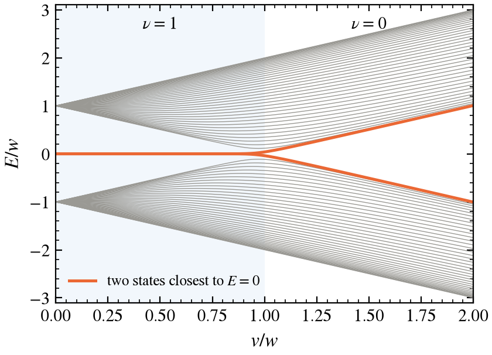
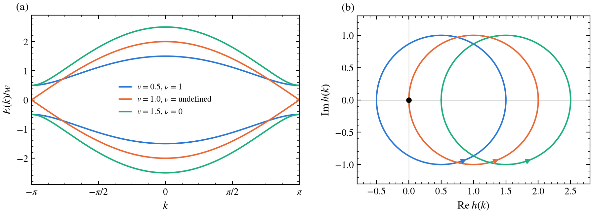
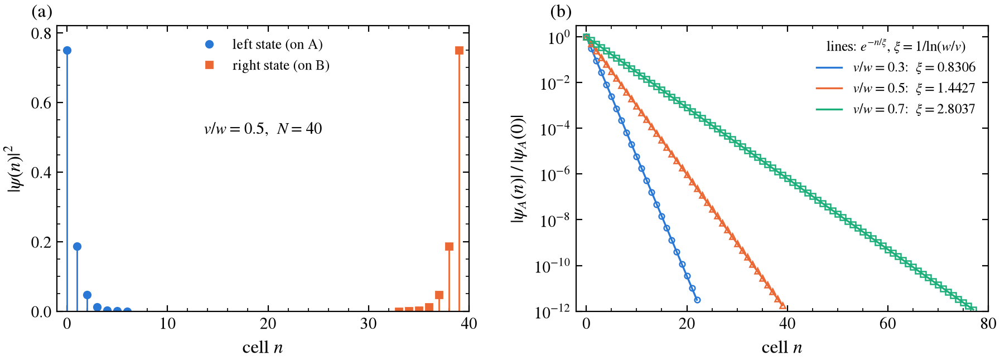
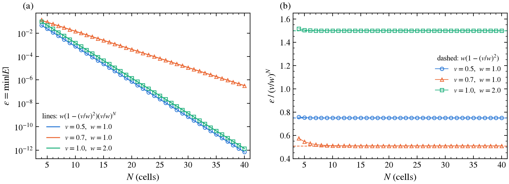
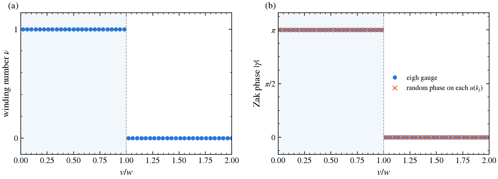
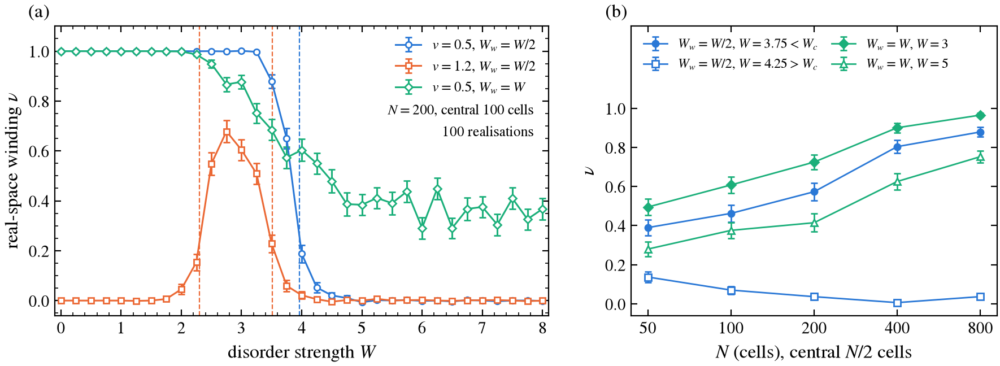

# SSH Model

*Topology, edge states and disorder in the Su–Schrieffer–Heeger chain.*

<p align="center">
  
</p>

<p align="center">
  <a href="#quick-start">Quick start</a> •
  <a href="#summary-of-results">Results</a> •
  <a href="SSH-model.pdf">Report (PDF)</a> •
  <a href="#references">References</a>
</p>

A NumPy implementation of the Su–Schrieffer–Heeger (SSH) chain, the simplest model of a one-dimensional topological insulator. The code computes the bulk winding number and Zak phase, and shows the zero-energy edge states of an open chain. It reproduces their localisation length and finite-size splitting. It then follows the real-space winding number of Mondragon-Shem *et al.* as the hoppings become disordered, up to and including the topological Anderson insulator.

> [!NOTE]
> Every number on this page is produced by `scripts/make_figures.py` and saved in [`figures/results.txt`](figures/results.txt). Every claim in the validation table is checked by a unit test (55 tests in `tests/`).

## Quick start

`ssh_model` is installed as part of the repository's Poetry environment, and pytest is in the `dev` group.

```bash
poetry install                                        # from the repository root
poetry run pytest SSH-model/tests                     # ~2 s
poetry run python SSH-model/scripts/make_figures.py   # ~12 min on 16 cores, then cached
poetry run python SSH-model/scripts/make_figures.py --quick   # 20 realisations per point
```

The disorder results are cached in `figures/*.npz` (git-ignored). Delete those files to recompute.

## Summary of results

| Quantity | Result | Expected |
|---|---|---|
| Winding number for $v \neq w$ (50 values of $v/w$) | integer to $2.5\times10^{-16}$ | exactly 0 or 1 |
| Open chain, $N = 60$, $v/w = 0.5$: smallest $\|E\|$ | $2.2\times10^{-16}$ | $< 10^{-10}$ |
| Open chain, $N = 60$, $v/w = 1.5$: smallest $\|E\|$ | $0.504\,w$ | $\approx \|v-w\| = 0.5\,w$ |
| Localisation length $\xi$, $v/w = 0.3,\ 0.5,\ 0.7$ | $0.830584,\ 1.442695,\ 2.803673$ (relative error $< 2\times10^{-13}$, round-off) | $1/\ln(w/v)$ within 2% |
| Edge-splitting slope, $v/w = 0.5,\ 0.7$ | $-0.69316,\ -0.35706$ | $\ln(v/w) = -0.69315,\ -0.35667$ |
| Edge-splitting prefactor $\varepsilon/(v/w)^N$, $w = 2$, $v = 1$ | $1.500$ | $w\,(1-(v/w)^2) = 1.5$ |
| Zak phase | $\pi$ for $v<w$, $0$ for $v>w$ (error $\le 1.3\times10^{-15}$) | $\pi\nu$ |
| Zak phase under random gauge | unchanged to $2.5\times10^{-15}$ | gauge invariant |
| Real-space winding, clean chain | equals the Bloch winding to $10^{-9}$ | 0 or 1 |
| Real-space winding, disorder ($v = 0.5$, $W_w = W_v/2$) | $1.000 \pm 0.003$ up to $W = 3.25$; drops to 0 by $W \approx 4.5$ | transition at $W_c = 3.959$ |
| Topological Anderson insulator ($v = 1.2$) | $\nu$ rises from 0 to $0.68 \pm 0.04$ at $W = 2.75$ | $\nu = 1$ for $2.299 < W < 3.515$ |

## 1. The model

The SSH chain has two sites, A and B, per unit cell. The hopping is $v$ inside a cell and $w$ between neighbouring cells:

$$
H = \sum_n \Big[\, v\, c^\dagger_{A,n} c_{B,n} + w\, c^\dagger_{B,n} c_{A,n+1} + \text{h.c.} \Big].
$$

**Bloch Hamiltonian.** A Fourier transform over cells, without intracell position phases (so that $H(k+2\pi) = H(k)$), gives

$$
H(k) = \begin{pmatrix} 0 & h^*(k) \\ h(k) & 0 \end{pmatrix}, \qquad h(k) = v + w\,e^{ik}, \qquad E_\pm(k) = \pm|h(k)| = \pm\sqrt{v^2 + w^2 + 2vw\cos k}.
$$

The gap is $2|v-w|$, at $k = \pi$, and closes only when $v = w$.

**Chiral symmetry.** With $\Gamma = \sigma_z$, $\Gamma H \Gamma = -H$. The spectrum is therefore symmetric about $E = 0$, and any zero-energy state can be chosen to live on one sublattice only. This symmetry protects the topology.

**Open chain.** `H_open(N, v, w)` builds the $2N\times2N$ real-space matrix with sites ordered $A_0, B_0, A_1, B_1, \dots$. It accepts either scalar hoppings or arrays of $N$ intracell and $N-1$ intercell hoppings, which is how disorder enters.

## 2. Method

### 2.1 Winding number

As $k$ runs over the Brillouin zone, $h(k)$ traces a circle of radius $w$ centred at $v$. The winding number $\nu$ counts how many times that circle goes around the origin. Numerically it is the sum of phase increments on a closed grid of $N_k$ points:

$$
\nu = \frac{1}{2\pi}\sum_{j=0}^{N_k-1} \arg\frac{h(k_{j+1})}{h(k_j)}, \qquad k_{N_k} \equiv k_0 .
$$

Each increment lies in $(-\pi, \pi]$, so the sum is an exact integer whenever the grid resolves $h(k)$. `winding_number` returns `nan` at $|v| = |w|$, where the gap is closed and $\nu$ is undefined.

### 2.2 Edge state, by hand

Look for a zero mode on sublattice A of a semi-infinite chain that starts at cell 0. The B rows of $H\psi = 0$ give

$$
v\,\psi_A(n) + w\,\psi_A(n+1) = 0 \quad\Longrightarrow\quad \psi_A(n) = \left(-\frac{v}{w}\right)^{n}\psi_A(0).
$$

The A rows are satisfied automatically, because $\psi_B = 0$. The state is normalisable only for $|v| < |w|$, which is exactly the $\nu = 1$ phase. This is bulk–boundary correspondence. The amplitude decays as $e^{-n/\xi}$ with

$$
\xi = \frac{1}{\ln|w/v|}.
$$

**Numerical edge states.** On a finite chain, `eigh` returns the hybridised pair $\psi_L \pm \psi_R$ with energies $\pm\varepsilon$. `edge_states` diagonalises $\Gamma$ inside that two-dimensional subspace. The eigenvectors with $\Gamma = \pm1$ are the left (A) and right (B) states, so the states are identified by sublattice weight rather than by eigenvalue index. `fit_xi` fits $\ln|\psi_A(n)|$ against $n$ on a 100-cell chain.

**Finite-size splitting.** The two end states overlap by $\sim e^{-N/\xi} = (v/w)^N$, which splits them to $\pm\varepsilon$. We measure $\varepsilon(N) = \min|E|$ and fit its semilog slope.

### 2.3 Zak phase

The Zak phase is the Berry phase of the lower band across the Brillouin zone. With $\phi(k) = \arg h(k)$, the lower-band state is $u(k) = (1, -e^{i\phi(k)})/\sqrt2$, so

$$
\gamma = i\oint \langle u|\partial_k u\rangle\, dk = -\tfrac12\oint \partial_k\phi\, dk = -\pi\nu \equiv \pi\nu \pmod{2\pi}.
$$

Numerically we never differentiate. We use the discretised Wilson loop on $N_k = 400$ points, including the closing link:

$$
\gamma = -\,\mathrm{Im}\,\ln \prod_{j=0}^{N_k-1}\langle u_j | u_{j+1}\rangle, \qquad u_{N_k} \equiv u_0 .
$$

Each $u_j$ appears once as a bra and once as a ket, so an arbitrary phase on any $u_j$ cancels. The `random_gauge` option of `zak_phase` tests exactly that.

### 2.4 Real-space winding number with disorder

Disorder is added to the hoppings, not to on-site energies, so chiral symmetry survives:

$$
v_n = v + W_v\, r_n, \qquad w_n = w + W_w\, r'_n, \qquad r_n, r'_n \in [-\tfrac12, \tfrac12] \text{ uniform}.
$$

Momentum is no longer a good quantum number, so we use the real-space winding number of Mondragon-Shem, Hughes, Song and Prodan (2014). With the flattened Hamiltonian $Q = \mathrm{sign}(H)$, the cell-position operator $X$, and the trace $\mathrm{Tr}'$ taken over the central $L' = N/2$ cells of an open chain,

$$
\nu = \frac{1}{2L'}\,\mathrm{Tr}'\big[\,\Gamma\, Q\, [Q, X]\,\big].
$$

The factor $\tfrac12$ is fixed by the clean limit. In chiral blocks $Q = \begin{pmatrix}0 & q\\ q^\dagger & 0\end{pmatrix}$, and the trace splits into $\mathrm{Tr}'(X - qXq^\dagger) - \mathrm{Tr}'(X - q^\dagger X q) = 2\nu L'$. With this normalisation the clean chain gives exactly 0 and 1 (see [`SSH-model.pdf`](SSH-model.pdf)).

**Where the transition should be.** The zero-energy localisation length of a random chiral chain diverges, and the winding can change, when $\langle \ln|v_n|\rangle = \langle \ln|w_n|\rangle$. For uniform disorder this average has a closed form,

$$
\langle \ln|a + W r|\rangle = \frac{F(a + W/2) - F(a - W/2)}{W}, \qquad F(x) = x\ln|x| - x,
$$

and `critical_disorder` solves for the crossing.

Each point in fig. 6 averages 100 realisations, and the error bars are standard errors of the mean. The realisations run in parallel, with an independent seeded random stream per chunk, so the results are reproducible.

## 3. Results

### 3.1 Bulk bands and winding number



**Figure 1.** (a) Bulk bands for $w = 1$ and $v = 0.5$ (topological), $1.0$ (critical) and $1.5$ (trivial). The gap $2|v - w|$ closes at $k = \pi$ when $v = w$. (b) The curve $h(k)$ in the complex plane, with arrows showing the direction of increasing $k$. The circle encloses the origin (black dot) only for $v < w$, which gives $\nu = 1$. At $v = w$ it passes through the origin.

### 3.2 Open-chain spectrum


**Figure 2.** Spectrum of a 40-cell open chain against $v/w$. In the shaded topological region ($v < w$), two states are pinned at $E = 0$: at $N = 60$ and $v/w = 0.5$ their energy is $2.2\times10^{-16}$, i.e. machine zero. For $v > w$ the lowest states sit at the bulk band edge: at $v/w = 1.5$, $\min|E| = 0.504 \approx |v - w|$.

### 3.3 Edge-state profile and localisation length



**Figure 3.** (a) The two zero modes after separation by sublattice weight. The left state lives only on A and the right state only on B; the weight on the wrong sublattice is below $10^{-30}$. (b) $|\psi_A(n)|$ for three values of $v/w$ on a 100-cell chain (symbols), with the analytic $e^{-n/\xi}$, $\xi = 1/\ln(w/v)$ (lines).

| $v/w$ | $\xi$ fitted | $\xi = 1/\ln(w/v)$ | relative error |
|---|---|---|---|
| 0.3 | 0.830584 | 0.830584 | $< 2\times10^{-13}$ |
| 0.5 | 1.442695 | 1.442695 | $< 2\times10^{-13}$ |
| 0.7 | 2.803673 | 2.803673 | $< 2\times10^{-13}$ |

The agreement is at machine precision, not merely within the 2% target. The relative errors are round-off: their digits in `results.txt` change with the NumPy/BLAS build, so only the bound is quoted. The $\Gamma$-projected state on a chain much longer than $\xi$ is the analytic zero mode, with neighbouring amplitudes in the exact ratio $-v/w$.

### 3.4 Edge-state splitting



**Figure 4.** (a) $\varepsilon = \min|E|$ against chain length. The symbols are exact diagonalisation and the lines are $w(1-(v/w)^2)(v/w)^N$. (b) $\varepsilon/(v/w)^N$, which converges to the dashed prefactor within about 10 cells.

| $(v, w)$ | fitted slope | $\ln(v/w)$ | $\varepsilon/(v/w)^N$ at $N = 30$ | $1-(v/w)^2$ | $w(1-(v/w)^2)$ |
|---|---|---|---|---|---|
| (0.5, 1) | −0.69316 | −0.69315 | 0.750 | 0.750 | 0.750 |
| (0.7, 1) | −0.35706 | −0.35667 | 0.510 | 0.510 | 0.510 |
| (1, 2) | −0.69316 | −0.69315 | **1.500** | 0.750 | **1.500** |

The splitting decays as $(v/w)^N$, so the slope on the semilog plot is $\ln(v/w)$. The project brief guessed the prefactor $1 - (v/w)^2$. That guess holds only for $w = 1$: the $(v, w) = (1, 2)$ row rules it out. Since $\varepsilon$ must scale linearly when $H$ is rescaled, the prefactor needs a factor of $w$:

$$
\varepsilon(N) \simeq w\left(1 - \frac{v^2}{w^2}\right)\left(\frac{v}{w}\right)^N = \frac{w^2 - v^2}{w}\left(\frac{v}{w}\right)^N .
$$

### 3.5 Bulk invariants: winding number and Zak phase



**Figure 5.** (a) Winding number against $v/w$. It is an integer to $2.5\times10^{-16}$ and jumps only at the gap closing. (b) Zak phase from the 400-point Wilson loop: $|\gamma| = \pi$ for $v < w$ and $0$ for $v > w$, with error $\le 1.3\times10^{-15}$. The crosses repeat the calculation with a random phase on every $u(k_j)$; they agree to $2.5\times10^{-15}$, confirming gauge invariance. This confirms $\gamma = \pi\nu$ (mod $2\pi$).

### 3.6 Real-space winding under disorder



**Figure 6.** (a) Disorder-averaged real-space winding number on a 200-cell chain, with the trace over the central 100 cells. Dashed lines mark the predicted transitions $\langle\ln|v_n|\rangle = \langle\ln|w_n|\rangle$, in the colour of the matching curve. (b) Finite-size dependence at fixed disorder for $N = 50$ to $800$, with the trace over the central $N/2$ cells. 100 realisations per point throughout.

**Topological chain, $v = 0.5$, $W_w = W_v/2$ (blue).** The winding stays quantised, $\nu = 1.000 \pm 0.003$, up to $W = 3.25$, although the hoppings already change sign at $W > 1$. It then falls through $0.88$ ($W = 3.5$), $0.65$ ($3.75$) and $0.19$ ($4.0$), and is zero from $W \approx 4.5$. The prediction is $W_c = 3.959$. Panel (b) shows that the crossover sharpens towards $W_c$ as the chain grows. Just below $W_c$, at $W = 3.75$, $\nu$ grows from $0.39$ to $0.88$ as $N$ goes from 50 to 800. Just above, at $W = 4.25$, it falls from $0.14$ to $0.04$. In the thermodynamic limit $\nu$ steps from 1 to 0 at $W_c$.

**Topological Anderson insulator, $v = 1.2$, $W_w = W_v/2$ (orange).** Without disorder this chain is trivial, $\nu = 0$. Disorder alone drives it into a topological phase: $\nu$ rises to $0.68 \pm 0.04$ at $W = 2.75$, inside the predicted window $2.299 < W < 3.515$, where $\langle\ln|v_n|\rangle < \langle\ln|w_n|\rangle$. Stronger disorder makes the chain trivial again. At $N = 200$ the plateau does not reach 1, because the window is narrow and both of its edges are critical.

**Equal disorder on both hoppings, $W_v = W_w = W$ (green).** This is the disorder model in the project brief. For $v = 0.5$, $w = 1$ the two log-averages never cross: $\langle\ln|0.5 + Wr|\rangle < \langle\ln|1 + Wr|\rangle$ for every $W$, with the difference vanishing only as $W\to\infty$. The chain is therefore topological at all disorder strengths. The drop of the green curve in (a) is a finite-size effect, not a transition. Panel (b) confirms this: $\nu$ climbs back towards 1 as $N$ grows, from $0.50$ to $0.97$ at $W = 3$ and from $0.28$ to $0.75$ at $W = 5$. The localisation length at $E = 0$ grows as the two log-averages approach each other, so larger disorder needs larger chains.

## 4. Discussion

1. **Why can't the winding change without the gap closing?** $\nu$ counts how many times $h(k)$ encircles the origin. A continuous deformation can change that count only by passing $h(k)$ through the origin, i.e. by making $E(k) = |h(k)| = 0$ somewhere. With disorder the same role is played by the mobility gap: $\nu$ changes only where the $E = 0$ localisation length diverges, at $\langle\ln|v|\rangle = \langle\ln|w|\rangle$.
2. **On-site energy difference $\pm m$ between A and B.** This adds $m\sigma_z$ to $H(k)$. That term commutes with $\Gamma = \sigma_z$ instead of anticommuting, so chiral symmetry is broken. The spectrum loses its $\pm E$ symmetry, the edge states move to $E = \pm m$, the vector $(\mathrm{Re}\,h, \mathrm{Im}\,h, m)$ leaves the plane, and the winding number is no longer quantised or protected.
3. **Dependence of the Zak phase on the unit cell.** Choosing the cell as $(B_n, A_{n+1})$ instead of $(A_n, B_n)$ swaps $v \leftrightarrow w$ and exchanges $\gamma = \pi$ and $0$. Moving the origin inside the cell shifts $\gamma$ continuously through the $e^{ikx}$ embedding phase. The Zak phase is a polarisation and is defined only once the origin is fixed. What is physical is the difference between phases, and the edge-state count for a given termination.
4. **What "topologically protected" means.** For any perturbation that keeps chiral symmetry and keeps the $E = 0$ states localised, the zero modes stay pinned at exactly $E = 0$, sublattice-polarised and exponentially localised. In fig. 6 that holds up to $W \approx 3.25$. Protection fails when chiral symmetry is broken (on-site terms, next-nearest-neighbour hopping), when the localisation length diverges ($W \to W_c$), or when the chain is so short that the two ends hybridise ($\varepsilon \propto e^{-N/\xi}$, fig. 4).

## Project layout

<details>
<summary>Files and what they contain</summary>

```text
SSH-model/
├── ssh_model/
│   ├── hamiltonian.py      H_k, H_open, chiral operator, cell positions
│   ├── bulk.py             bands, winding number, Zak phase
│   ├── edge.py             open spectrum, edge states, ξ fit, edge splitting
│   └── disorder.py         random hoppings, sign(H), real-space winding, critical W
├── tests/                  55 pytest tests
├── scripts/make_figures.py figures and figures/results.txt
├── figures/
├── docs/report.tex         LaTeX source of SSH-model.pdf
└── SSH-model.pdf           the project report
```

</details>

## References

1. J. K. Asbóth, L. Oroszlány, A. Pályi, *A Short Course on Topological Insulators*, ch. 1, Lecture Notes in Physics **919** (2016), arXiv:1509.02295.
2. W. P. Su, J. R. Schrieffer, A. J. Heeger, *Solitons in polyacetylene*, Phys. Rev. Lett. **42**, 1698 (1979).
3. I. Mondragon-Shem, T. L. Hughes, J. Song, E. Prodan, *Topological criticality in the chiral-symmetric AIII class at strong disorder*, Phys. Rev. Lett. **113**, 046802 (2014).
4. N. R. Cooper, J. Dalibard, I. B. Spielman, *Topological bands for ultracold atoms*, Rev. Mod. Phys. **91**, 015005 (2019).
5. P. Delplace, D. Ullmo, G. Montambaux, *Zak phase and the existence of edge states in graphene*, Phys. Rev. B **84**, 195452 (2011).
