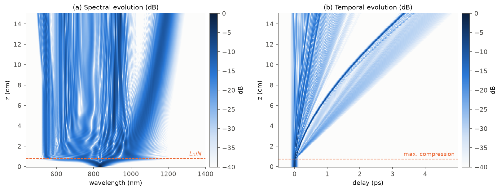
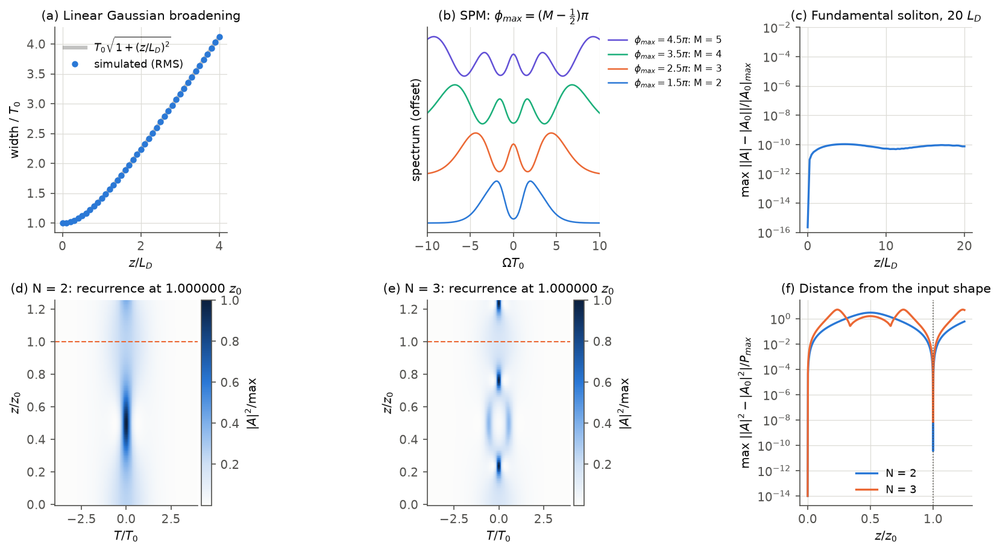
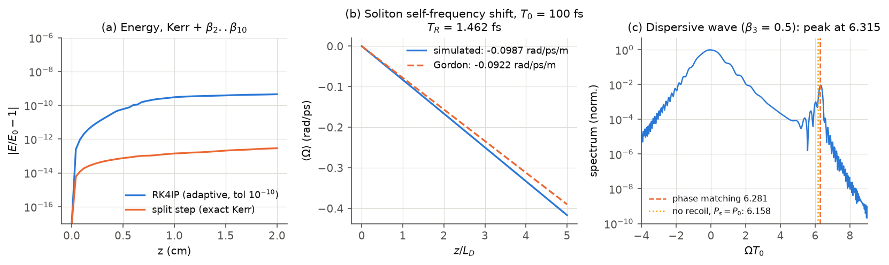
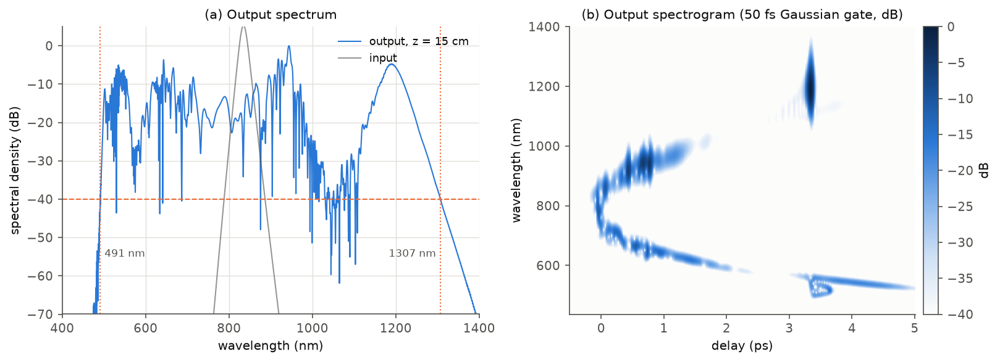
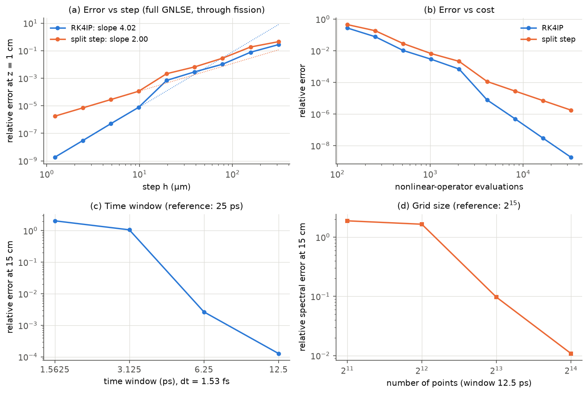
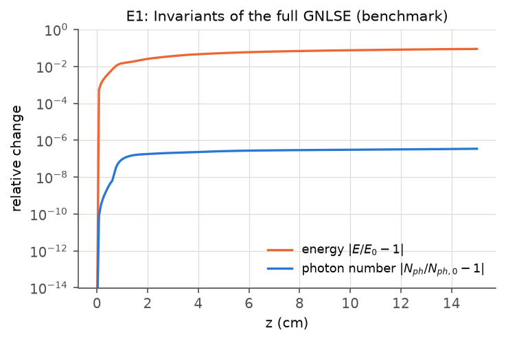
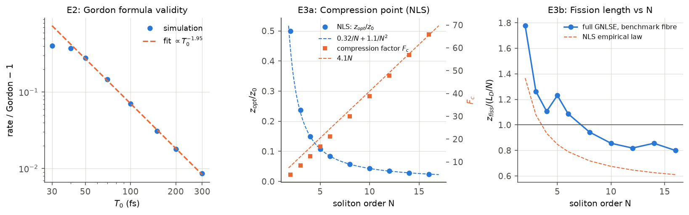
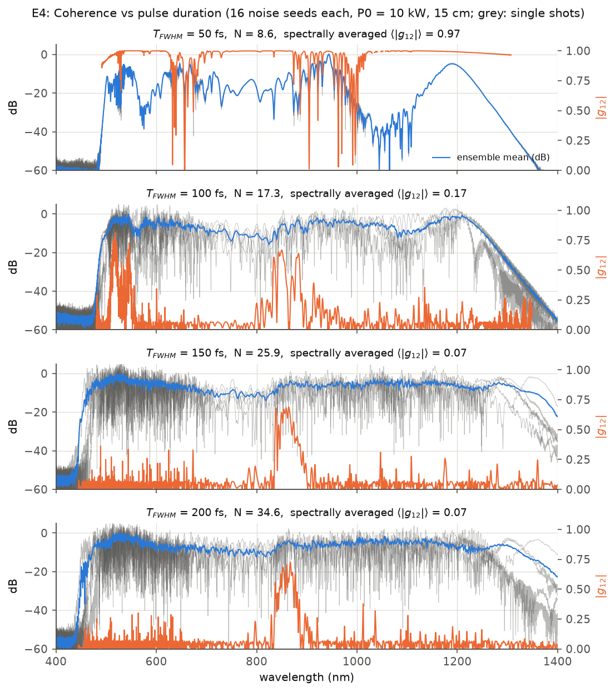
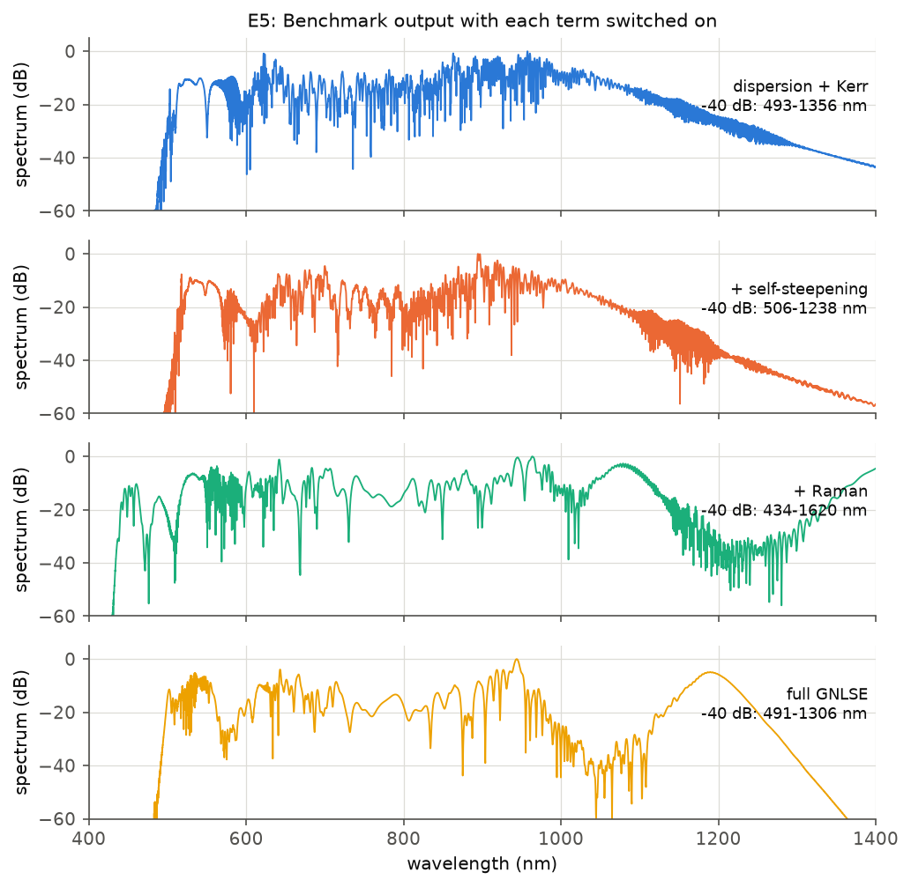

# Supercontinuum Generation in a Photonic Crystal Fibre

*GNLSE with RK4IP and split step, the Dudley–Genty–Coen benchmark, and where the simple estimates fail.*

<p align="center">
  
</p>

<p align="center">
  <a href="#quick-start">Quick start</a> •
  <a href="#summary-of-results">Results</a> •
  <a href="Supercontinuum.pdf">Report (PDF)</a> •
  <a href="#references">References</a>
</p>

A femtosecond pulse launched into the anomalous-dispersion region of a photonic crystal fibre compresses, breaks up into fundamental solitons, sheds dispersive waves and red-shifts by Raman scattering; together these spread its spectrum over an octave. This project solves the generalised nonlinear Schrödinger equation (GNLSE) that describes it, with dispersion to any order, Kerr, self-steepening and the delayed Raman response. Two integrators are implemented, each with a fixed or adaptive step: a symmetric split-step Fourier method and the interaction-picture Runge–Kutta method (RK4IP, Hult 2007). The solver is checked against the analytic limits of the NLS and reproduces the benchmark of Dudley, Genty and Coen (RMP 78, 1135, 2006). It is then used for five further studies:

- Photon number as the true invariant.
- The validity of the Gordon formula.
- Compression and fission scaling with soliton order.
- Coherence against pulse duration.
- The role of each higher-order term.

> [!NOTE]
> Every number on this page is produced by `scripts/run_checks.py` and `scripts/run_extensions.py` and saved in [`results/`](results/) (`checks_table.md`, `checks.json`, `window_study.json`, `extensions.json`). Each row of the summary table names the test that checks it (16 tests in `tests/`). The full report with derivations is [`Supercontinuum.pdf`](Supercontinuum.pdf).

## Quick start

`supercontinuum` is installed as part of the repository's Poetry environment, and pytest is in the `dev` group.

```bash
poetry install                                                    # from the repository root
poetry run pytest -m "not slow" Supercontinuum/tests              # ~35 s
poetry run pytest Supercontinuum/tests                            # + benchmark, photon number, convergence
poetry run python Supercontinuum/scripts/run_checks.py --small    # reduced pipeline into results/small/, ~50 s
poetry run python Supercontinuum/scripts/run_checks.py            # figures 1-5, ~3 min
poetry run python Supercontinuum/scripts/run_extensions.py        # figures 6-9, ~13 min
```

The same targets are in the `Makefile` (`make test`, `make test-all`, `make smoke`, `make checks`, `make extensions`). Propagation results are cached in `results/*.pkl`; `--fresh` recomputes them, and `run_extensions.py --redo coherence` recomputes one study.

<details>
<summary>Runtimes and hardware</summary>

All propagations run on the GPU in one process. Measured on an AMD Ryzen 7 7840HS with an RTX 3050 6 GB Laptop GPU (Python 3.14.7, NumPy 2.4.6, SciPy 1.17.1, PyTorch 2.12.0 with CUDA 13):

| | runs | wall time | CPU | peak host RAM | peak GPU memory |
|---|---|---|---|---|---|
| `run_checks.py` | 41 | 189 s | 1 core | 1.5 GB | 0.6 GB |
| `run_extensions.py` | 96 | ~13 min (coherence 10 min) | 1 core | 1.3 GB | ~0.7 GB |

</details>

## Summary of results

Benchmark: 835 nm pump, $T_0 = 28.4$ fs (50 fs FWHM), $P_0 = 10$ kW, $\gamma = 0.11\ \mathrm{W^{-1}m^{-1}}$, $\beta_2\ldots\beta_{10}$ from the brief, 15 cm. Derived scales: $L_D = 6.82$ cm, $N = 8.66$, $L_D/N = 0.79$ cm.

| Quantity | Result | Expected | Test |
|---|---|---|---|
| Fourier convention | $+\Omega$ is blue | — | `test_fourier_convention_positive_omega_is_blue` |
| Raman time $T_R = f_R\int t\,h_R\,dt$ | $1.462$ fs (quadrature = closed form to $10^{-6}$) | "about 1.5 fs" | `test_raman_time` |
| $L_D$, $N$, zero-dispersion wavelength | $6.82$ cm, $8.66$, $780$ nm | $6.8$ cm, $8.7$, $780$ nm | `test_benchmark_scales_and_zero_dispersion` |
| Linear Gaussian broadening, $0\ldots4L_D$ | max relative error $4\times10^{-16}$ | $T_0\sqrt{1+(z/L_D)^2}$ | `test_bar[check_linear]` |
| SPM peaks at $\phi_{max} = 1.5, 2.5, 3.5, 4.5\pi$ | $2, 3, 4, 5$ | $M$ with $\phi_{max} = (M-\frac12)\pi$ | `test_bar[check_spm]` |
| Fundamental soliton over $20L_D$ | shape error $1.1\times10^{-10}$ | shape invariant | `test_bar[check_fundamental_soliton]` |
| $N = 2$ soliton | recurrence at $z_0(1\pm6\times10^{-12})$, shape error $4\times10^{-11}$ | period $z_0 = \frac{\pi}{2}L_D$ | `test_higher_order_soliton[2]` |
| $N = 3$ soliton | recurrence at $z_0(1\pm4\times10^{-9})$, shape error $7\times10^{-9}$ | period $z_0$ | `test_higher_order_soliton[3]` |
| Energy, Kerr + $\beta_2\ldots\beta_{10}$, through fission | RK4IP $4.5\times10^{-10}$, split step $2.9\times10^{-13}$ | conserved | `test_bar[check_conservation]` |
| Soliton self-frequency shift, $T_0 = 100$ fs | $-0.0987$ vs Gordon $-0.0922$ rad/ps/m (7%) | Gordon formula | `test_bar[check_raman_shift]` |
| Dispersive wave ($\beta_3 = 0.5$, $N = 1$) | peak at $\Omega T_0 = 6.315$, phase matching $6.281$, FWHM $0.176$ | phase matching | `test_bar[check_dispersive_wave]` |
| Benchmark fission point | $z = 0.75$ cm $= 0.95\,L_D/N$ | $\sim L_D/N$ | `test_benchmark` |
| Benchmark spectrum at $-40$ dB | $491$–$1307$ nm | Dudley, Genty and Coen (2006) | `test_benchmark` |
| Convergence order | RK4IP $h^{4.02}$, split step $h^{2.00}$ | $h^4$, $h^2$ | `test_convergence_order` |
| Photon number, full GNLSE, 15 cm | drift $3.5\times10^{-7}$ while energy drops 8.9% | conserved | `test_photon_number` |
| RK4IP vs split step at equal cost | $6\times$ fewer evaluations at error $10^{-6}$, $20\times$ at $10^{-8}$ | RK4IP better | `scripts/run_checks.py` |
| Gordon-formula excess vs $T_0$ | $\propto T_0^{-1.95}$; 40% at 30 fs, 0.9% at 300 fs | $\propto T_0^{-2}$ | `scripts/run_extensions.py` |
| NLS compression, $N = 16$ | $z_{opt}/z_0 = 0.0244$, $F_c = 65.9$ | $0.0243$, $65.6$ | `scripts/run_extensions.py` |
| Coherence $\langle\|g_{12}\|\rangle$, 50 / 100 / 200 fs | $0.97$ / $0.17$ / $0.07$ | coherent for $N \lesssim 10$ | `scripts/run_extensions.py` |
| Batched GPU solver vs serial solver | $\le 10^{-11}$ (typically $10^{-15}$), identical step counts | identical | `test_batch_matches_serial_solver` |

### Corrections to the brief

Details are in the sections below.

1. **$T_R = 1.462$ fs**, not 1.5 fs: $f_R\cdot2\tau_1^2\tau_2/(\tau_1^2+\tau_2^2)$ with the brief's constants, confirmed by quadrature.
2. **The Gordon formula is not within 20% for benchmark-scale solitons.** At $T_0 = 50$ fs the simulated shift is 28% faster, and at the 28 fs of the benchmark about 40%. Agreement to 20% needs $T_0 \gtrsim 60$ fs, so the check uses $T_0 = 100$ fs (§3.3, §3.7).
3. **Energy conservation to $10^{-8}$ is a property of the split step, not of RK4IP.** The split step with an exact Kerr sub-step is unitary and conserves energy to rounding. RK4IP is not unitary; its drift is its truncation error, and reaching $10^{-8}$ through fission needs an adaptive tolerance of $10^{-10}$ (§3.2).
4. **The phase-matching condition needs the soliton's recoil.** With the input values $\Omega_s = 0$, $P_s = P_0$ it predicts $6.158$, outside the radiation peak; with the soliton's actual centre frequency and peak power it predicts $6.281$ against the measured $6.315$ (§3.3).
5. **"$N-1$ fundamental solitons" is not what is counted.** A physical classifier (anomalous dispersion, local soliton number 0.6–1.6, resolved) finds 5 solitons in the benchmark output; a plain threshold count gives 3 to 12 depending on the threshold (§3.4).
6. **"Compare at equal runtime"** is done at equal numbers of nonlinear-operator evaluations, which is machine independent; both methods cost 4 per step (§3.5).

## 1. Model and conventions

Units: ps, rad/ps, m, W; $\beta_k$ in $\mathrm{ps}^k/\mathrm{m}$; $\gamma$ in $\mathrm{W^{-1}m^{-1}}$; wavelengths in nm. In the frame moving at the group velocity,

$$
\frac{\partial A}{\partial z} = -\frac{\alpha}{2}A + \sum_{k\ge2}\frac{i^{k+1}\beta_k}{k!}\frac{\partial^k A}{\partial T^k} + i\gamma\Big(1+\frac{i}{\omega_0}\frac{\partial}{\partial T}\Big)\Big[A\int R(T')\,|A(T-T')|^2\,dT'\Big],
$$

$$
R(T) = (1-f_R)\,\delta(T) + f_R\,h_R(T), \qquad h_R(T) = \frac{\tau_1^2+\tau_2^2}{\tau_1\tau_2^2}\,e^{-T/\tau_2}\sin(T/\tau_1),
$$

with $f_R = 0.18$, $\tau_1 = 12.2$ fs, $\tau_2 = 32$ fs (Blow and Wood).

**Fourier convention.** $A(T) = \sum_\Omega \tilde A(\Omega)\,e^{-i\Omega T}$, so `Aw = ifft(A)`, $\partial_T \to -i\Omega$, and positive $\Omega$ is blue. In the frequency domain

$$
\frac{d\tilde A}{dz} = \Big[i\beta(\Omega) - \frac{\alpha}{2}\Big]\tilde A + i\gamma\Big(1+\frac{\Omega}{\omega_0}\Big)\,\mathcal F\Big\{A\big[(1-f_R)|A|^2 + f_R\,(h_R\circledast|A|^2)\big]\Big\}, \qquad \beta(\Omega) = \sum_k\frac{\beta_k\Omega^k}{k!}.
$$

The sign of the Raman shift depends on this convention (a pitfall named in the brief), and the tests fix it.

| Function | Meaning |
|---|---|
| `Grid(n, window, wavelength0)` | centred time grid, $\Omega$ in FFT order, wavelength axis |
| `Fibre(betas, gamma, length, alpha, raman, self_steepening)`, `dudley_pcf()` | fibre with switchable terms; the benchmark fibre |
| `GNLSE(grid, fibre).propagate(A0, method, nsteps \| tol, nsave, keep, callback)` | serial solver: `"rk4ip"` or `"ssfm"`, fixed or adaptive step |
| `batch.Run`, `batch.run_batch`, `batch.execute` | the same integrators for many runs at once in PyTorch (GPU) |
| `analysis.photon_number` | $\sum\|\tilde A\|^2/(\omega_0+\Omega)$ |
| `analysis.dispersive_wave_offset` | root of the phase-matching condition, with soliton recoil |
| `analysis.classify_solitons` | fundamental solitons in an output field |
| `analysis.coherence` | $\|g_{12}(\lambda)\|$ of an ensemble |

## 2. Method

### 2.1 Integrators

- **RK4IP.** The linear operator is applied exactly as $e^{Lh/2}$ and the nonlinear part is integrated by classical RK4 in the interaction picture: 4 nonlinear evaluations per step.
- **Split step.** Strang splitting $D/2\cdot N\cdot D/2$. The nonlinear sub-step is exact for pure Kerr, $A\,e^{i\gamma|A|^2h}$, which makes the scheme unitary; otherwise it is classical RK4, also 4 evaluations, so the two methods compare at equal cost.
- **Raman convolution.** $h_R$ is sampled from $t = 0$, normalised to $\sum h\,dt = 1$, and applied as a circular convolution. $(1-f_R)I + f_R\,h_R\circledast I$ is one real-FFT filter.

### 2.2 Adaptive stepping

- **RK4IP:** the embedded RK4(3)IP of Balac and Mahé (2013) with first-same-as-last, still 4 evaluations per accepted step. The local error is $\|u_4-u_3\|/\|u_4\| = (h/10)\|k_4-k_5\|/\|u_4\|$, the step factor $0.9\,(\mathrm{tol}/\mathrm{err})^{1/4}$ clamped to $[0.2, 2]$. A step shortened to land on a save point does not shrink the next one.
- **Split step:** step doubling with the local-error method (Sinkin et al. 2003), Richardson-extrapolated, rejected above $2\,\mathrm{tol}$, step changed by $2^{1/3}$.

### 2.3 Batched GPU integration

`supercontinuum/batch.py` advances many independent propagations as one array of shape (runs, $n$). Each row has its own grid, fibre, pulse, length, tolerance and save points, and only $n$ is shared. Every row keeps its own adaptive step, so an easy run is not held back by a hard one, and finished rows leave the batch. Each check is written as a plan: its runs plus a function that turns their results into the check. Each script passes all its plans to a single `execute(...)` call, which groups the runs by $n$ and integrator.

In double precision the batch reproduces the serial solver to $\sim10^{-15}$ with identical step counts. Single precision is several times faster but its $\sim10^{-7}$ rounding is above the tolerances used here. On an RTX 3050 Laptop GPU a double-precision FFT with $n \le 8192$ costs about the same for 1 field as for 16. A single run is therefore no faster than on one CPU core. The gain is from batching: 16 noise seeds at $n = 2^{14}$ run about 6× faster than serially on the CPU. Overrides: `SC_DEVICE` (e.g. `cpu`), `SC_MAX_ROWS` (rows per chunk), `SC_THREADS` (CPU backend). Without CUDA the batch runs on the CPU, and without PyTorch the serial solver is used.

### 2.4 Diagnostics

- **Fission point:** the $z$ of maximum peak power.
- **Soliton identification:** a temporal peak counts as a fundamental soliton if four conditions hold. Its gated spectrum lies in the anomalous region, and its local soliton number $\sqrt{\gamma P T_0^2/|\beta_2(\Omega_c)|}$ is in $0.6$–$1.6$. It is resolved, $T_0 \ge 4\,dt$, and it is not a shoulder within $4T_0$ of a stronger soliton.
- **Phase matching:** $\beta(\Omega) - \beta(\Omega_s) - \beta_1(\Omega_s)(\Omega-\Omega_s) = \gamma P_s/2$, solved numerically from the full Taylor series.
- **Coherence:** $|g_{12}(\lambda)| = |\langle E_i^*E_j\rangle_{i\ne j}|/\langle|E|^2\rangle$ over an ensemble with one photon per mode of random phase added to the input, averaged over the $-40$ dB bandwidth weighted by the mean spectrum.
- **Window checks:** the fraction of energy within 5% of either end of the time and frequency windows is recorded for every run.

## 3. Results

### 3.1 Analytic limits



**Figure 1.** (a) RMS width of a chirp-free Gaussian under dispersion alone against $T_0\sqrt{1+(z/L_D)^2}$. (b) SPM spectra (Kerr only) at $\phi_{max} = 1.5\ldots4.5\pi$. (c) Shape error of a fundamental soliton over $20L_D$. (d, e) Intensity of $N = 2$ and $N = 3$ solitons over $1.25z_0$. (f) Distance from the input shape; the minimum at $z_0$ is the recurrence.

The linear and soliton limits are reproduced to round-off and to the integrator's truncation error (fixed RK4IP, 4000 steps over $20L_D$, 8000 over $1.25z_0$). The recurrence point is found from a parabola through the three samples nearest the minimum of the distance and lies at $z_0$ to $6\times10^{-12}$ ($N = 2$) and $4\times10^{-9}$ ($N = 3$).

### 3.2 Conservation, Raman shift and dispersive wave



**Figure 2.** (a) Energy drift with Kerr and $\beta_2\ldots\beta_{10}$ only, benchmark pulse over 2 cm (through fission): adaptive RK4IP (tol $10^{-10}$) and split step with the exact Kerr step (2000 steps). (b) Mean frequency of a $T_0 = 100$ fs fundamental soliton over $5L_D$ against the Gordon rate. (c) Output spectrum of an $N = 1$ soliton with $\beta_3 = 0.5$ after $10L_D$, with the phase-matched frequency with and without recoil.

- **Energy.** The split step is unitary and its drift ($2.9\times10^{-13}$) is rounding. RK4IP's drift ($4.5\times10^{-10}$) is its truncation error, so for RK4IP the "conservation" check is an accuracy check.
- **Raman.** The fit (after the first $L_D$, where the soliton sheds a little radiation) gives $-0.0987$ rad/ps/m against Gordon's $-0.0922$, 7% faster. The sign is red, as it must be.
- **Dispersive wave.** The radiation peaks at $\Omega T_0 = 6.315$ with FWHM $0.176$. Phase matching with the soliton's actual centre frequency (recoiled to the red) and peak power gives $6.281$, within the peak; the input values give $6.158$, outside it.

### 3.3 The benchmark


**Figure 3.** Benchmark evolution over 15 cm on $2^{13}$ points over 12.5 ps (adaptive RK4IP, tol $10^{-8}$: 10 369 steps, 41 485 evaluations). (a) Spectrum (dB) against wavelength and $z$; dashed: $L_D/N$. (b) Temporal intensity (dB); dashed: maximum compression.



**Figure 4.** (a) Output spectrum at 15 cm and input spectrum; dotted lines at the $-40$ dB edges. (b) Output spectrogram with a 50 fs Gaussian gate.

- **Fission.** The peak power is maximal at $z = 0.75$ cm (37 kW, $3.7P_0$), i.e. $0.95\,L_D/N$; the spectrum broadens rapidly after it.
- **Output.** The spectrum spans 491–1307 nm at $-40$ dB, as in the paper. The leading Raman soliton peaks near 1190 nm and arrives 3.3 ps late; dispersive waves form the 500–600 nm band. The spectrogram shows blue radiation trapped behind the red soliton (Gorbach and Skryabin).

### 3.4 Solitons in the output

The classifier of §2.4 finds 5 fundamental solitons. The leading one is at 3.35 ps (4.8 kW, $T_0 = 16$ fs, 1148 nm), and four sit in the dense region below 1 ps, at 0.07, 0.43, 0.68 and 0.80 ps. The brief's $N - 1 \approx 8$, or round($N$) = 9, also counts weaker solitons that overlap below 1 ps and cannot be separated cleanly. A plain peak count above a threshold gives anything from 3 to 12, so the count is only meaningful with a physical criterion.

### 3.5 Convergence



**Figure 5.** (a) Error at $z = 1$ cm (through fission) against fixed step, full GNLSE, reference RK4IP with 32 768 steps; dotted: $h^4$ and $h^2$. (b) The same error against the number of nonlinear evaluations. (c) Error at 15 cm against the time window ($dt = 1.53$ fs, reference 25 ps). (d) Spectral error at 15 cm against the number of points (window 12.5 ps, reference $2^{15}$).

- **Step size.** For $h \lesssim 10\ \mu$m RK4IP converges as $h^{4.02}$ and the split step as $h^{2.00}$. For $h \gtrsim 20\ \mu$m both are pre-asymptotic (errors $10^{-3}$ to $10^{-1}$), because the step does not resolve the $\sim250\ \mu$m nonlinear length at the compression peak. Going from 20 to 10 µm drops the RK4IP error by 90×.
- **Cost.** At equal error RK4IP needs about 7 000 evaluations for $10^{-6}$ against about 43 000 for the split step (6×). For $10^{-8}$ it needs about 21 000 against about 430 000 (20×; split-step values extrapolated along its $h^2$ line).

| time window (ps) | 1.5625 | 3.125 | 6.25 | 12.5 |
|---|---|---|---|---|
| error vs 25 ps | $2.1$ | $1.1$ | $2.7\times10^{-3}$ | $1.3\times10^{-4}$ |

| points (12.5 ps) | $2^{11}$ | $2^{12}$ | $2^{13}$ | $2^{14}$ |
|---|---|---|---|---|
| spectral error vs $2^{15}$ | $1.9$ | $1.7$ | $9.7\times10^{-2}$ | $1.1\times10^{-2}$ |
| energy at spectral edges | $8\times10^{-2}$ | $4\times10^{-2}$ | $3\times10^{-9}$ | $6\times10^{-11}$ |

The Raman soliton walks 3.3 ps, so windows of 3 ps or less fail completely. Grids of $2^{12}$ points or fewer alias (4–8% of the energy at the spectral edges). At $2^{13}$ the edge energy is only $3\times10^{-9}$; the 10% field-level difference comes from the phase-sensitive fine interference structure of the spectrum, while the dB spectrum and every number in the table are unchanged. Use $2^{14}$ if the complex field is needed to 1%.

### 3.6 Photon number as the invariant (extension E1)



**Figure 6.** Relative change of energy and photon number $\sum|\tilde A|^2/(\omega_0+\Omega)$ along the benchmark (full GNLSE, tol $10^{-8}$).

With Raman scattering the energy is not conserved: each scattered photon gives part of its energy to a phonon. The photon number is conserved by the full GNLSE, and it drifts by only $3.5\times10^{-7}$ over 15 cm while the energy drops by 8.9%. Energy tests only the Kerr + dispersion subset; the photon number tests the full solver, including the Raman and self-steepening terms.

### 3.7 Gordon formula and soliton-order scaling (extensions E2, E3)



**Figure 7.** (a) Simulated self-frequency-shift rate over the Gordon rate, minus one, for $T_0 = 30$–300 fs, with a power-law fit for $T_0 \ge 70$ fs. (b) Pure NLS ($T_0 = |\beta_2| = \gamma = 1$): point of maximum compression and compression factor against $N$, with $0.32/N + 1.1/N^2$ and $4.1N$. (c) Full GNLSE on the benchmark fibre: fission distance over $L_D/N$ against $N$, with the NLS law and the $\times1.5$ band.

- **Gordon formula (E2).** The excess falls as $T_0^{-1.95}$ for $T_0 \ge 70$ fs and grows more slowly below 50 fs: 40% at 30 fs, 28% at 50 fs, 7% at 100 fs, 0.9% at 300 fs. This is the expected $(\Omega/\Omega_R)^2 \propto T_0^{-2}$ correction from the curvature of the Raman gain. The formula linearises the gain around $\Omega = 0$, while a short soliton already samples its rising part (peak near $1/\tau_1 \approx 82$ rad/ps).
- **Compression (E3a).** The point of maximum compression follows $z_{opt}/z_0 = 0.32/N + 1.1/N^2$ ($N = 16$: 0.0244 against 0.0243). The compression factor follows $F_c \approx 4.1N$ ($N = 16$: 65.9 against 65.6; below the line at small $N$, as known).
- **Fission (E3b).** The fission distance stays within $\times1.5$ of $L_D/N$ for every $N \ge 3$ and lies above the pure-NLS law: higher-order dispersion and Raman delay fission slightly past the ideal compression point.

### 3.8 Coherence against pulse duration (extension E4)



**Figure 8.** Ensemble-mean spectrum (dB), five single shots (grey) and $|g_{12}(\lambda)|$ for 16 noise seeds per duration, $P_0 = 10$ kW, 15 cm. The 50 fs runs use 12.5 ps on $2^{14}$ points; longer pulses use 25 ps on $2^{15}$ points (same $dt$).

| $T_{FWHM}$ | $N$ | $\langle\|g_{12}\|\rangle$ | energy at time-window edges |
|---|---|---|---|
| 50 fs | 8.6 | **0.97** | $3\times10^{-6}$ |
| 100 fs | 17.3 | **0.17** | $1\times10^{-6}$ |
| 150 fs | 25.9 | **0.07** | $6\times10^{-6}$ |
| 200 fs | 34.6 | **0.07** | $5\times10^{-6}$ |

The transition between $N \approx 9$ and $N \approx 17$ is sharp, consistent with the rule that supercontinua stay coherent only for $N \lesssim 10$. For longer pulses, noise-seeded modulation instability breaks the pulse up before deterministic fission does. The single shots show the fluctuation that the mean hides. The long pulses need the wider window: on 12.5 ps their most red-shifted Raman solitons walked off the window and wrapped round, putting 16–19% of the energy at the edges. Spontaneous Raman noise is not included and would lower the coherence further.

### 3.9 Contribution of each term (extension E5)



**Figure 9.** Benchmark output (15 cm, $2^{14}$ points) with the higher-order terms switched on in turn.

| model | $-40$ dB span | adaptive steps |
|---|---|---|
| dispersion + Kerr | 493–1356 nm | 13 215 |
| + self-steepening | 506–1238 nm | 7 905 |
| + Raman (no self-steepening) | 434–1620 nm | 11 146 |
| full GNLSE | 491–1306 nm | 5 791 |

Energy at the spectral edges stays below $3\times10^{-6}$ in every case, so none of these spectra is aliased. Without Raman there is no self-frequency shift: the solitons stay near 900–1000 nm and the red edge comes from dispersive spreading, not from a distinct Raman soliton. Self-steepening moves energy to the blue during compression and lowers the soliton peak powers, which narrows the spectrum. Raman without self-steepening overestimates the broadening; the two terms partly compete, and both are needed for the paper's 490–1310 nm span.

## 4. Discussion

1. *What happens physically at soliton fission?* An $N$-th order soliton is a bound state of $N$ fundamental solitons with equal velocities, and their interference produces the periodic breathing. Perturbations that break the integrability of the NLS ($\beta_3$, Raman, self-steepening) give the constituents different velocities. At maximum compression ($z \approx L_D/N$, fig. 3) they separate as solitons of peak power $\approx P_0(2N-2k+1)^2/N^2$ and shed the rest as dispersive waves.
2. *Why does the Raman effect shift solitons to the red, not the blue?* The Raman response is causal and delayed, so the induced index change peaks behind the pulse centre; equivalently, the Raman gain amplifies the low-frequency side of the spectrum at the expense of the high-frequency side. The direction is fixed by energy conservation: a phonon is created, not absorbed. In the code the sign follows from the causal $h_R$ and the Fourier convention, and fig. 2b confirms $\Omega < 0$.
3. *Why is RK4IP better than plain split step here?* RK4IP integrates the linear part exactly in the interaction picture and approximates only the nonlinear part, to fourth instead of second order. Measured: $h^4$ against $h^2$, and 6× ($10^{-6}$) to 20× ($10^{-8}$) fewer evaluations at equal error (fig. 5b). The stiff high-order dispersion at the window edges costs it no step-size penalty.
4. *How does the dispersive-wave wavelength follow from phase matching?* A soliton's wavenumber $\beta(\omega_s) + \beta_1(\omega_s)(\omega-\omega_s) + \gamma P_s/2$ is linear in $\omega$, while linear waves follow the full $\beta(\omega)$; where the two cross, the soliton radiates resonantly. With $\beta_3 > 0$ the crossing lies on the blue side of the zero-dispersion wavelength, at $\Omega \approx -3\beta_2/\beta_3$ to leading order. Here the root is found from the full Taylor series, and the soliton's recoil must be included for it to land within the peak (fig. 2c).

## 5. What I would ask

- **Gas-filled hollow-core fibre.** In a Raman-active gas the response is a long-lived molecular coherence rather than a 30 fs damped oscillation, and photoionisation adds a plasma term. How much of this solver's structure (photon number, phase matching with recoil, the coherence criterion) carries over, and at what pressure does the single-$h_R$ model stop being adequate?
- **Microresonators.** Kerr combs are described by the Lugiato–Lefever equation, which is this GNLSE with driving, detuning and loss on the round trip. Do dispersive waves from cavity solitons follow the same recoil-corrected phase matching as in §3.2, and how well does the Gordon-formula correction of §3.7 describe the Raman shift of cavity solitons?
- **Noise.** One photon per mode is the minimal quantum noise. How much lower is the coherence of fig. 8 with spontaneous Raman noise and realistic pump intensity and timing jitter included, and does the $N \approx 10$ threshold move?

## Limitations

- Constant $\gamma$ and effective area, as in the brief: no frequency-dependent $\gamma(\omega)$ or mode-area correction.
- No spontaneous Raman noise in the coherence study.
- Double precision is slow on consumer GPUs (1/64 of single-precision throughput), so single runs gain nothing from the GPU; only batches do.

## Project layout

<details>
<summary>Files and what they contain</summary>

```text
Supercontinuum/
├── supercontinuum/
│   ├── grid.py       time/frequency grids, Fourier convention, wavelength axis
│   ├── fibre.py      Fibre (beta_k, gamma, loss, switchable terms), Raman response, benchmark PCF
│   ├── pulses.py     sech and Gaussian pulses, one-photon-per-mode noise
│   ├── scales.py     L_D, L_NL, N, L_fiss, z0
│   ├── solver.py     serial GNLSE: RK4IP and split step, fixed or adaptive (NumPy/SciPy)
│   ├── batch.py      the same integrators batched in PyTorch on the GPU; plans and execute()
│   ├── analysis.py   moments, invariants, spectra in wavelength, phase matching,
│   │                 spectrogram, soliton classification, coherence, window-edge energy
│   └── checks.py     every check as a plan (its runs) plus a function returning measured/target/pass
├── tests/            16 pytest tests (3 marked slow)
├── scripts/
│   ├── run_checks.py      check table, figures 1-5, results/checks*.{md,json}, window_study.json
│   ├── run_extensions.py  extension studies, figures 6-9, results/extensions.json
│   └── style.py           figure style, output paths, --small mode
├── results/
├── figures/
└── Makefile
```

</details>

## References

1. J. M. Dudley, G. Genty, S. Coen, *Supercontinuum generation in photonic crystal fiber*, Rev. Mod. Phys. **78**, 1135 (2006).
2. G. P. Agrawal, *Nonlinear Fiber Optics*, 5th ed., Academic Press (2013), chapters 2, 4, 5 and 12.
3. J. Hult, *A fourth-order Runge–Kutta in the interaction picture method for simulating supercontinuum generation in optical fibers*, J. Lightwave Technol. **25**, 3770 (2007).
4. S. Balac, F. Mahé, *Embedded Runge–Kutta scheme for step-size control in the interaction picture method*, Comput. Phys. Commun. **184**, 1211 (2013).
5. O. V. Sinkin, R. Holzlöhner, J. Zweck, C. R. Menyuk, *Optimization of the split-step Fourier method in modeling optical-fiber communications systems*, J. Lightwave Technol. **21**, 61 (2003).
6. K. J. Blow, D. Wood, *Theoretical description of transient stimulated Raman scattering in optical fibers*, IEEE J. Quantum Electron. **25**, 2665 (1989).
7. J. P. Gordon, *Theory of the soliton self-frequency shift*, Opt. Lett. **11**, 662 (1986).
8. N. Akhmediev, M. Karlsson, *Cherenkov radiation emitted by solitons in optical fibers*, Phys. Rev. A **51**, 2602 (1995).
9. L. F. Mollenauer, R. H. Stolen, J. P. Gordon, W. J. Tomlinson, *Extreme picosecond pulse narrowing by means of soliton effect in single-mode optical fibers*, Opt. Lett. **8**, 289 (1983).
10. A. V. Gorbach, D. V. Skryabin, *Light trapping in gravity-like potentials and expansion of supercontinuum spectra in photonic-crystal fibres*, Nat. Photonics **1**, 653 (2007).
11. J. M. Dudley, S. Coen, *Coherence properties of supercontinuum spectra generated in photonic crystal and tapered optical fibers*, Opt. Lett. **27**, 1180 (2002).
12. D. V. Skryabin, A. V. Gorbach, *Colloquium: Looking at a soliton through the prism of optical supercontinuum*, Rev. Mod. Phys. **82**, 1287 (2010).
