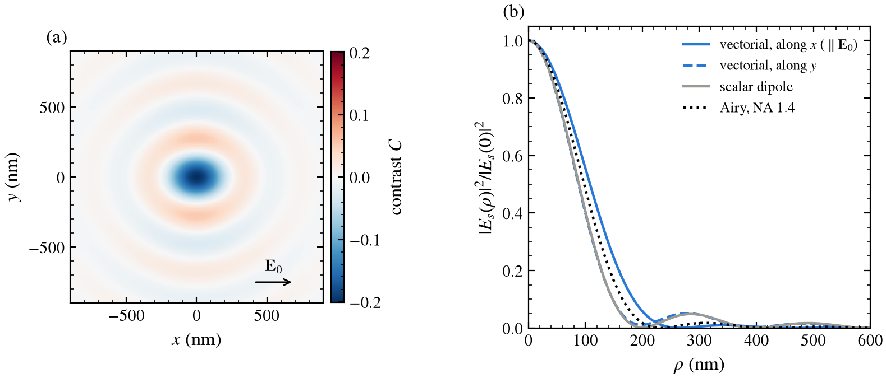
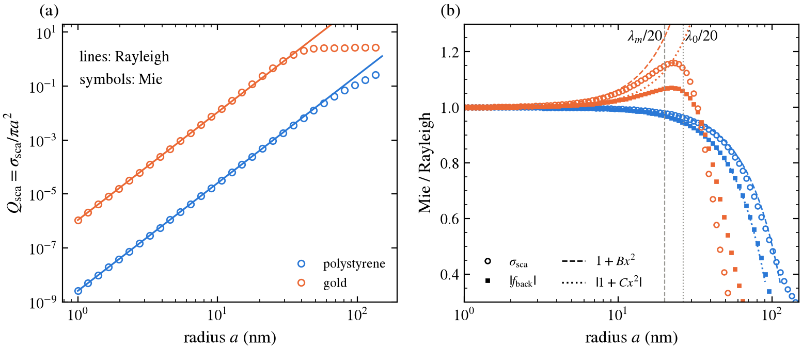
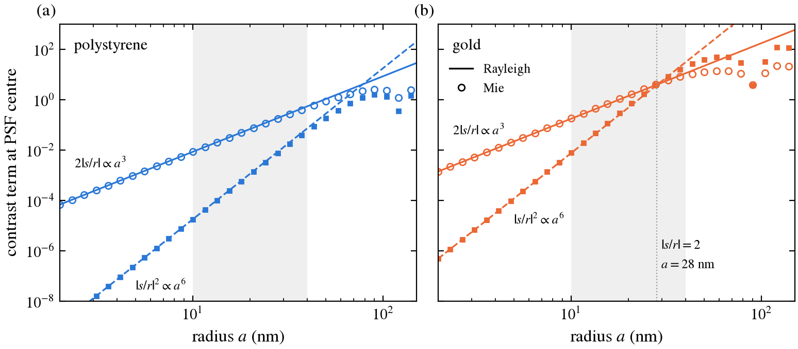
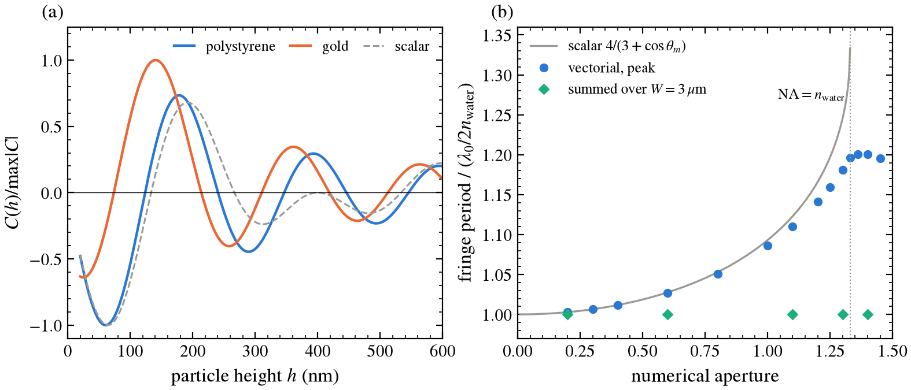
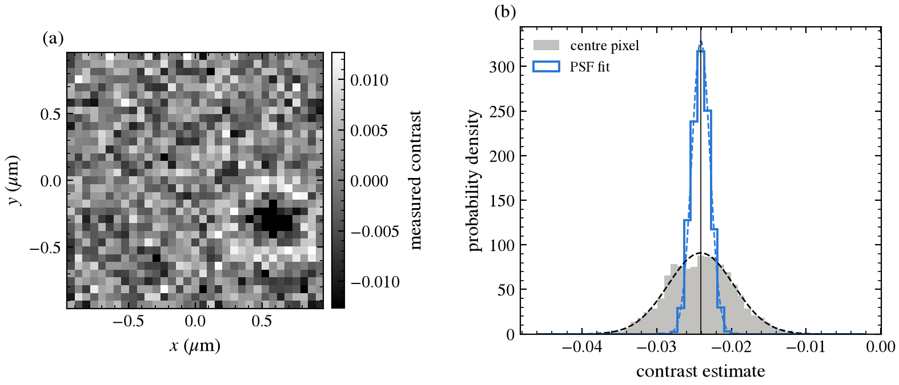
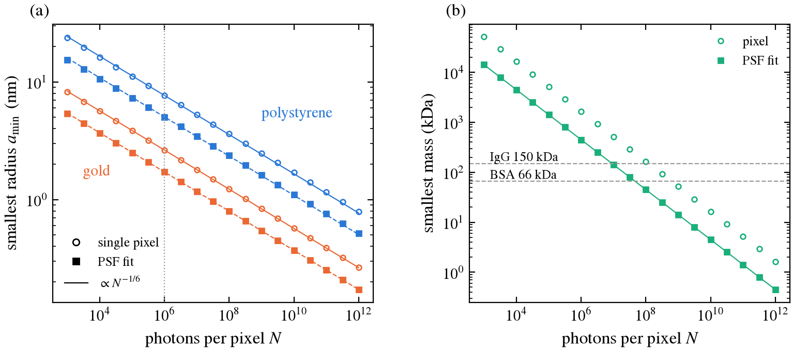
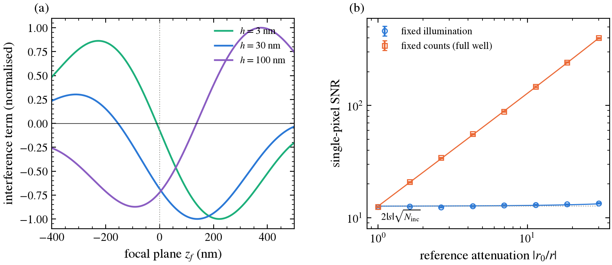
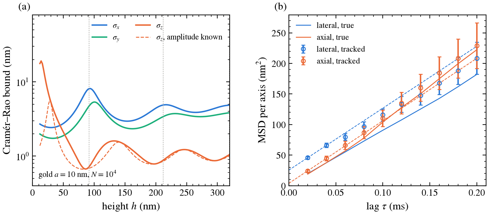
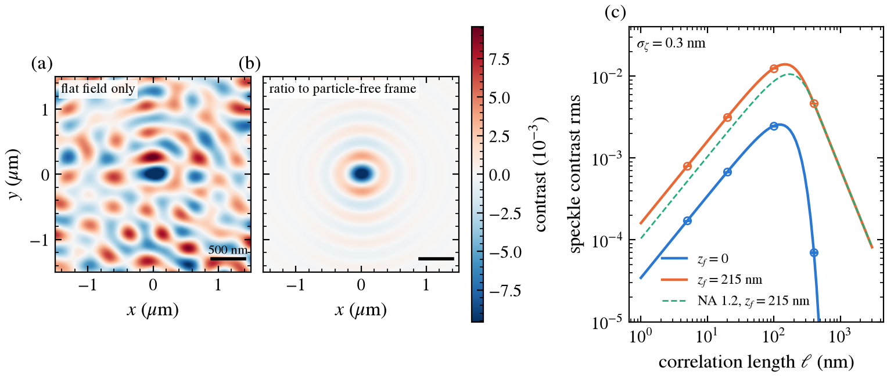
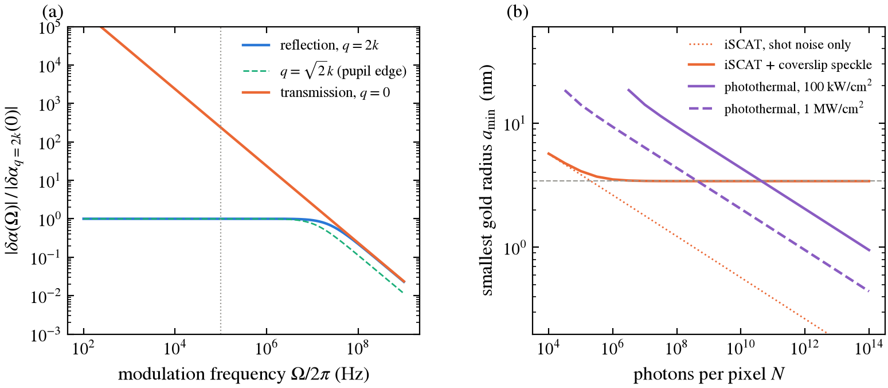

# Interferometric Scattering (iSCAT) Microscopy

*Signal, image and detection limit of iSCAT from first principles.*

<p align="center">
  
</p>

<p align="center">
  <a href="#quick-start">Quick start</a> •
  <a href="#summary-of-results">Results</a> •
  <a href="iSCAT.pdf">Report (PDF)</a> •
  <a href="#references">References</a>
</p>

A sub-wavelength particle on a coverslip scatters a field $E_s\propto a^3$. In iSCAT this field interferes with the weak reflection $E_r$ from the glass–water interface, so the camera records $C = 2\,\mathrm{Re}(E_s/E_r) + |E_s/E_r|^2$. This project computes that signal from first principles:

* Scattering by Rayleigh and by a Mie series written here, checked against Bohren & Huffman and against `miepython`.
* The image of the particle in two models: a closed-form scalar one and a vectorial dipole-near-interface one (Fresnel s/p transmission, aplanatic objective, supercritical light).
* Shot-noise-limited images and the detection limit.
* Three extensions beyond the brief: 3D tracking of a diffusing particle from its interference pattern, static speckle from coverslip roughness, and photothermal detection of absorbing particles.

Along the way it corrects six of the brief's statements and derives the leading error terms ([`iSCAT.pdf`](iSCAT.pdf)).

The optical setup is $\lambda_0 = 532$ nm, glass $n_1 = 1.52$, water $n_2 = 1.33$ (so $\lambda_m = 400$ nm) and objective NA 1.4. The particles are polystyrene, $n = 1.59$, and gold, $n = 0.544+2.231i$ (Johnson & Christy 1972, interpolated to 532 nm).

> [!NOTE]
> All numbers below are copied from [`figures/results.txt`](figures/results.txt), which `scripts/make_figures.py` writes. Each row of the summary table names the test that checks it (133 tests in `tests/`).

## Quick start

```bash
poetry install
poetry run pytest iSCAT/tests                   # ~18 s
poetry run python iSCAT/scripts/make_figures.py # ~52 s
```

Both times were measured on a Ryzen 7 7840HS with Python 3.14.7, NumPy 2.4.6 and SciPy 1.17.1. The script imports `fourier_optics` from [`Fourier-optics/`](../Fourier-optics/README.md) for the Gaussian illumination, and one test uses its propagator.

## Summary of results

| Quantity | Result | Expected | Test |
|---|---|---|---|
| Mie vs BHMIE listing ($m = 1.55$, $x = 5.213$) | $Q_{\rm sca} = 3.10543$, $Q_{\rm back} = 2.92534$ | 3.10543, 2.92534 | `test_bohren_huffman_example` |
| Mie vs `miepython` 3.3.0 | 4.7e-7 at most, which is `miepython`'s truncation error (ours is converged to 5e-12) | — | `test_mie_matches_miepython`, `test_mie_truncation_converged` |
| Rayleigh $a^6$ law within 2% (polystyrene) | up to $a = 19.99$ nm $= \lambda_m/20$; 3.6% at $\lambda_0/20$ | — | `test_brief_a6_law_within_2pct_needs_medium_wavelength` |
| Leading Mie correction to $\sigma_{\rm sca}$ | $1+Bx^2$, $B = \frac65\mathrm{Re}\frac{m^2-2}{m^2+2} = -0.200$ | derived (M3) | `test_rayleigh_x2_coefficient_lossless` |
| Leading correction to the iSCAT amplitude $f_{\rm back}$ | $1+Cx^2$, $C = -0.312$; $C\to-2/5$ (Rayleigh–Gans) as $m\to1$ | derived (M4) | `test_backscatter_x2_coefficient` |
| Mie departs from Rayleigh by 10% ($\sigma_{\rm sca}$) | polystyrene 43.6 nm, gold 14.4 nm | — | `test_divergence_radius_ps_predicted_by_x2_law_less_so_gold` |
| Log-log slope, $a$ = 10–40 nm (Rayleigh) | 3.0000 and 6.0000 | 3, 6 | `test_brief_contrast_slopes_10_to_40_nm` |
| Same with Mie, polystyrene | 2.927 (interference), **5.855** (scattering) | 3, 6 | same |
| Reference reflectivity | $r = +0.0667$, $\|r\|^2 = 0.444\%$, no π shift | ≈ 0.4% | `test_reference_has_no_pi_shift_and_brief_reflectivity` |
| Lossless particle at $h = z_f = 0$ | $\arg(E_s/E_r) = \pi/2$ exactly (Gouy) | — | `test_gouy_phase_quarter_wave_in_focus` |
| Fringe period vs height, NA 0.3 | 1.0065 $\lambda_m/2$ (scalar 2$\lambda_m/(3+c)$ exactly) | $\lambda/2n$ | `test_brief_period_bar_at_low_na`, `test_scalar_fixed_focus_period` |
| Fringe period, NA 1.4, focus on interface | **240.1 nm = 1.20** $\lambda_m/2$ | $\lambda/2n$ | same |
| Fringe period, signal summed over the spot ($W$ = 3 µm) | 1.000451 $\lambda_m/2$; predicted $1+1/(kW)^2 = 1.000450$ | — | `test_window_integrated_period` |
| Vectorial PSF ($\|E_s\|^2$ FWHM, NA 1.4) | 216 nm along $\mathbf E_0$, 176 nm across (ratio 1.23); Airy 196 nm | — | `test_vectorial_psf_elongated_along_polarisation` |
| Simulated images: centre pixel, 2000 images | mean $-2.4127(98)\times10^{-2}$ vs model $-2.4083\times10^{-2}$; std $4.394(69)\times10^{-3}$ vs predicted $4.391\times10^{-3}$ | model | `test_simulated_peak_contrast_and_noise` |
| PSF fit | std $1.210(19)\times10^{-3}$ vs predicted $1.2145\times10^{-3}$ (3.6× better than one pixel) | — | `test_matched_filter_amplitude_and_error` |
| Smallest radius, $N = 10^6$, 3σ, best focus | polystyrene 7.68 nm (5.04 nm with a PSF fit); gold 2.63 nm (1.71) | — | `test_detection_limit_scales_as_n_to_minus_one_sixth` |
| $d\ln a_{\min}/d\ln N$ | −0.164 (polystyrene, best focus); **−0.122** with focus on the interface | $-1/6$ | `test_fixed_focus_breaks_one_sixth_law` |
| Protein contrast ($dn/dc = 0.185$ mL/g, $h = 3$ nm) | $-1.83\times10^{-3}$ per MDa at best focus, 14× weaker in exact focus | — | `test_protein_polarizability_matches_sphere_to_first_order` |
| Reference attenuation at fixed illumination | SNR 12.49(16) → 13.47(17) at 30×; exact theory 12.67 → 13.27 | — | `test_signal_to_noise_independent_of_reference_at_fixed_illumination` |
| *Extension:* 3D fit of gold $a$ = 10 nm, $N = 10^4$ | spread = Cramér–Rao bound for $(x_0, y_0, h, s)$; $\sigma_z$ = 0.67 nm at the contrast zero, 8.1 nm at the fringe extremum | — | `test_fit_reaches_cramer_rao_bound`, `test_axial_best_and_lateral_worst_at_contrast_zero` |
| *Extension:* tracked diffusing particle, 400 frames | errors 3.90/2.90/2.51 nm vs CRLB 4.18/2.84/2.15 nm; MSD fit recovers $D$ and $\sigma$ | — | `test_msd_fit_recovers_diffusion_and_localisation_error` |
| *Extension:* uniform roughness step $\zeta_0$ | sheet field $= 2ik_1\zeta_0E_r$, the shifted-interface Fresnel result (pure phase) | exact | `test_uniform_height_is_a_shifted_interface` |
| *Extension:* speckle, $\sigma_\zeta$ = 0.3 nm, $\ell$ = 20 nm | rms contrast $3.185\times10^{-3}$ (Monte Carlo) vs $3.176\times10^{-3}$ (R4) at $z_f$ = 215 nm; zero for NA ≤ $n_2$ at $z_f = 0$ | — | `test_speckle_std_matches_spectral_integral`, `test_focus_on_interface_speckle_needs_supercritical_light` |
| *Extension:* speckle floor without background removal | polystyrene 10.2–11.2 nm, gold 2.5–3.4 nm, independent of $N$ | — | `test_ratiometric_image_cancels_static_speckle` |
| *Extension:* photothermal lens, gold | $\delta\alpha/\alpha\approx2.8\times10^{-3}$ per 100 kW/cm²; in reflection within 1% of steady state to 3.7 MHz (halves at 39 MHz), forward $\propto1/\Omega$ | — | `test_steady_lens_is_finite_in_reflection_and_diverges_forward`, `test_lens_polarizability_is_born_integral_of_index_profile` |
| *Extension:* photothermal vs speckle-limited iSCAT (gold) | photothermal at 1 MW/cm² goes below the 3.41 nm speckle floor from $N = 10^9$ | — | `test_lockin_shot_noise_is_sqrt_two_over_n`, `test_photothermal_signal_scales_as_a_cubed` |

### Corrections to the brief

1. **"Mie reproduces $a^6$ within 2% for $a<\lambda/20$."** This holds only if λ is the wavelength *in water*, and then only just: the 2% radius for polystyrene is 19.99 nm, against $\lambda_m/20 = 20.00$ nm. With the vacuum wavelength the error at $\lambda_0/20 = 26.6$ nm is 3.6%. For gold the 2% radius is 5.9 nm.
2. **"Slopes 3 and 6 for 10–40 nm."** With Rayleigh scattering the slopes are exactly 3 and 6 by construction, so this tests nothing. With Mie, the interference slope is 2.927, close to 3, but the scattering-only slope is 5.855. The miss comes from the backscattering amplitude, which leaves the $a^3$ law faster than $\sigma_{\rm sca}$ does: $C = -0.312$ vs $B = -0.200$. The magnetic dipole and electric quadrupole add coherently at order $x^2$.
3. **"Contrast period in z equals λ/(2n)."** With n = n_water = 1.33, this holds to 1% only at low NA (1.0065 at NA 0.3; not above NA ≈ 0.37). It also holds if the focus follows the particle, or for the signal summed over the whole spot. At the PSF peak with the focus fixed on the coverslip, the scalar model gives exactly $2\lambda_m/(3+\cos\theta_m)$. The vectorial model gives 240 nm at NA 1.4, 20% longer.
4. **"The sign (π shift) from the reflection."** Seen from the glass, the glass→water reflection has $r = +0.0667$: there is no π shift. The quarter-wave offset that makes particles on the glass look dark is the Gouy phase of the scattered spherical wave. A lossless particle exactly in the focal plane gives *zero* interference contrast.
5. **"$a_{\min}\propto N^{-1/6}$."** This needs the iSCAT phase to be independent of size. For a particle resting on the glass, with the focus on the interface, the phase is $\pi/2 + k(3+c)a/2$, so the contrast goes as $a^4$ and $a_{\min}\propto N^{-1/8}$ (scalar model; −0.122 vectorial). Moving the focus about 200 nm into the sample restores $-1/6$, and makes small particles 14× brighter.
6. **"Reference reflectivity ≈ 0.4%."** It is 0.444%.

### Convergence of the discretisations

| Discretisation | Measured | Predicted | Logged as |
|---|---|---|---|
| Mie series truncation (Wiscombe + 15) | change from 60 more terms < 1e-11 | converged | `[mie]` |
| Vectorial pupil quadrature (Gauss–Legendre, split at $\kappa = k_2$) | 200 vs 400 nodes per piece: < 1e-10 relative | spectral | `test_quadrature_converged` |
| Bessel-table interpolation (`DipoleImager`) | order 2.00 | 2 | `[conv]`, `test_tabulated_imager_converges_second_order` |
| Roughness FFT box size $L$ | error envelope $\propto L^{-1.48}$ | $L^{-3/2}$ ($\rho^{-3/2}$ PSF tail) | `[conv]` |
| Speckle variance on the FFT grid | error envelope $\propto\Delta\kappa^{1.44}$ | $\Delta\kappa^{3/2}$ (lattice points in a disc) | `[conv]` |
| Speckle radial integral (400 nodes) | change vs 2000 nodes < 1e-13 | spectral | `[conv]` |

The two FFT errors oscillate rather than fall monotonically, so the table quotes the slope of the running maximum.

### Negative controls

| Positive claim | Control where the effect must vanish | Test |
|---|---|---|
| a particle gives contrast | particle-free frames: zero mean, $1/\sqrt N$ noise | `test_background_noise_is_one_over_sqrt_n` |
| the interference term carries the signal | a lossless particle exactly in focus gives zero interference contrast | `test_gouy_phase_quarter_wave_in_focus` |
| absorption heats gold | a lossless sphere absorbs nothing at any size | `test_lossless_sphere_absorbs_nothing` |
| roughness makes speckle | a flat or index-matched surface gives none; a uniform step is a pure phase; NA ≤ $n_2$ at $z_f = 0$ gives none | `test_flat_surface_and_index_matched_glass_give_no_speckle`, `test_uniform_height_is_a_shifted_interface`, `test_focus_on_interface_speckle_needs_supercritical_light` |
| speckle limits detection | a ratio to a particle-free frame removes it to second order | `test_ratiometric_image_cancels_static_speckle` |
| the tracker finds particles | particle-free images give a fitted amplitude of zero, within the CRLB | `test_particle_free_images_give_zero_amplitude` |
| the MSD intercept measures localisation error | noise-free tracks give a zero intercept | `test_msd_fit_recovers_diffusion_and_localisation_error` |
| the thermal lens gives a lock-in signal | no absorption, or $dn/dT = 0$, gives exactly zero | `test_no_absorption_or_no_dn_dT_gives_no_photothermal_signal` |

## Model

**Geometry and conventions** ([`iSCAT.pdf`](iSCAT.pdf) §0). Time dependence is $e^{-i\omega t}$. The geometry:

* An $x$-polarised plane wave $E_0 = 1$ comes from the glass.
* The reference is its reflection $r = (n_1-n_2)/(n_1+n_2)$.
* The particle at height $h$ is driven by the transmitted field $t\,e^{ik_2h}$, with dipole moment $\mathbf p = \varepsilon_0\varepsilon_2\alpha\,t\,e^{ik_2h}\hat x$.
* The objective in the glass is focused on $z = z_f$; $z_f>0$ is inside the water.

**Scattering.** Rayleigh: $\alpha = 4\pi a^3(m^2-1)/(m^2+2)$, $\sigma_{\rm sca} = (8\pi/3)k^4a^6|L|^2$. Mie: the BHMIE algorithm, with the exact dipole polarizability $6\pi i a_1/k^3$ used in the images, and the backscattering amplitude $S_1(\pi)/(-ik)$.

**Contrast.** $C = 2\,\mathrm{Re}(E_x/E_r) + (|E_x|^2+|E_y|^2)/|E_r|^2$. Only the co-polarised component interferes with the reference.

### Approximations

* A homogeneous sphere with the bulk index. For gold below about 5 nm, surface damping, which is not included, broadens the plasmon.
* The illumination is a plane wave at normal incidence. The particle's own reflection from the interface (the image dipole) and the near-field change of the local field are neglected; both are of relative size $\sim r\,(ka)^3$.
* The imaging model treats the particle as an $x$-oriented point dipole, with the Mie $a_1$ but no higher multipoles. For polystyrene the omitted $b_1$ and $a_2$ change the backscattered amplitude by less than 2% up to $a$ = 16 nm (3.1% at 20 nm; M4).
* There are no aberrations. The objective is aplanatic, the tube lens paraxial, and the pixels are point samples (60 nm in the object plane).
* The scalar model propagates in water only and collects NA ≤ $n_2$. The vectorial model includes Fresnel s/p transmission, the $\sqrt{\cos\theta_1}$ apodisation and supercritical angles up to NA < $n_1$.
* The only noise is shot noise: no read noise, vibration or background drift. Figures 9 and 10 add static speckle from the coverslip roughness; the extensions list their own approximations below.

## Method

### Mie series
The BHMIE recurrences: $D_n(mx)$ downward from $n_{\max}+16$, which is stable for absorbing spheres, and $\psi_n$, $\xi_n$ upward, truncated at Wiscombe's $n_{\max} = x + 4.05x^{1/3}+2$. Checks:

* The BH appendix listing.
* `miepython` for four indices and $x$ = 0.05–25 (`miepython` uses $n - i\kappa$, so its index is conjugated).
* $Q_{\rm ext} = Q_{\rm sca}$ for real $m$.
* The optical theorem $Q_{\rm ext} = 4\,\mathrm{Re}S(0)/x^2$.
* The extinction paradox $Q_{\rm ext}\to2$.
* Convergence in $n_{\max}$.

The leading departures from Rayleigh, (M3) and (M4), are checked at $x$ = 0.02–0.04 with error $O(x^2)$.

### Scalar image
This is (S2): the angular spectrum of the dipole, transmitted with $t t'$, band-limited at $\min(\mathrm{NA}, n_2)$ and propagated to the focal plane. Writing it in $u = k_z$ removes the $1/k_z$ singularity, and the centre value has the closed form (S3). The quadrature matches the closed form to 1e-12.

The defocused image was also rebuilt independently on an FFT grid. Starting from the in-focus band-limited image, I propagated it with the **angular-spectrum propagator of [Fourier-optics](../Fourier-optics/README.md)** (`fourier_optics.propagate`); the two agree to 6e-3. The residual comes from counting lattice points inside the pupil disk and falls as the grid grows (`test_scalar_defocus_matches_fourier_optics_propagator`). The simulated image in Figure 5 uses the Fourier-optics Gaussian beam as the illumination.

### Vectorial image (Level 2)
This is (V3), a Richards–Wolf-type integral for an $x$ dipole above the interface. The $\kappa$ integral is split at $\kappa = k_2$ into smooth pieces ($\kappa = k_2\sin\theta_2$, then $k_2\cosh u$). With 300 Gauss–Legendre nodes per piece it converges to 1e-10. Checks:

* For $n_1 = n_2$ the centre value has a closed form, matched to 1e-10.
* For $n_1 = n_2$ and NA → 0 it reduces to the scalar model, with the predicted $O(\mathrm{NA}^2)$ error.
* Symmetry: $E_x$ is even, $E_y$ is odd in $x$ and $y$ and zero on both axes.
* Fresnel energy conservation for s and p.

### Noise
Each pixel collects Poisson counts, and the contrast is (signal frame)/(background frame) − 1 with an independent Poisson background in each pixel. The predicted per-pixel noise is the delta-method (N1). The PSF fit is linear least squares with the noise-free template, with error $1/\sqrt{N\sum T^2}$. The detection limit is the radius at which $|C| = 3\sigma$, found by bisection in $\log a$. The focus is chosen to make a 5 nm particle darkest.

### Tracking (extension)
The image of a particle at $(x_0, y_0, h)$ with amplitude $s$ comes from `DipoleImager`. It tabulates the $J_0$ and $J_2$ pupil sums on a 1 nm radial grid once; $h$ then enters only through $e^{ik_{z2}h}$, so one image costs two matrix–vector products (≈1 ms instead of ≈10 ms). The interpolation error falls as $\Delta\rho^2$: measured order 2.00. The Cramér–Rao bounds use the Poisson Fisher information (T1) with central differences. The estimator is weighted least squares (Levenberg–Marquardt), with the shot-noise weights frozen at the starting guess. Diffusion coefficients come from a two-lag MSD fit, which is unbiased for $D$ and $\sigma^2$ (T3–T4).

### Roughness speckle (extension)
The surface is a Gaussian random field: white noise filtered by $\sqrt{S(\kappa)}$ on a periodic grid. Its image is a single FFT convolution with the vectorial transfer function (R2), which is the Fourier form of the same pupil integrals as the particle image, so the two are imaged consistently. The FFT result is a periodic sum of images. Its error envelope falls as $L^{-3/2}$ (measured −1.48), because a hard-edged pupil gives a $\rho^{-3/2}$ tail. All maps are 41 µm or larger. The speckle rms is also computed directly as the radial integral (R4). On the FFT grid that integral becomes a lattice sum over a hard-edged disc, whose error falls as $\Delta\kappa^{3/2}$ (measured 1.44).

### Photothermal signal (extension)
The temperature (H1) and the lens polarizability (H2) are closed forms, each checked against quadrature. The extended lens enters the vectorial image as a $q$-dependent weight on each plane wave (H3). The lock-in amplitude combines the $\pm\Omega$ sidebands (H4), and its shot noise is $\sqrt{2/N}$ per quadrature (H5). A time-domain demodulation and a Poisson Monte Carlo check both.

## Results

### Figure 1: Mie vs Rayleigh



**Figure 1.** (a) Scattering efficiency: Rayleigh (lines) and Mie (symbols). (b) Mie/Rayleigh ratio for $\sigma_{\rm sca}$ (circles) and for the backscattered amplitude that iSCAT measures (squares), with the derived leading terms $1+Bx^2$ (dashed) and $|1+Cx^2|$ (dotted). Vertical lines mark $\lambda_m/20$ and $\lambda_0/20$.

| | 2% radius ($\sigma$) | 10% radius ($\sigma$) | 2% radius ($\|f_{\rm back}\|$) | 10% radius ($\|f_{\rm back}\|$) |
|---|---|---|---|---|
| polystyrene | 19.99 nm | 43.61 nm | 16.13 nm | 36.09 nm |
| gold | 5.89 nm | 14.43 nm | 8.78 nm | 36.82 nm |

For polystyrene the $x^2$ law predicts the 10% radius as 45.0 nm, 3% from the true value. For gold it predicts 12.6 nm, 14% off: near the plasmon the $x^3$ radiative term ($-\frac43x^3\mathrm{Im}L$) matters. The gold ratio first *rises*, to 1.161 at $a$ = 22.8 nm, before it falls; $B>0$ means that the size correction pulls the resonance towards 532 nm.

### Figure 2: contrast vs radius



**Figure 2.** Interference term $2|s/r|$ and scattering term $|s/r|^2$ at the PSF centre ($h$ = 20 nm, focus on the interface, NA 1.4), for Rayleigh (lines) and Mie (symbols). The brief's fit range, 10–40 nm, is shaded.

| | interference slope | scattering slope | $\|s/r\| = 2$ at |
|---|---|---|---|
| polystyrene, Mie | 2.927 | 5.855 | 149 nm |
| gold, Mie | 2.949 | 5.898 | 28 nm |

For polystyrene the interference term dominates up to about 150 nm. The backscattered amplitude follows the $a^3$ law to within 2% up to 16 nm (3.1% at 20 nm), and the scattering-only slope misses 6 ± 0.1 for the reason given in the corrections. Gold has a 20.5 times larger polarizability per volume ($|L_{\rm Au}/L_{\rm PS}|$), so the pure-scattering regime starts at 28 nm.

### Figure 3: contrast vs height



**Figure 3.** (a) Centre contrast vs particle height for 20 nm particles, normalised, with NA 1.4 and the focus on the interface. The dashed line is the scalar model with NA clipped to $n_2$. (b) Fringe period, in units of $\lambda_0/2n_{\rm water} = 200$ nm. Circles: vectorial peak, fitted over $h$ = 20–220 nm. Line: scalar $4/(3+\cos\theta_m)$. Diamonds: signal summed over a Gaussian window $W$ = 3 µm.

| NA | 0.2 | 0.4 | 0.8 | 1.0 | 1.2 | 1.33 | 1.4 |
|---|---|---|---|---|---|---|---|
| vectorial peak period (nm) | 200.57 | 202.32 | 210.18 | 217.26 | 228.18 | 239.17 | 240.12 |
| scalar $2\lambda_m/(3+c)$ (nm) | 200.57 | 202.34 | 210.59 | 218.62 | 233.15 | 266.67 | — |

The fringes come from the phase $k_2h$ (illumination) $+\langle k_z\rangle h$ (return path), where $\langle k_z\rangle$ is averaged over the collected angles. At high NA, the oblique return rays are slower in $z$ and the period grows. The vectorial model falls below the scalar one at high NA, because its $\sqrt{\cos\theta}$ apodisation and Fresnel factors weight the oblique rays less than the scalar $1/k_z$. Above NA = $n_2$ the extra rays are evanescent in water: they add amplitude near the glass but no $z$-phase, so the period stops growing (240 nm).

Summing the image over the whole spot keeps only $\kappa\approx0$. The period is then $\lambda_m/2\,(1+1/(kW)^2)$ at every NA; the $W$ = 3 µm value 1.000451 matches the predicted 1.000450.

The polarizability phase of gold, $\arg\alpha_{\rm Au}/\alpha_{\rm PS}$ = 0.958 rad, shifts its fringes. Its first dark fringe is at $h$ = 24 nm, against 60 nm for polystyrene.

### Figure 4: the iSCAT point-spread function


**Figure 4.** (a) Vectorial iSCAT contrast image of a 30 nm polystyrene sphere on the glass at the best focus ($z_f$ = 140 nm), peak $C = -0.201$. (b) Scattered intensity profiles $|E_s|^2$ at $z_f = 0$.

| | FWHM of $\|E_s\|^2$ |
|---|---|
| vectorial, along $\mathbf E_0$ | 216.2 nm |
| vectorial, perpendicular | 175.6 nm |
| scalar dipole (NA → $n_2$) | 177.1 nm |
| Airy, NA 1.4 ($0.514\lambda_0$/NA) | 195.5 nm |

The vectorial spot is elongated along the polarisation by a factor of 1.23. The $J_2\cos2\phi$ term of (V3) comes from the p-polarised rays, whose field tilts out of the pupil plane. The scalar model misses this and is narrower than Airy, because its $1/k_z$ weighting favours high angles. The interferometric image in (a) is a ring pattern whose sign alternates. Its central lobe (301 nm FWHM in $\mathrm{Re}\,E_x$ at $z_f = 0$) is wider than the intensity PSF, because the camera records the field, not its square.

### Figure 5: simulated image and its statistics



**Figure 5.** (a) One simulated contrast image. A 15 nm polystyrene particle sits at (600, −300) nm under a Gaussian beam ($w_0$ = 4 µm, from Fourier-optics), with $N = 10^5$ photons/pixel and one background frame. (b) Over 2000 images of a centred particle: the centre-pixel contrast (grey) and the PSF-fit amplitude (blue), with the predicted Gaussians (dashed).

| | mean | standard deviation |
|---|---|---|
| model | $-2.4083\times10^{-2}$ | centre pixel $4.3913\times10^{-3}$; fit $1.2145\times10^{-3}$ |
| centre pixel | $-2.4127(98)\times10^{-2}$ | $4.3935(69)\times10^{-3}$ |
| PSF fit | $-2.4096(27)\times10^{-2}$ | $1.2099(19)\times10^{-3}$ |

Peak contrast and noise match the prediction: every number is within 1σ of its error.

* **Background frame.** A measured background frame raises the per-pixel noise from $1/\sqrt N$ (3.16e-3) to $\sqrt{(1+C)(2+C)/N}$ (4.39e-3).
* **PSF fit.** The fit gains $\sqrt{\sum T^2}$ = 3.65 over one pixel; 3.62 was measured.
* **Illumination profile.** The beam profile cancels in the ratio: the off-centre particle has the same contrast as a centred one ($-2.4083\times10^{-2}$), because the particle and the reference are driven by the same beam.

### Figure 6: detection limit



**Figure 6.** (a) Smallest detectable radius (3σ) vs photons per pixel at the best focus, for one pixel (open) and a PSF fit (filled). Lines are $N^{-1/6}$. (b) Smallest detectable protein mass, from the $dn/dc$ polarizability, at $h$ = 3 nm and the best focus.

| $N = 10^6$ | single pixel | PSF fit | slope (1e6–1e12) |
|---|---|---|---|
| polystyrene | 7.68 nm | 5.04 nm | −0.1644 |
| gold | 2.63 nm | 1.71 nm | −0.1662 |
| polystyrene, focus on interface | 11.23 nm | — | −0.1222 (1e6–1e8) |

| photons per pixel | $10^6$ | $10^8$ | $10^{10}$ |
|---|---|---|---|
| smallest protein, single pixel | 1637 kDa | 164 kDa | 16 kDa |
| smallest protein, PSF fit | 448 kDa | 45 kDa | 4.5 kDa |

The slopes approach −1/6 from above, because the particle centre rises with $a$ ($h = a$) and that shifts the phase. With the focus on the coverslip the contrast goes as $a^4$ (correction 5).

For proteins, I assumed $dn/dc$ = 0.185 mL/g and a molecule 3 nm above the glass. This gives $\alpha$ = 462 nm³ per MDa, and the contrast is linear in mass: $-1.83\times10^{-3}$ per MDa at the best focus. The equivalent-sphere picture (density 1.35 g/cm³, $n$ = 1.580) gives 0.962 times this polarizability, against the derived $1-\delta/6-2\delta^2/9 = 0.961$.

Detecting a 66 kDa protein at 3σ with a PSF fit needs $4.6\times10^7$ photons per pixel (150 kDa: $8.9\times10^6$). That means hundreds of frames at a full well of $10^5$, which is why mass photometry averages frames. I have not compared these numbers with published mass-photometry limits, as the brief asks.

### Figure 7: choosing the focus and the reference strength



**Figure 7.** (a) Interference term vs focal-plane position for dipoles at three heights. (b) Single-pixel SNR vs reference attenuation for a fixed scattered field $s = -2\times10^{-4}$. Blue: fixed illumination. Orange: fixed detected counts per pixel. Lines are the exact (N2).

| $h$ | 3 nm | 30 nm | 100 nm |
|---|---|---|---|
| best focus $z_f$ | 221 nm | 140 nm | −91 nm |
| gain over $z_f = 0$ | 14.3× | 1.46× | 1.21× |

At **fixed illumination**, attenuating the reference does not change the shot-noise SNR: 12.49(16) at 1×, against a theory of 12.67. It rises slightly to 13.47(17) at 30× (theory 13.27), because a dark fringe lowers the total intensity, and it would fall to the dark-field value $|s|\sqrt{N_{\rm inc}}$ only once $|r|\ll|s|$. At **fixed counts**, set by the camera full well, the SNR grows as $1/|r|$: 400(5) at 30×, theory 398. That is the case for partial reflectors.

Figures 8–10 go beyond the brief. Each has its own tests (`test_isc_tracking.py`, `test_isc_roughness.py`, `test_isc_photothermal.py`) and derivation (`iSCAT.pdf` §6–8).

### Figure 8: 3D tracking from the interference pattern



**(a)** Cramér–Rao bounds (T1) for a gold particle of radius 10 nm imaged with $N = 10^4$ photons per pixel on 15 × 15 pixels, with the focus on the interface. The fitted parameters are $(x_0, y_0, h)$ and the amplitude $s$. **(b)** A particle diffusing freely in 3D ($D$ = 0.5 µm²/s, 50 kHz frames), localised frame by frame. The MSD of the tracked positions sits $2\sigma^2$ above that of the true track (T3). The error bars are the expected scatter of each MSD point, taken from 500 simulated tracks of the same length.

| | at $h$ = 24 nm (fringe extremum) | at $h$ = 90 nm (contrast ≈ 0) |
|---|---|---|
| $\sigma_x$, $\sigma_y$ | 2.45, 1.78 nm | 7.94, 4.51 nm |
| $\sigma_z$ | 8.11 nm | 0.69 nm |
| $\sigma_z$ with the amplitude known | 3.91 nm | 0.68 nm |

The precision swaps between the axes with the fringe (T2). At a zero crossing of the centre contrast, the phase of $E_s/E_r$ passes through quadrature, so the intensity changes fastest with $h$. The same spot then has almost no contrast to locate laterally. The minimum of $\sigma_z$ (86 nm) and the maximum of $\sigma_x$ (94 nm) both lie within 10 nm of the crossing at 91.6 nm. At the extremum, $h$ and the amplitude both deepen the dark spot, so they are correlated; knowing the amplitude halves $\sigma_z$ there.

At $h$ = 60 nm the weighted least-squares fit is unbiased and its spread equals the bound for all four parameters. 200 fits give 3.49, 2.28, 1.44 nm against 3.25, 2.14, 1.47 nm, with a 5% standard error on each spread (also `test_fit_reaches_cramer_rao_bound`). Near the extremum at $N = 10^4$ the fit is not yet efficient, because the strong $h$–$s$ correlation flattens the likelihood. There $\sigma_z$ = 8.50 nm against a bound of 7.47 nm (+14%), with a bias in $h$ of −1.17 ± 0.60 nm.

The height is known only modulo the fringe period. A fit started 240 nm too high settles at $h$ = 280 nm, but with $\chi^2$ = 746 against 232 at the true fringe (225 pixels). At NA 1.4 the PSF changes shape over one period, and that breaks the ambiguity.

| track (400 frames, amplitude known) | lateral | axial |
|---|---|---|
| error std (x, y / z) | 3.90, 2.90 nm | 2.51 nm |
| rms CRLB along the track | 4.18, 2.84 nm | 2.15 nm |
| MSD fit $D$ (true track, input 0.500) | 0.506 µm²/s (0.447) | 0.511 µm²/s (0.473) |
| MSD fit $\sigma$ (rms CRLB) | 3.57 nm (3.58) | 1.40 nm (2.15) |

A two-lag fit from 400 frames has 14% scatter per axis (2000 simulated tracks), so a single track pins $D$ only to about that. The particle wanders between 10 nm (touching the glass) and 126 nm. Near the glass it sits at a fringe extremum, where the fit is not yet efficient, so the axial error (2.51 nm) is above its bound (2.15 nm). That matches the fixed-height efficiency check above.

Approximations: point-sampled pixels, instantaneous frames (no motion blur), and no hydrodynamic hindrance near the wall (which slows motion normal to the glass when the gap is comparable to $a$). The wall reflects the particle at $h = a$. The particle's amplitude is taken as known when tracking, because $s$ is shared by all frames and can be fitted once.

### Figure 9: speckle from coverslip roughness



**(a)** A polystyrene particle ($a$ = 12 nm, peak contrast $-1.19\times10^{-2}$) on glass with rms roughness $\sigma_\zeta$ = 0.3 nm and correlation length $\ell$ = 20 nm (assumed typical AFM values). It is imaged at the particle's best focus $z_f$ = 215 nm. The speckle rms, $3.1\times10^{-3}$, is a quarter of the particle's contrast. **(b)** The same image divided by a particle-free frame of the same surface. It differs from the smooth-glass image by at most $1.9\times10^{-5}$. **(c)** Speckle contrast rms against $\ell$: lines are the spectral integral (R4), circles are the mean of three 41 µm Monte Carlo maps, with standard-error bars (smaller than the symbols). At all eight points they agree within 1.8 standard errors.

The roughness is modelled to first order as a sheet of polarizability $(m^2-1)\zeta$ at the interface, imaged with the vectorial transfer function (R1–R2). A uniform step reproduces the shifted-interface Fresnel phase exactly (R3), and a single raised pixel reproduces the dipole PSF.

| | $z_f$ = 0 | best focus |
|---|---|---|
| speckle rms ($\ell$ = 20 nm) | $6.79\times10^{-4}$ | $3.18\times10^{-3}$ (215 nm), $2.19\times10^{-3}$ (106 nm) |
| $\ell$ of the largest speckle | 117 nm ($2.6\times10^{-3}$) | 143 nm ($1.4\times10^{-2}$) |
| 3σ floor, polystyrene | 10.20 nm | 11.16 nm |
| 3σ floor, gold | 2.52 nm | 3.41 nm |

Three things follow from (R4–R5):

* **With the focus on the interface, roughness is a phase object.** For subcritical light the transfer function is purely imaginary relative to $E_r$, the same Gouy argument that makes a particle in focus invisible. All of the $z_f = 0$ speckle comes from supercritical light: with NA ≤ $n_2$ it is exactly zero.
* **Speckle is worst at $\ell\approx$ 100–150 nm.** It grows as $\ell$ for fine roughness, which is a flat spectrum filtered by the pupil, and falls as $\ell^{-2}$ for long-wavelength roughness, which is nearly a uniform phase shift. A surface with long correlation lengths is much less of a problem than its rms suggests.
* **Moving the focus does not escape the floor.** The particle and the roughness sit at almost the same height, so defocus amplifies both. The floor moves from 10.2 to 11.2 nm for polystyrene. Without background removal the floor is independent of $N$: for gold at $N = 10^{10}$ it is 3.41 nm, against 0.57 nm from shot noise alone (Fig. 10b).

The static speckle cancels in a ratio to a particle-free frame of the same field (b). This is why landing assays and mass photometry use differential frames. It works only for a particle that moves or arrives, and only while the surface is stable.

### Figure 10: photothermal detection of absorbers



**(a)** Lens polarizability against pump modulation frequency for gold $a$ = 10 nm (H2), normalised to the steady reflection value. **(b)** Smallest detectable gold radius against probe photons per pixel. Three cases are compared: iSCAT with shot noise only, iSCAT with the Fig. 9 speckle, and photothermal readout at 100 kHz with two pump intensities.

A modulated pump heats the particle, and the probe reads the thermal lens in the water around it as a weak extended scatterer (H1–H4). The pump and probe are both at 532 nm.

| gold | $\sigma_{\rm abs}$ | steady $\Delta T(a)$ at 100 kW/cm² | $\delta\alpha(2k)/\alpha$ |
|---|---|---|---|
| $a$ = 5 nm | 44.9 nm² | 1.19 K | $(-1.97+1.95i)\times10^{-3}$ |
| $a$ = 10 nm | 374.7 nm² | 4.97 K | $(-1.88+1.98i)\times10^{-3}$ |
| $a$ = 20 nm | 3341 nm² | 22.15 K | $(-1.42+2.03i)\times10^{-3}$ |

* **Reflection probes the lens at $q = 2k$.** The $e^{-\gamma r}/r$ temperature tail would make a forward-probed lens grow as $r_{\rm th}^2\propto1/\Omega$. At $q = 2k$ it converges to $4\pi\cos(qa)/q^2$, so the iSCAT photothermal signal stays within 1% of its steady value up to $3.7\times10^6$ Hz and halves at $3.9\times10^7$ Hz. At 100 kHz it is within 0.05% of steady state, and 236× smaller than the forward lens.
* **The signal scales as $a^3$, the same as iSCAT.** The lens $\delta\alpha$ is about $2.8\times10^{-3}$ of gold's $\alpha$ at 100 kW/cm². It is real and negative ($dn/dT<0$), while gold's $\alpha$ has phase $\arg L_{\rm Au}$ = 0.77 rad, so the two have different best foci. For $a$ = 5 nm, $|\delta C|$ is $6.5\times10^{-5}$ at $z_f$ = 215 nm, $4.7\times10^{-5}$ at the static best focus (106 nm), and $3.3\times10^{-6}$ at $z_f$ = 0. The lock-in also costs a factor √2 in noise (H5).
* **It wins against speckle, not against shot noise.** The glass does not absorb, so its speckle has no photothermal signal. At 1 MW/cm², photothermal readout goes below the 3.41 nm speckle floor from $N = 10^9$, and reaches 2.04 nm at $10^{10}$ and 0.95 nm at $10^{12}$. At 100 kW/cm² the crossover is at $N = 10^{11}$.

Approximations: the glass is treated as water for heat flow, and gold's own $d\varepsilon/dT$ is ignored. The angle dependence of the extended lens uses the analytic continuation of (H2) for supercritical light. A point dipole with $\delta\alpha(2k)$ gives a signal 1.4× smaller, which sets the scale of the model uncertainty. $dn/dT = -1\times10^{-4}$ K⁻¹ is an order-of-magnitude value for water near room temperature.

## Discussion

1. **Why does the signal scale as the volume, not the volume squared?** The camera measures intensity, which is quadratic in the total field. The cross term $2\,\mathrm{Re}(E_rE_s^*)$ is linear in $E_s\propto\alpha\propto a^3$. Figure 2 shows the two terms with slopes 3 and 6; for polystyrene the cross term dominates up to about 150 nm.
2. **What sets the optimal reference strength?** Shot noise alone does not (Fig. 7b, blue). What matters is how many photons you can detect: a weaker reference lets more illumination fit in the full well, so the SNR grows as $1/|r|$ (orange). The limits are photodamage, a reference that no longer dominates read noise and stray light ($|r|^2N$ must stay well above read noise), and the $|s|^2$ term once $|r|\sim|s|$.
3. **Why does the contrast change sign with height?** The phase of $E_s/E_r$ is $\pi/2$ (Gouy) $+ \arg\alpha + (k_2 + \langle k_z\rangle)h$ (Fig. 3). The period is $\lambda_m/2$ only for paraxial collection; at NA 1.4 with a fixed focus it is 240 nm. Moving the focus adds its own phase, which is why the best focus depends on height (Fig. 7a).
4. **What is the fundamental noise limit?** Photon shot noise, $\sigma_C = 1/\sqrt N$ per pixel and $1/\sqrt{N\sum T^2}$ for the PSF fit (Fig. 5). Reaching it needs:
   * Frame averaging up to the stability of the setup.
   * A fresh background estimate (ratiometric imaging, which costs √2 here).
   * Suppression of speckle from the coverslip roughness, which in experiments often sets the floor before shot noise does. With $\sigma_\zeta$ = 0.3 nm the floor is 10 nm for polystyrene at any $N$ (Fig. 9), unless a particle-free frame of the same field is divided out.

## What I would ask

* Should the reference include the objective's angular collection (a focused, not collimated, illumination)? In a scanning (confocal) iSCAT, $|E_r|$ depends on NA.
* Should the substrate be a stratified coverslip, for example with a thin dielectric layer, as in later interferometric-reflectance designs? (V2) would then become a multilayer transfer matrix.
* For the mass-photometry numbers, which $dn/dc$ and height should be used for a membrane protein or a nucleic acid?
* What does the coverslip's AFM roughness spectrum look like? Fig. 9c shows that the correlation length matters as much as the rms height, and the Gaussian spectrum used here is an assumption.

## Project layout

<details>
<summary>Files and what they contain</summary>

```text
iSCAT/
├── iscat/
│   ├── scattering.py   # Rayleigh, Mie (BHMIE), x^2 coefficients, protein polarizability
│   ├── imaging.py      # Fresnel, scalar closed form and quadrature, vectorial PSF, best focus
│   ├── noise.py        # Poisson images, ratiometric contrast, PSF fit, detection limit, SNR
│   ├── tracking.py     # Fisher information, 3D localisation, Brownian tracks, MSD fit
│   ├── roughness.py    # rough surfaces, speckle field (FFT transfer function), speckle rms
│   └── photothermal.py # heat diffusion, thermal-lens polarizability, lock-in signal and noise
├── tests/              # 133 tests: test_isc_{scattering,imaging,noise,tracking,roughness,photothermal,script}.py
├── scripts/make_figures.py
├── figures/            # fig1-fig10, results.txt
├── docs/
│   └── report.tex      # LaTeX source of iSCAT.pdf
└── iSCAT.pdf           # the project report
```

</details>

## References

* R. W. Taylor, V. Sandoghdar, *Interferometric scattering microscopy: seeing single nanoparticles and molecules via Rayleigh scattering*, Nano Lett. **19**, 4827 (2019).
* G. Young, P. Kukura, *Interferometric scattering microscopy*, Annu. Rev. Phys. Chem. **70**, 301 (2019).
* M. Piliarik, V. Sandoghdar, *Direct optical sensing of single unlabelled proteins and super-resolution imaging of their binding sites*, Nat. Commun. **5**, 4495 (2014).
* D. Cole, G. Young, A. Weigel, A. Sebesta, P. Kukura, *Label-free single-molecule imaging with numerical-aperture-shaped interferometric scattering microscopy*, ACS Photonics **4**, 211 (2017).
* J. Ortega-Arroyo, P. Kukura, *Interferometric scattering microscopy (iSCAT): new frontiers in ultrafast and ultrasensitive optical microscopy*, Phys. Chem. Chem. Phys. **14**, 15625 (2012).
* C. F. Bohren, D. R. Huffman, *Absorption and Scattering of Light by Small Particles* (Wiley, 1983), ch. 4–5 and appendix A.
* W. J. Wiscombe, *Improved Mie scattering algorithms*, Appl. Opt. **19**, 1505 (1980).
* L. Novotny, B. Hecht, *Principles of Nano-Optics*, 2nd ed. (Cambridge, 2012), ch. 3 and 10.
* B. Richards, E. Wolf, *Electromagnetic diffraction in optical systems II*, Proc. R. Soc. A **253**, 358 (1959).
* P. B. Johnson, R. W. Christy, *Optical constants of the noble metals*, Phys. Rev. B **6**, 4370 (1972).
* S. Prahl, `miepython` 3.3.0, https://github.com/scottprahl/miepython.
* R. J. Ober, S. Ram, E. S. Ward, *Localization accuracy in single-molecule microscopy*, Biophys. J. **86**, 1185 (2004).
* X. Michalet, *Mean square displacement analysis of single-particle trajectories with localization error: Brownian motion in an isotropic medium*, Phys. Rev. E **82**, 041914 (2010).
* J. C. Stover, *Optical Scattering: Measurement and Analysis*, 2nd ed. (SPIE, 1995), for first-order (Rayleigh–Rice) surface scattering.
* S. Berciaud, D. Lasne, G. A. Blab, L. Cognet, B. Lounis, *Photothermal heterodyne imaging of individual metallic nanoparticles: theory versus experiment*, Phys. Rev. B **73**, 045424 (2006).
* H. S. Carslaw, J. C. Jaeger, *Conduction of Heat in Solids*, 2nd ed. (Oxford, 1959), for the oscillating spherical heat source.
