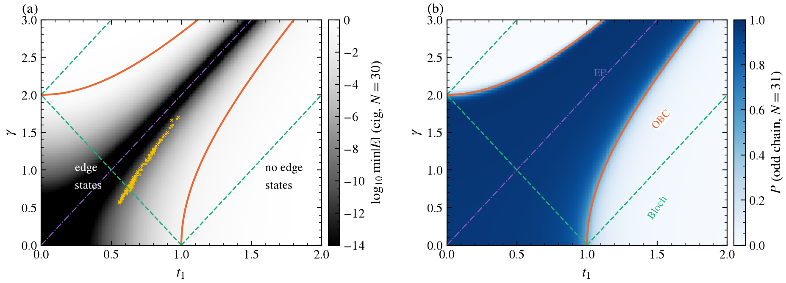
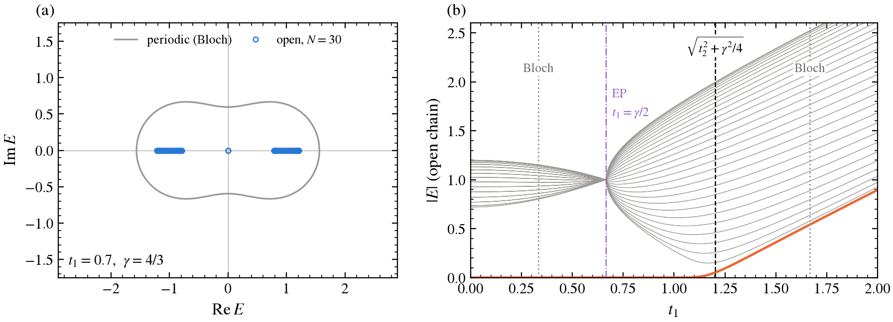
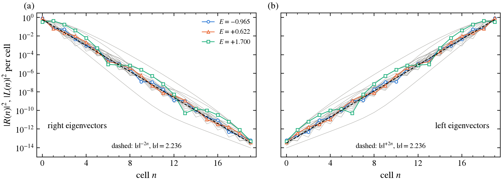
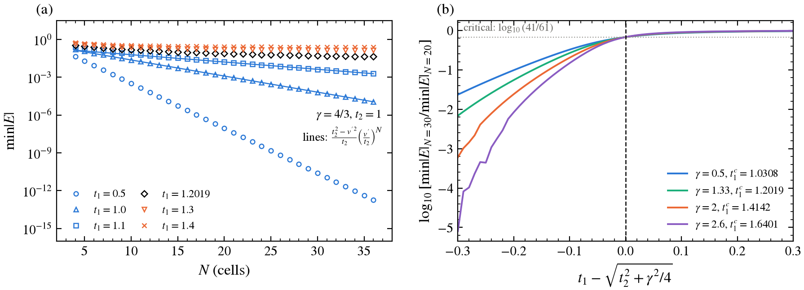
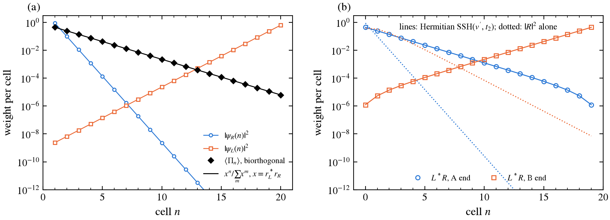
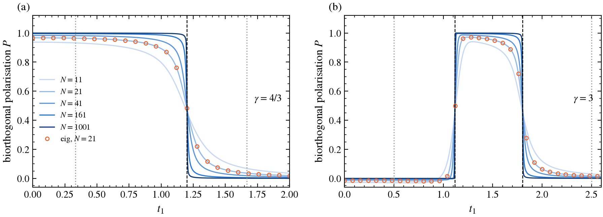
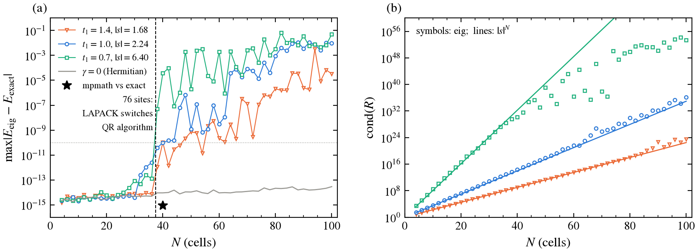

# Non-Hermitian SSH Model

*Skin effect, biorthogonal bulk–boundary correspondence and when `eig` stops being trustworthy.*

<p align="center">
  
</p>

<p align="center">
  <a href="#quick-start">Quick start</a> •
  <a href="#summary-of-results">Results</a> •
  <a href="nh-SSH.pdf">Report (PDF)</a> •
  <a href="#references">References</a>
</p>

A NumPy reproduction of Kunst, Edvardsson, Budich and Bergholtz, *Biorthogonal bulk-boundary correspondence in non-Hermitian systems* (PRL **121**, 026808, 2018). The model is the SSH chain with non-reciprocal intracell hopping. Its open-chain edge states appear and disappear far from where the Bloch bands close. The code shows the mismatch between the periodic and open spectra and the skin effect in the left and right eigenvectors. It maps the open chain exactly onto a Hermitian SSH chain, builds the $(t_1, \gamma)$ phase diagram, and implements the paper's biorthogonal polarisation $P$. All of this is checked against closed forms, and the closed forms are used to find out where the standard eigensolver starts returning wrong answers.

> [!NOTE]
> Every number on this page is produced by `scripts/make_figures.py` and saved in [`figures/results.txt`](figures/results.txt). Every row of the summary table is checked by the named test (48 tests in `tests/`). Derivations and the full report are in [`nh-SSH.pdf`](nh-SSH.pdf).

## Quick start

`nh_ssh` is installed as part of the repository's Poetry environment. pytest is in the `dev` group and mpmath is a main dependency.

```bash
poetry install                                          # from the repository root
poetry run pytest nh-SSH/tests                          # ~1 s
poetry run python nh-SSH/scripts/make_figures.py        # ~35 s on 16 cores, ~18 s of it the mpmath check
poetry run python nh-SSH/scripts/make_figures.py --skip-mpmath
```

Runtimes were measured on an AMD Ryzen 7 7840HS (Python 3.14.7, NumPy 2.4.6, SciPy 1.17.1, OpenBLAS 0.3.31). The `results.txt` header records the versions, because the eigensolver errors in §3.6 depend on the LAPACK build.

## Summary of results

$\gamma = 4/3$, $t_2 = 1$ unless stated.

| Quantity | Result | Expected | Test |
|---|---|---|---|
| Open-chain eigenvalues vs Hermitian SSH$(v', t_2)$, $N \le 20$ | agree to $\le 10^{-14}$ | $< 10^{-10}$ | `test_open_spectrum_equals_hermitian_ssh` |
| Open spectrum at $t_1 = 0.7$ | real, $\mathrm{Im}\,E = 0$ exactly | real (similar to Hermitian) | `test_open_spectrum_equals_hermitian_ssh` |
| Bulk decay factor per cell of right eigenvectors, $N = 12$, $t_1 = 0.7,\ 1.0,\ 1.4$ | $0.1591,\ 0.4508,\ 0.5959$ | $1/\|s\| = 0.1562,\ 0.4472,\ 0.5957$ (within 3%) | `test_skin_decay_factor` |
| Slope of $\ln\min\|E\|$ vs $N$, $t_1 = 1.0$ | $-0.29436$ | $\ln(v'/t_2) = -0.29389$ | `test_min_E_decays_exponentially_below_transition` |
| OBC transition from finite-size crossing, $\gamma = 0.5,\ 4/3,\ 2,\ 2.6$ | $1.0308,\ 1.2019,\ 1.4142,\ 1.6401$ | $\sqrt{t_2^2+\gamma^2/4}$, same to 4 digits | `test_transition_follows_sqrt_formula` |
| Same, from $P(N{=}31) = 1/2$ | within $0.003$ of the formula | | `test_polarization_jumps_at_obc_point_not_bloch` |
| Biorthogonal edge density vs Hermitian SSH density | agree to $\le 3\times10^{-12}$ | $< 10^{-6}$ | `test_biorthogonal_edge_density_matches_hermitian` |
| Polarisation from `eig` vs closed form, $N = 11, 21, 31$ | agree to $7\times10^{-10}$ | | `test_numerical_polarization_matches_closed_form` |
| $P$ at the Bloch values $t_1 = 1/3,\ 5/3$, $N = 1001$ | $0.9993,\ 0.0007$ (no jump) | no jump | `test_polarization_jumps_at_obc_point_not_bloch` |
| Finite-size form of $P$ | $1-P = 1/(N(1-x))$, $P = 1/(N(x-1))$ to $10^{-9}$ | derived, [§4 of derivation](nh-SSH.pdf) | `test_polarization_quantised_with_1_over_N_correction` |
| Second OBC transition for $\gamma > 2t_2$ ($\gamma = 3$) | $t_1 = 1.118$ | $\sqrt{\gamma^2/4 - t_2^2}$ (extension) | `test_second_transition_for_large_gamma` |
| Largest $N$ with `eig` error $< 10^{-10}$, $t_1 = 0.7$ | $N = 37$; error $6\times10^{-14} \to 5\times10^{-8}$ at $N = 38$ | | `test_eig_accurate_below_76_sites`, `test_eig_fails_at_large_N` |
| 60-digit mpmath, $N = 40$, $t_1 = 0.7$ | exact formula agrees to $\le 10^{-15}$; `eig` is off by $3.7\times10^{-5}$ | | `test_imaginary_v_prime_partner_against_mpmath` (smaller case) |

### Corrections to the brief

Details are in the sections below.

1. The similarity transformation needs different factors on the A and B sites of a cell (they differ by $s$), not one factor $s^{-n}$ per cell. With the per-cell version the intracell bond stays non-reciprocal (§1).
2. The point where `eig` fails is set by the matrix size at which LAPACK switches QR algorithm (76 sites here), not by $s^N$ reaching $1/\epsilon$. For 75 sites or fewer the error stays at $10^{-13}$ even at $|s|^N = 10^{48}$ (§3.6).
3. The brief's N = 40 error table is BLAS-dependent. At $t_1 = 1.0$ I measure $1.0\times10^{-10}$, not $2.8\times10^{-8}$. At $N = 60$, $t_1 = 0.7$ the error matches ($2.0\times10^{-3}$), but no spurious imaginary parts appear: all eigenvalues come back exactly real up to $N = 60$. Spurious imaginary parts first appear at $N = 70$ ($t_1 = 0.7$, $2\times10^{-3}$) and $N = 100$ ($t_1 = 1.0$, $9\times10^{-3}$).
4. The decay factor $0.159 \approx 1/s$ belongs to the bulk (skin) eigenvectors. The zero mode itself decays much faster, by $|r_R| = |t_1-\gamma/2|/t_2 = 0.033$ per cell at $t_1 = 0.7$.
5. For $\gamma > 2t_2$ there is a second OBC transition at $t_1 = \sqrt{\gamma^2/4 - t_2^2}$. It is part of Eq. (9) of the paper, but the brief only lists the first.
6. For an even number of A sites, $P$ is undefined at $r_L^* r_R = -1$, where $\langle\psi_L|\psi_R\rangle = 0$. This sits exactly on the second transition. Odd chains avoid it (§3.5).

## 1. The model

Two sites per cell. The intracell hopping is non-reciprocal and the intercell hopping is not:

$$
H = \sum_n \Big[ (t_1 + \tfrac{\gamma}{2})\, c^\dagger_{A,n} c_{B,n} + (t_1 - \tfrac{\gamma}{2})\, c^\dagger_{B,n} c_{A,n} + t_2\,(c^\dagger_{A,n+1} c_{B,n} + c^\dagger_{B,n} c_{A,n+1}) \Big].
$$

This is Eq. (8) of Kunst *et al.*, with $f_\pm = t_1 \mp \gamma/2$ and $g_\pm = t_2$. Sites are ordered $A_0, B_0, A_1, B_1, \dots$, and $H_{ij}$ is the amplitude to hop from $j$ to $i$.

**Bloch Hamiltonian.**

$$
H(k) = \begin{pmatrix} 0 & t_1 + \gamma/2 + t_2 e^{-ik} \\ t_1 - \gamma/2 + t_2 e^{ik} & 0 \end{pmatrix}, \qquad E(k)^2 = (t_1 + \tfrac{\gamma}{2} + t_2 e^{-ik})(t_1 - \tfrac{\gamma}{2} + t_2 e^{ik})
$$

The periodic gap closes where either factor vanishes, $|t_1 \pm \gamma/2| = t_2$. For $\gamma = 4/3$ that is $t_1 = 1/3$ and $5/3$. These are also the exceptional points of $H(k)$.

**Chiral symmetry.** $\Gamma = \mathrm{diag}(1,-1,1,-1,\dots)$ gives $\Gamma H \Gamma = -H$, so the spectrum comes in $\pm E$ pairs and zero modes can sit on one sublattice.

**Left and right eigenvectors.** $H \ne H^\dagger$, so $H|R_n\rangle = E_n|R_n\rangle$ and $H^\dagger|L_n\rangle = E_n^*|L_n\rangle$ are different sets. We normalise them biorthogonally, $\langle L_m|R_n\rangle = \delta_{mn}$. Only the product of the two normalisations is fixed. `biorthogonal_eig` sets $\|R_n\| = 1$ and puts the rest into $L_n$.

## 2. Method

### 2.1 Exact similarity map to a Hermitian chain

A diagonal matrix $D$ with

$$
D_{A,n} = s^{-n}, \quad D_{B,n} = s^{-(n+1)}, \qquad s = \sqrt{\frac{t_1 + \gamma/2}{t_1 - \gamma/2}}, \qquad v' = \sqrt{t_1^2 - \gamma^2/4}
$$

turns the open chain into the Hermitian SSH chain with hoppings $(v', t_2)$: $H_\text{open} = D\, H_\text{SSH}(v', t_2)\, D^{-1}$. The A and B sites of one cell need factors differing by $s$, so that $(t_1 \pm \gamma/2)\,s^{\mp1} = v'$, while $B_n$ and $A_{n+1}$ share a factor so that the $t_2$ bond is untouched. Three consequences follow, all tested:

- **Spectrum**: identical to SSH$(v', t_2)$, so real for $|t_1| > \gamma/2$.
- **Eigenvectors**: $R = D\psi$ grows as $|s|^{-n}$ per cell (all piled up at the left for $|s| > 1$) and $L = D^{-\dagger}\psi$ as $|s|^{+n}$ (piled up at the right).
- **Biorthogonal density**: $L_i^* R_i = |\psi_i|^2$, exactly the Hermitian density.

`exact_open_spectrum` uses this map with `eigvalsh` on the Hermitian partner. That is the reference every eigensolver result is compared with. For $|t_1| < \gamma/2$, $v'$ is imaginary and the partner is complex symmetric. Its eigenvalues are checked against 30-digit mpmath.

### 2.2 Edge states and the transition

Because the spectrum is that of SSH$(v', t_2)$, the results of the SSH project carry over with $v \to v'$. Edge states exist for $|v'| < t_2$, the splitting is $\varepsilon \simeq \frac{t_2^2 - v'^2}{t_2}(v'/t_2)^N$, and the transition is at $|v'| = t_2$:

$$
t_1 = \sqrt{t_2^2 + \gamma^2/4} \quad(= 1.2019 \text{ for } \gamma = 4/3), \qquad t_1 = \sqrt{\gamma^2/4 - t_2^2} \quad(\gamma \ge 2 t_2).
$$

**A parameter-free locator at finite $N$.** At $v' = t_2$ the partner is a uniform chain of $2N$ sites, so $\min|E| = 2t_2\sin\frac{\pi}{2(2N+1)} \propto 1/N$. The ratio $\min|E|_{N=30}/\min|E|_{N=20}$ crosses $\approx 41/61$ exactly at the transition, falls below it on the topological side and rises above it on the trivial side.

**Identifying the edge states.** On the even chain the two modes nearest $E = 0$ are hybridised. `chiral_edge_states` diagonalises $\langle L_i|\Gamma|R_j\rangle$ inside that pair and so separates them by sublattice, not by eigenvalue order. The rotated pair is biorthonormalised again afterwards.

### 2.3 The biorthogonal polarisation

The chain with $N$ A-sites and $N-1$ B-sites (last cell broken) has an exact zero mode for any parameters (Kunst *et al.* Eqs. 3–4):

$$
\psi_R(A, n) \propto r_R^n, \quad r_R = -\frac{t_1 - \gamma/2}{t_2}; \qquad \psi_L(A, n) \propto r_L^n, \quad r_L = -\frac{(t_1 + \gamma/2)^*}{t_2^*}.
$$

The paper's Eq. (7) defines

$$
P = 1 - \lim_{N\to\infty} \frac{1}{N}\,\langle\psi_L|\sum_n n\,\Pi_n|\psi_R\rangle, \qquad \langle\psi_L|\psi_R\rangle = 1,
$$

with $\Pi_n$ the projector onto cell $n = 1, \dots, N$. Since $\langle\Pi_n\rangle \propto x^n$ with $x = r_L^* r_R = (t_1^2 - \gamma^2/4)/t_2^2$, $P = 1$ for $|x| < 1$ and $0$ for $|x| > 1$. The condition $|x| = 1$ is the same as $|v'| = t_2$ above.

`polarization` computes $P$ at finite $N$ from the numerical left and right eigenvectors returned by `scipy.linalg.eig`. It picks the zero mode as the eigenvector with no weight on B, not as the smallest $|E|$. `polarization_exact` evaluates the same expression from the closed form. The leading finite-size correction is derived in [§4 of the derivation](nh-SSH.pdf): $1-P = 1/(N(1-x))$ for $|x|<1$ and $P = 1/(N(x-1))$ for $x > 1$. The test checks it to $10^{-9}$ relative.

### 2.4 Accuracy

Each `eig` result is compared with `exact_open_spectrum`. Large-$N$ spot checks use 60-digit `mpmath.eig`. The condition number of the right-eigenvector matrix, $\mathrm{cond}(R)$, measures how non-normal the matrix is.

## 3. Results

### 3.1 Periodic vs open spectrum



**Figure 1.** (a) Complex spectrum at $t_1 = 0.7$. The periodic spectrum (grey) is a closed loop with $|\mathrm{Im}\,E|$ up to $0.667$. The open chain ($N = 30$, blue) has a real spectrum ($\mathrm{Im}\,E = 0$ exactly) with a zero-mode pair at the origin, nowhere near the loop. (b) $|E|$ of a 30-cell open chain against $t_1$. The two states nearest zero (orange) leave $E = 0$ at the OBC transition $t_1 = 1.2019$ (dashed). Nothing happens at the Bloch gap closings $t_1 = 1/3,\ 5/3$ (dotted). At the exceptional point $t_1 = \gamma/2$ all bulk levels meet at $|E| = t_2$. To its left $v'$ is imaginary and the bulk spectrum is complex.

### 3.2 Skin effect



**Figure 2.** Weight per cell of all 40 eigenvectors of a 20-cell chain at $t_1 = 1.0$ (grey), with three highlighted. (a) Right eigenvectors all pile up at the left end, (b) left eigenvectors at the right end. The dashed lines are $|s|^{\mp 2n}$ with $|s| = \sqrt5 = 2.236$.

| $t_1$ | $1/\|s\|$ | right decay per cell, $N = 12$ | rel. error | left growth per cell | $\|s\|$ |
|---|---|---|---|---|---|
| 0.7 | 0.1562 | 0.1591 | +1.9% | 6.287 | 6.403 |
| 1.0 | 0.4472 | 0.4508 | +0.8% | 2.218 | 2.236 |
| 1.4 | 0.5957 | 0.5959 | +0.0% | 1.678 | 1.679 |

The decay factor is a fit to the summed cell weight of the bulk eigenvectors. Summing averages out the standing-wave oscillations of the individual states. The residual error is the boundary shape of those standing waves, and it halves from $N = 12$ to $N = 20$ (0.8% at $t_1 = 0.7$). The exact statement is sharper: $R_n/\psi_n = c\,D_n$ for every eigenvector, which `test_right_eigenvectors_are_scaled_hermitian_ones` checks to $10^{-8}$.

### 3.3 Open chain vs the exact solution



**Figure 3.** (a) $\min|E|$ against $N$. Below the transition (blue) it decays exponentially; the lines are the SSH splitting formula with $v \to v'$. At the transition (black, $t_1 = 1.2019$) it decays as $1/N$, and above it (orange) it levels off at the gap. (b) The ratio $\min|E|_{30}/\min|E|_{20}$ against the distance from $\sqrt{t_2^2+\gamma^2/4}$, for four values of $\gamma$. All four curves pass through the critical value $\log_{10}(41/61)$ at zero.

| $t_1$ | $\min\|E\|$, $N = 10$ | $N = 20$ | $N = 30$ | |
|---|---|---|---|---|
| 0.5 | $3.3\times10^{-4}$ | $9.2\times10^{-8}$ | $2.6\times10^{-11}$ | edge states ($v'$ imaginary) |
| 1.0 | $2.38\times10^{-2}$ | $1.24\times10^{-3}$ | $6.59\times10^{-5}$ | edge states |
| 1.1 | $7.3\times10^{-2}$ | $1.7\times10^{-2}$ | $4.3\times10^{-3}$ | edge states, $\xi = 7.5$ cells |
| 1.3 | 0.239 | 0.167 | 0.145 | no edge states |
| 1.4 | 0.337 | 0.270 | 0.252 | no edge states |

The $t_1 = 1.0$ and $1.4$ rows reproduce the brief's table. At $t_1 = 0.5$, $N = 40$, $\min|E| = 8\times10^{-15}$, which is round-off (the brief quotes $3\times10^{-13}$). The fitted slopes are $-0.29436$ ($t_1 = 1.0$; $\ln(v'/t_2) = -0.29389$) and $-0.13462$ ($t_1 = 1.1$; $-0.13358$). The finite-size crossing reproduces $\sqrt{t_2^2+\gamma^2/4}$ to four digits at $\gamma = 0.5, 4/3, 2, 2.6$ (1.0308, 1.2019, 1.4142, 1.6401).

### 3.4 Phase diagram


**Figure 4.** (a) $\log_{10}\min|E|$ of a 30-cell open chain from `eig`, on a $201\times151$ grid. Orange: OBC transitions $|t_1^2 - \gamma^2/4| = t_2^2$. Green dashed: Bloch gap closings. Purple: exceptional line $t_1 = \gamma/2$. Yellow crosses: grid points where `eig`'s $\min|E|$ is wrong by more than a factor of 2 (see below). (b) Biorthogonal polarisation from the numerical zero mode of the odd chain ($N = 31$).

The edge-state region is bounded by the OBC curves and cuts straight across the Bloch lines. For $\gamma > 2$ the second branch $t_1 = \sqrt{\gamma^2/4 - t_2^2}$ closes the topological region from the left. $P(N = 31) = 1/2$ falls within $0.003$ of the analytic lines for every $\gamma$ checked:

| $\gamma$ | $P = 1/2$ at $t_1$ | analytic |
|---|---|---|
| 0.50 | 1.028 | 1.031 |
| 1.34 | 1.201 | 1.204 |
| 2.00 | 1.412 | 1.414 |
| 2.60 | 0.832, 1.638 | 0.831, 1.640 |

The offset is the $1/N$ term: at the transition $P_N = 1/2 - 1/(2N)$.

**A trap even at $N = 30$.** The largest eigenvalue error on the whole grid is $1.0\times10^{-8}$, which looks harmless. But the quantity on the plot is the *smallest* $|E|$, and near the exceptional line $\min|E|$ can be $10^{-10}$. At 90 of the 26 308 grid points with exact $\min|E| > 10^{-12}$, `eig` returns a value more than 2× off. The worst case is $10^{-17}$ against an exact $2\times10^{-10}$. An absolute error bound says nothing about the relative accuracy of a tiny eigenvalue. Without the exact solution, these points would look like extra-good edge states.

### 3.5 Edge-state densities and the polarisation



**Figure 5.** (a) Exact zero mode of the odd chain ($N = 20$, $t_1 = 1.0$). $|\psi_R|^2$ decays from the left with $r_R = -1/3$, and $|\psi_L|^2$ grows towards the *right* with $r_L = -5/3$. Each alone suggests a different end. The biorthogonal density $\langle\Pi_n\rangle$ (black diamonds) decays from the left as $x^n$, $x = r_L^* r_R = 0.556$ (line), to $3.4\times10^{-13}$. (b) The two Γ-rotated edge states of the even chain ($N = 20$). $L^*R$ (symbols) lies on the Hermitian SSH$(v', t_2)$ edge densities (lines), with a maximum difference of $2.8\times10^{-12}$. The dotted lines show $|R|^2$ alone, which overstates the localisation of the A-end state and puts the B-end state at the wrong end.



**Figure 6.** Biorthogonal polarisation against $t_1$. Lines: closed form for $N = 11$ to $1001$ (light to dark). Circles: from `eig` at $N = 21$. Dashed: OBC transitions. Dotted: Bloch gap closings. (a) $\gamma = 4/3$. (b) $\gamma = 3$, the parameters of Fig. 1 of the paper, with two OBC transitions at $t_1 = 1.118$ and $1.803$.

| $\gamma$ | $N$ | $P$ at OBC point(s) | $P$ at Bloch points |
|---|---|---|---|
| 4/3 | 21 | 0.476 | 0.964, 0.036 |
| 4/3 | 1001 | 0.4995 | 0.9993, 0.0007 |
| 3 | 21 | 0.476, 0.476 | −0.016, 0.016 |
| 3 | 1001 | 0.4995, 0.4995 | −0.0003, 0.0003 |

$P$ steps between 0 and 1 at the OBC transitions and ignores the Bloch values. The step sharpens as $1/N$, with the prefactor given by the finite-size formula. $P$ from the numerical eigenvectors agrees with the closed form to $7\times10^{-10}$ at $\gamma = 4/3$. At $\gamma = 3$ the agreement is only $3.5\times10^{-5}$, because the norm $\sum x^n$ nearly cancels near $x = -1$.

**A detail the paper does not discuss: even chains at $x = -1$.** At $\gamma = 3$ the lower transition has $x = r_L^* r_R = -1$, not $+1$. For an even number of A sites the biorthogonal norm $\sum_{n=1}^N (-1)^n$ is then zero: $\psi_L$ and $\psi_R$ are biorthogonally orthogonal and cannot be normalised. $P(N = 20)$ is undefined there, and nearby it diverges. For odd $N$ the norm is $-1$ and $P = 1/2 - 1/(2N) = 0.476$ at $N = 21$. This is why the polarisation scans (figs. 4b and 6) use odd $N$. For $x < 0$, $P$ also dips slightly below zero on the trivial side, as $P = 1/(N(x-1))$ predicts.

### 3.6 Numerical accuracy



**Figure 7.** (a) Largest distance from an `eig` eigenvalue to the exact spectrum, against $N$, for three values of $t_1$. Grey: the Hermitian control $\gamma = 0$. Star: 60-digit mpmath at $N = 40$, $t_1 = 0.7$, compared with the exact formula. (b) Condition number of the right-eigenvector matrix (symbols) and $|s|^N$ (lines).

| $t_1$ | $\|s\|$ | error $N = 30$ | $N = 36$ | $N = 38$ | $N = 40$ | $N = 60$ | $N = 100$ |
|---|---|---|---|---|---|---|---|
| 1.4 | 1.68 | $8.0\times10^{-15}$ | $7.1\times10^{-15}$ | $1.1\times10^{-12}$ | $1.0\times10^{-10}$ | $2.2\times10^{-10}$ | $3.4\times10^{-5}$ |
| 1.0 | 2.24 | $3.8\times10^{-15}$ | $2.4\times10^{-12}$ | $3.7\times10^{-11}$ | $1.0\times10^{-10}$ | $3.2\times10^{-9}$ | $9.4\times10^{-3}$ |
| 0.7 | 6.40 | $8.7\times10^{-14}$ | $1.3\times10^{-13}$ | $5.0\times10^{-8}$ | $3.7\times10^{-5}$ | $2.0\times10^{-3}$ | $4.9\times10^{-2}$ |

The brief expects the eigensolver to fail once $s^N$ approaches $1/\epsilon \approx 10^{16}$, i.e. $N \approx 20$ at $t_1 = 0.7$. That is not what happens. $\mathrm{cond}(R)$ does follow $|s|^N$ (panel b, up to $10^{24}$ at $N = 30$), yet the eigenvalues stay accurate to $10^{-13}$. Then all three curves jump together between $N = 37$ and $N = 38$, i.e. between 74 and 76 sites; with the extra site, 75 sites is still fine. LAPACK's `dhseqr` uses the small double-shift QR up to $n = 75$ (the `NMIN` crossover in `iparmq`) and the multishift QR with aggressive early deflation above that. The second algorithm is the one that breaks on these graded matrices. At $t_1 = 0.7$ the error jumps from $6\times10^{-14}$ to $5\times10^{-8}$ over that single step. Above it, the size of the error does grow with $|s|$. The Hermitian control stays below $3\times10^{-14}$ up to $N = 100$.

**Answer to the brief's question.** With NumPy 2.4.6 on OpenBLAS 0.3.31, `eig` is wrong (error $> 10^{-10}$) from $N = 38$ cells at $t_1 = 0.7$. The thresholds are $N = 40$ at $t_1 = 1.4$ and $N = 42$ at $t_1 = 1.0$. At $N = 40$, $t_1 = 0.7$, 60-digit mpmath agrees with the exact formula to $\le 10^{-15}$, and `eig` is off by $3.7\times10^{-5}$. The step is set by a LAPACK tuning parameter, so a different build can move it. That is why the phase diagram uses $N = 30$ and every result here is checked against the exact solution.

## 4. Discussion

1. **Why is $H \neq H^\dagger$ enough to make left and right eigenvectors differ?** $\langle L|$ is a left eigenvector of $H$, i.e. a right eigenvector of $H^\dagger$. If $H^\dagger \neq H$, their eigenvectors differ in general. Here the difference is explicit: $R = D\psi$ and $L = D^{-\dagger}\psi$, and they are equal only when $D$ is unitary, i.e. $|s| = 1$, i.e. $\gamma = 0$.
2. **Why does the Bloch winding fail?** The Bloch Hamiltonian describes plane waves, $|e^{ikn}| = 1$. The open-chain eigenstates are not plane waves: they grow or decay as $|s|^{\mp n}$ (fig. 2). The periodic spectrum (the loop in fig. 1a) is the spectrum of a different operator. The open chain is similar to SSH$(v', t_2)$, so its topology is the winding of $v' + t_2e^{ik}$, which changes at $|v'| = t_2$. In the language of Yao and Wang (the [non-Bloch](../non-Bloch/README.md) project), the open chain lives on the generalised Brillouin zone $|e^{ik}| = 1/|s|$, not on the unit circle.
3. **What does the similarity map do?** It leaves the spectrum unchanged and moves every eigenvector by the same exponential profile $D$. Observables built from $L^*R$ (densities, $P$) don't see $D$ at all. Observables built from $|R|^2$ alone carry the full skin profile.
4. **When not to trust `numpy.linalg.eig`.** When the matrix is strongly non-normal, which is what $\mathrm{cond}(R) \gg 1$ signals. Here that means $10^{24}$ at $N = 30$. Fig. 7 shows that a bound in $\mathrm{cond}(R)$ is too pessimistic below 76 sites and that something else entirely sets the failure above. Fig. 4 shows that even a small absolute error can make the smallest eigenvalue wrong by orders of magnitude. Four things help. Use an exact reference (here, the Hermitian partner) and a high-precision recomputation (mpmath) at a few sizes. Check against $N$ and against algorithm (`eig` vs `schur`), and stay below the size where the check fails.

## 5. What I would ask Dr. Kunst

- **Even chains at $x = -1$.** The norm $\langle\psi_L|\psi_R\rangle$ of the exact zero mode vanishes for even $N$ at $r_L^* r_R = -1$, which is exactly the second transition in Eq. (9). Is $P$ meant to be defined on odd chains only, with the even chain treated by the "both ends map onto $n = 1$" argument? Or is the vanishing norm itself a signature of the transition?
- **Disorder.** For random $t_{1,n}$ the similarity map still exists, with site-dependent $s_n$ and $v'_n$. That suggests the transition moves to $\langle\ln|v'_n|\rangle = \ln t_2$, as in the Hermitian disordered SSH chain. Is $P$ from the numerical zero mode still quantised there, and is the transition really at that condition?
- **The crossover scale $\Gamma_c \propto e^{-\alpha N}$.** For the parameters of Fig. 1 the paper quotes $\alpha \approx 0.58$. My naive guess, $\ln|s| = \ln\sqrt5 = 0.80$, does not match. What sets $\alpha$?
- **Is the biorthogonal density measurable?** $\psi_L$ is not a physical state of the open system. In which experiments (photonic or electric-circuit lattices) is $L^*R$, or $P$, accessible directly rather than through the spectrum?
- **Numerics in larger systems.** For the 2D Chern-insulator example and $N = 46$, the eigenvector condition numbers must be huge. How were the spectra in Fig. 2 checked, and is high-precision arithmetic standard practice in the group?
- **Relation to the GBZ winding.** For this model $P$ and the non-Bloch winding of Yao and Wang give the same phase diagram. Is there a model where they disagree, for example one without an exactly solvable zero mode?

## Project layout

<details>
<summary>Files and what they contain</summary>

```text
nh-SSH/
├── nh_ssh/
│   ├── model.py            H_open (odd/even), H_bloch, Bloch closings, v', s, similarity D, partner chain
│   ├── spectrum.py         biorthogonal eig, exact spectrum, errors, cond(R), skin decay, chiral edge states
│   └── polarization.py     r_R, r_L, exact zero mode, biorthogonal density, P (numerical, closed form, limit)
├── tests/                  48 pytest tests, one per claim
├── scripts/make_figures.py figures and figures/results.txt
├── figures/
├── docs/
│   └── report.tex          LaTeX source of nh-SSH.pdf
└── nh-SSH.pdf              the project report
```

</details>

## References

1. F. K. Kunst, E. Edvardsson, J. C. Budich, E. J. Bergholtz, *Biorthogonal bulk-boundary correspondence in non-Hermitian systems*, Phys. Rev. Lett. **121**, 026808 (2018), arXiv:1805.06492.
2. S. Yao, Z. Wang, *Edge states and topological invariants of non-Hermitian systems*, Phys. Rev. Lett. **121**, 086803 (2018).
3. E. J. Bergholtz, J. C. Budich, F. K. Kunst, *Exceptional topology of non-Hermitian systems*, Rev. Mod. Phys. **93**, 015005 (2021).
4. D. C. Brody, *Biorthogonal quantum mechanics*, J. Phys. A **47**, 035305 (2014).
5. T. E. Lee, *Anomalous edge state in a non-Hermitian lattice*, Phys. Rev. Lett. **116**, 133903 (2016).
6. V. M. Martinez Alvarez, J. E. Barrios Vargas, L. E. F. Foa Torres, *Non-Hermitian robust edge states in one dimension: anomalous localization and eigenspace condensation at exceptional points*, Phys. Rev. B **97**, 121401(R) (2018).
7. L. N. Trefethen, M. Embree, *Spectra and Pseudospectra*, Princeton University Press (2005).
8. K. Braman, R. Byers, R. Mathias, *The multishift QR algorithm. Part II: Aggressive early deflation*, SIAM J. Matrix Anal. Appl. **23**, 948 (2002).
