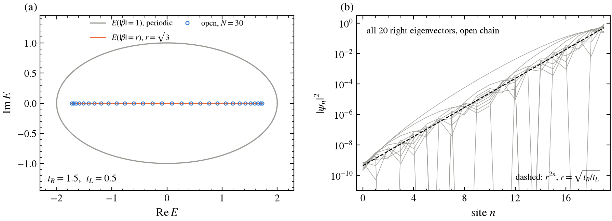
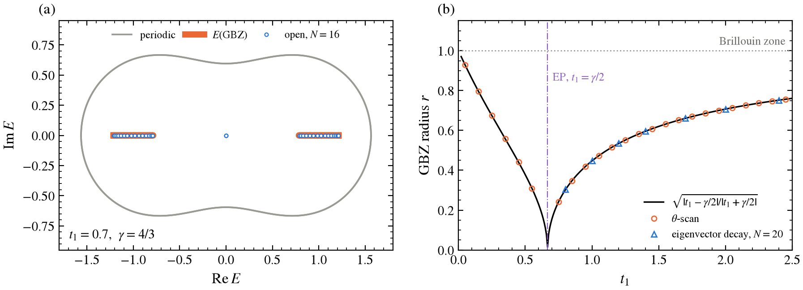
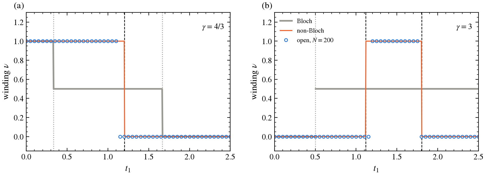
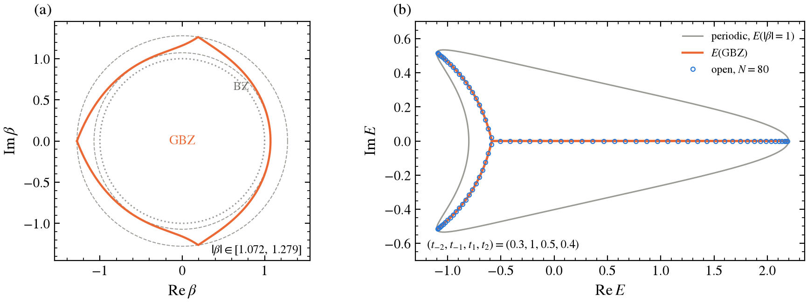
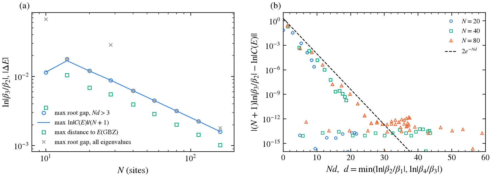
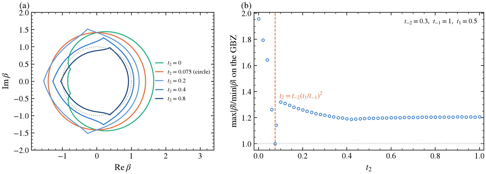
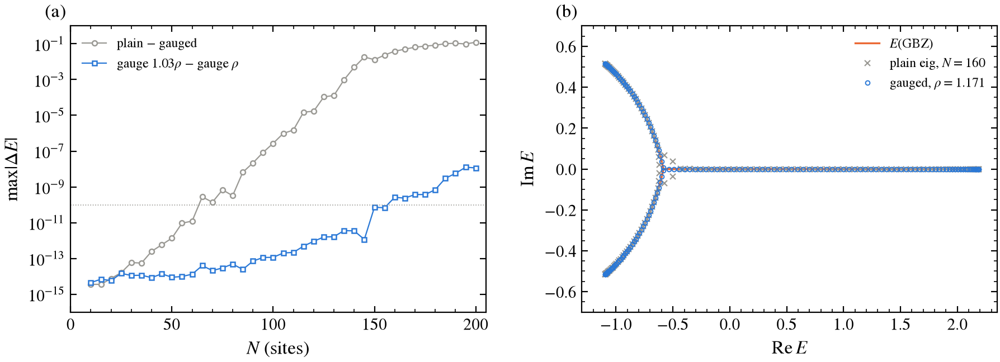

# Non-Bloch Band Theory
### Generalised Brillouin zone, non-Bloch winding number, and how far the open spectrum sits from E(GBZ)

Bloch's theorem fails for chains with a non-Hermitian skin effect: the open-chain eigenstates grow or decay as $\beta^n$ with $|\beta| \neq 1$, and the periodic spectrum has little to do with the open one. Non-Bloch band theory (Yao and Wang 2018, Yokomizo and Murakami 2019) replaces the Brillouin zone $|\beta| = 1$ by the generalised Brillouin zone (GBZ), the curve on which the open-chain continuum lives. This project computes the GBZ with one root-finding code for three chains: Hatano–Nelson, the non-reciprocal SSH chain of the previous project, and a single-band chain with second-neighbour hopping whose GBZ is not a circle. It checks that the non-Bloch winding number counts the open-chain edge states where the Bloch winding does not. It also derives and verifies the leading finite-size term: how far the eigenvalues of an $N$-site chain sit from $E(\mathrm{GBZ})$, with no fitted parameter.

Every number on this page is produced by `scripts/make_figures.py` and saved in [`figures/results.txt`](figures/results.txt). Every row of the summary table is checked by the named test (56 tests in `tests/`). Derivations and the full report are in [`non-Bloch.pdf`](non-Bloch.pdf).

---

## Summary of results

| Quantity | Result | Expected | Test |
|---|---|---|---|
| Hatano–Nelson GBZ radius from the θ-scan, three $(t_R, t_L)$ | $\sqrt{t_R/t_L}$ to $\le 2\times10^{-15}$ | $< 10^{-10}$ | `test_hatano_nelson_gbz_radius` |
| HN eigenvector growth per site, $N = 12, 20, 30$ | $1.7321$ | $r = \sqrt3 = 1.7321$ | `test_hatano_nelson_eigenvectors_are_r_n_times_sines` |
| NH-SSH GBZ radius from the θ-scan, $t_1 = 0.3 \dots 2.0$ | equal to $\sqrt{\|t_1-\gamma/2\|/\|t_1+\gamma/2\|}$ in all 12 printed digits | same | `test_nh_ssh_gbz_radius` |
| NH-SSH: roots at the bulk open-chain eigenvalues ($E$-scan), $N = 40$ | $\|\beta_{1,2}\| = r$ to $\le 10^{-15}$ | $r$ | `test_nh_ssh_scan_of_open_eigenvalues` |
| $\nu_\text{non-Bloch}$ vs zero-mode pairs of the open chain ($N = 200$), 1001 values of $t_1$ at $\gamma = 4/3, 3$ | equal everywhere except 37 points within 0.072 of a transition | equal | `test_nonbloch_winding_counts_edge_states` |
| $\nu_\text{Bloch}$ at the same points | $1/2$ between the Bloch gap closings; differs from $\nu_\text{non-Bloch}$ at 665 points | | same test |
| $\gamma = 0$ | GBZ $= $ unit circle, $\nu = $ project-1 winding | same | `test_hermitian_limit_reduces_to_project_1` |
| Range-2 chain, $(t_{-2}, t_{-1}, t_1, t_2) = (0.3, 1, 0.5, 0.4)$: max/min $\|\beta\|$ on the GBZ | $1.2786/1.0719 = 1.193$ | $> 1$ (not a circle) | `test_range2_gbz_is_not_a_circle` |
| Range-2, $N = 80$: max distance of open eigenvalues to $E(\mathrm{GBZ})$ | $2.0\times10^{-3}$ (to $E(\text{unit circle})$: $0.44$) | $\to 0$ | `test_range2_open_spectrum_converges_as_1_over_N` |
| Exponent of the max root gap vs $N$, $N \ge 40$ | $-0.980$ | $-1$ | same test |
| $(N+1)\ln\|\beta_3/\beta_2\|$ vs $\ln\|C(E)\|$ per eigenvalue | median agreement $\le 10^{-12}$ for $N \ge 56$; each within $2e^{-Nd}$ | derived, [§4 of derivation](non-Bloch.pdf) | `test_finite_size_gap_matches_boundary_prediction` |
| $t_2$ scan: GBZ circular only at | $t_2 = 0.075$, max/min $= 1.000000000000$ | $t_{-2}(t_1/t_{-1})^2 = 0.075$ | `test_circular_negative_control` |
| `eig` error vs 40-digit mpmath, $N = 100$ | plain $2.7\times10^{-7}$; gauged $\le 10^{-13}$ | | `test_gauged_eig_matches_mpmath`, `test_plain_eig_drifts_at_N_100` |

**Corrections to the brief** (details in the sections below):

1. The non-Bloch winding is $\nu = 1$ for $|t_1^2 - \gamma^2/4| < t_2^2$, with an absolute value. The brief's $t_1^2 - \gamma^2/4 < t_2^2$ misses the second transition at $t_1 = \sqrt{\gamma^2/4 - t_2^2}$ for $\gamma > 2t_2$. At $\gamma = 3$, $t_1 = 0.9$ it predicts $\nu = 1$, but $\nu = 0$ and the open chain has no zero modes (§3.3).
2. The Bloch winding in the mismatch region is not a wrong integer, it is $1/2$. Exactly one of $h_1, h_2$ has its zero on the wrong side of the unit circle (§3.3).
3. Hatano–Nelson direction: with $E(\beta) = t_R\beta^{-1} + t_L\beta$ and $t_R$ the hop to the right, the GBZ radius is $\sqrt{t_R/t_L}$, not its inverse. For $t_R > t_L$ every eigenvector grows towards the right end (fig. 1b).
4. The quoted decay factor $0.159$ vs $0.156$ is right, but only at $N = 12$. At $N = 20$ the fit gives $0.1575$; the exact GBZ radius is $0.15617$. The gap is the boundary shape of the standing waves.
5. For one band no resultant is needed. $E$ is an explicit function of $\beta$, so the θ-scan equation is just $E(\beta) = E(\beta e^{i\theta})$. The two-band chiral chain reduces to the same form in $\lambda = E^2$.
6. "$N \le 20$" is more cautious than needed here. Plain `eig` stays below $10^{-10}$ up to $N = 60$ for the range-2 chain. After a diagonal gauge transform to the GBZ's mean radius it is accurate to $\le 10^{-13}$ at $N = 100$ against mpmath (§3.7).

---

## 1. Models and conventions

Single band, sites $n = 1, \dots, N$, with $H_{n,n+k} = t_k$, so that $t_{-k}$ moves a particle $k$ sites to the right. The plane wave $\psi_n = \beta^n$ gives

$$
E(\beta) = \sum_{k=-p}^{q} t_k \beta^k ,
$$

and $\beta^p\,[E(\beta) - E]$ is a polynomial with $p+q$ roots, sorted as $|\beta_1| \le \dots \le |\beta_{p+q}|$.

| Model | $E(\beta)$ | $p, q$ |
|---|---|---|
| Hatano–Nelson | $t_R\beta^{-1} + t_L\beta$ | 1, 1 |
| Range-2 chain | $t_{-2}\beta^{-2} + t_{-1}\beta^{-1} + t_1\beta + t_2\beta^2$ | 2, 2 |
| NH-SSH, in $\lambda = E^2$ | $h_1 h_2 = t_2(t_1-\tfrac\gamma2)\beta^{-1} + (t_1^2 - \tfrac{\gamma^2}{4} + t_2^2) + t_2(t_1+\tfrac\gamma2)\beta$ | 1, 1 |

The non-reciprocal SSH chain is the one from the previous project, $H_{AB}(\beta) = h_1 = t_1 + \gamma/2 + t_2/\beta$ and $H_{BA}(\beta) = h_2 = t_1 - \gamma/2 + t_2\beta$, with $\gamma = 4/3$ and $t_2 = 1$ unless stated. Because $\det[H(\beta) - E] = E^2 - h_1h_2$, the two-band chiral problem is a one-band problem in $\lambda = E^2$, and the same GBZ code applies. `test_ssh_lambda_is_h1_h2_and_matches_project_3` ties this to `nh_ssh.bloch_energies`.

---

## 2. Method

### 2.1 GBZ from the θ-scan

The open-chain continuum is the set of $E$ with $|\beta_p(E)| = |\beta_{p+1}(E)|$, and the GBZ is the set of those two roots. Following Yokomizo and Murakami, for each $\theta \in (0, 2\pi)$ solve

$$
E(\beta) = E(\beta e^{i\theta}) \quad\Longleftrightarrow\quad \sum_k t_k\,(1 - e^{ik\theta})\,\beta^{k+p} = 0 ,
$$

a polynomial of degree $p+q$. Each root $\beta$ is a candidate: compute $E(\beta)$, find all $p+q$ roots there, and keep $\beta$ if exactly $p-1$ roots are smaller in modulus and $q-1$ larger. Counting avoids picking the wrong "middle two" when roots are nearly degenerate. The θ grid is clustered at $0$ and $2\pi$, where the pair merges at the branch points. `gbz_points` is the only GBZ code; it is used for all three models.

### 2.2 Winding numbers

$\nu = (W[h_2] - W[h_1])/2$, with $W$ the winding of $h_i(\beta)$ around $0$ as $\beta$ runs counter-clockwise around $|\beta| = r$. $r = 1$ gives the Bloch winding and $r = \sqrt{|t_1-\gamma/2|/|t_1+\gamma/2|}$ the non-Bloch one. `winding` sums wrapped phase increments over 2001 points and returns NaN if a zero of $h_i$ lies on the contour. It locates the zeros exactly, because a sampled $\min|h|$ misses a zero that falls between grid points. `winding_by_counting` uses the argument principle (zeros inside minus pole order) as an independent check. The sign is fixed by $\nu = 1$ for $\gamma = 0$, $t_1 < t_2$.

The edge-state count comes from the previous project: the number of $\pm E$ pairs with $|E| < 10^{-8}$ in the exact open spectrum (`nh_ssh.exact_open_spectrum`, via the similar Hermitian chain) at $N = 200$.

### 2.3 The leading finite-size term

An open eigenvector is $\psi_n = \sum_j c_j\beta_j^n$, which must vanish on $p$ sites left of the chain and $q$ sites right of it. Expanding that determinant and keeping its two largest terms ([derivation §4](non-Bloch.pdf)) gives

$$
(N+1)\,\ln\left|\frac{\beta_{p+1}(E)}{\beta_p(E)}\right| = \ln|C(E)| ,
$$

where $C(E)$ is a ratio of small minors built from the roots at $E$ (`boundary_log_ratio`). The left side is $(N+1)$ times the "root gap" that vanishes on $E(\mathrm{GBZ})$. So each eigenvalue misses the continuum by $\ln|C(E)|/(N+1)$, with no free parameter. The neglected terms are of order $e^{-Nd}$, where $d = \min(\ln|\beta_p/\beta_{p-1}|, \ln|\beta_{p+2}/\beta_{p+1}|)$ measures how far the next root is. For Hatano–Nelson $C = 1$ exactly.

### 2.4 Accuracy and the imaginary gauge

$D = \mathrm{diag}(\rho^n)$ maps $t_k \to t_k\rho^k$, i.e. $E(\beta) \to E(\rho\beta)$. It leaves the eigenvalues unchanged and divides the GBZ by $\rho$. For a circular GBZ, $\rho = r$ removes the skin effect entirely (this is the similarity map of the previous project). For the range-2 chain, $\rho = \sqrt{\min|\beta|\max|\beta|} = 1.1707$ removes everything except the non-circular part. `H_obc(N, chain, rho)` builds the gauged matrix. The gauged eigenvalues are checked against 40-digit `mpmath.eig` at $N = 40, 60, 80, 100$ and against a second gauge $1.03\rho$ at every $N$.

---

## 3. Results

### 3.1 Hatano–Nelson



**Figure 1.** $t_R = 1.5$, $t_L = 0.5$. (a) The periodic spectrum $E(|\beta| = 1)$ is an ellipse (grey). $E$ on the GBZ circle $|\beta| = \sqrt3$ collapses onto the segment $[-2\sqrt{t_Rt_L}, 2\sqrt{t_Rt_L}]$ (orange), and the 30 open-chain eigenvalues lie on it. (b) $|\psi_n|^2$ of all 20 right eigenvectors of a 20-site open chain. All of them grow towards the right end as $r^{2n}$ (dashed).

The θ-scan gives the radius $\sqrt{t_R/t_L}$ to $\le 2\times10^{-15}$ for $(t_R, t_L) = (1.5, 0.5),\ (0.4, 1.0),\ (2.0, 0.1)$. The open eigenvalues are exactly $2\sqrt{t_Rt_L}\cos\frac{\pi m}{N+1}$, and $\psi_n/r^n$ are the orthonormal sine vectors (checked to $10^{-8}$). A fit to the summed eigenvector weight gives a growth of $1.7321 = \sqrt3$ per site at $N = 12, 20, 30$. Even this simplest chain is non-normal: `eig` at $N = 30$ is already off by $7\times10^{-11}$, because $r^N = 3^{15}$.

### 3.2 Non-reciprocal SSH chain



**Figure 2.** (a) $t_1 = 0.7$, $\gamma = 4/3$. Grey: periodic spectrum, a closed loop. Orange: $E = \pm\sqrt{\lambda(\beta)}$ on the GBZ, two real segments. Circles: exact open spectrum ($N = 16$), on the segments, plus the zero-mode pair at the origin. (b) GBZ radius against $t_1$. Line: $\sqrt{|t_1-\gamma/2|/|t_1+\gamma/2|}$. Circles: θ-scan. Triangles: decay per cell of the bulk right eigenvectors, from `nh_ssh.skin_decay_factor`. At the exceptional point $t_1 = \gamma/2$ the GBZ shrinks to $\beta = 0$.

The product of the two roots of the quadratic is $(t_1-\gamma/2)/(t_1+\gamma/2)$ at every $E$, so equal moduli force the circle. The θ-scan reproduces it in all 12 printed digits at $t_1 = 0.3, 0.7, 1.0, 1.4, 2.0$, including $t_1 = 0.3 < \gamma/2$ where $v'$ is imaginary. Scanning $E$ over the bulk open eigenvalues ($N = 40$) gives $|\beta_1| = |\beta_2| = r$ to $\le 10^{-15}$. The zero modes are not on the continuum: their root gap is finite.

On the circle, $\lambda(re^{i\varphi}) = |v' + t_2e^{i\varphi}|^2$ with $v' = \sqrt{t_1^2 - \gamma^2/4}$. $E(\mathrm{GBZ})$ is therefore exactly the band of the Hermitian SSH$(v', t_2)$ chain that the previous project found by a similarity map. The two pictures are the same statement. $r = 1/|s|$, and the decay factor quoted in the brief belongs here:

| $t_1$ | $r$ (GBZ) | decay per cell, $N = 12$ | $N = 20$ |
|---|---|---|---|
| 0.7 | 0.1562 | 0.1591 | 0.1575 |

### 3.3 Bloch vs non-Bloch winding



**Figure 3.** Winding numbers against $t_1$. Grey: Bloch ($|\beta| = 1$). Orange: non-Bloch (GBZ). Circles: number of zero-mode pairs of the open chain, $N = 200$. Dashed: OBC transitions $|t_1^2 - \gamma^2/4| = t_2^2$. Dotted: Bloch gap closings. (a) $\gamma = 4/3$. (b) $\gamma = 3$, two OBC transitions.

| $(t_1, \gamma)$ | $\nu_\text{Bloch}$ | $\nu_\text{non-Bloch}$ | zero-mode pairs, $N = 200$ | $\min\|E\|$ |
|---|---|---|---|---|
| (0.2, 4/3) | 1 | 1 | 1 | $3\times10^{-17}$ |
| (0.7, 4/3) | 1/2 | 1 | 1 | $3\times10^{-17}$ |
| (1.0, 4/3) | 1/2 | 1 | 1 | $3\times10^{-16}$ |
| (1.3, 4/3) | 1/2 | 0 | 0 | 0.12 |
| (2.0, 4/3) | 0 | 0 | 0 | 0.89 |
| (0.9, 3) | 1/2 | 0 | 0 | 0.67 |
| (1.4, 3) | 1/2 | 1 | 1 | $4\times10^{-16}$ |
| (2.2, 3) | 1/2 | 0 | 0 | 0.61 |

On 501 points ($\gamma = 4/3$) and 500 points ($\gamma = 3$), $\nu_\text{non-Bloch}$ equals the zero-mode count except at 13 and 24 points. All of these lie within $0.062$ and $0.072$ of a transition, where the edge-state splitting at $N = 200$ has not yet dropped below the $10^{-8}$ threshold. The Bloch winding disagrees with the open chain at 267 and 398 of the points.

Counting zeros explains it. $h_2$ has a zero at $|\beta| = |t_1-\gamma/2|/t_2$, and $h_1$ has one at $t_2/|t_1+\gamma/2|$ plus a pole at $0$. At $t_1 = 1$: $0.333$ and $0.600$. The unit circle encloses both zeros: $W[h_2] = 1$, $W[h_1] = 0$, $\nu = 1/2$. The GBZ circle ($r = 0.447$) separates them: $W[h_2] = 1$, $W[h_1] = -1$, $\nu = 1$. In general $\nu = 1$ exactly when $|t_1^2 - \gamma^2/4| < t_2^2$ ([derivation §3](non-Bloch.pdf)). With the absolute value, this includes the lower transition at $\sqrt{\gamma^2/4 - t_2^2} = 1.118$ for $\gamma = 3$, which the brief's formula does not.

### 3.4 A non-circular GBZ



**Figure 4.** $(t_{-2}, t_{-1}, t_1, t_2) = (0.3, 1, 0.5, 0.4)$. (a) GBZ in the $\beta$-plane (orange), between the circles $|\beta| = 1.0719$ and $1.2786$ (dashed). Dotted: Brillouin zone. (b) Periodic spectrum (grey), $E(\mathrm{GBZ})$ (orange) and the open chain at $N = 80$ (blue, gauged `eig`, §3.7).

The GBZ is not a circle: $|\beta|$ varies by a factor of $1.193$ along it. It has three cusps, at the largest $|\beta|$. At a cusp $E = -0.583$, and the root moduli there are $(0.3585, 1.2786, 1.2786, 1.2794)$: a third root is within 0.1%. The cusps are where the three arcs of $E(\mathrm{GBZ})$ meet, at the junction near $E = -0.58$ in panel (b). At $N = 80$ the open eigenvalues lie within $2.0\times10^{-3}$ of $E(\mathrm{GBZ})$ and $0.44$ from the periodic loop.

### 3.5 How fast the open spectrum reaches E(GBZ)



**Figure 5.** (a) Largest root gap $\ln|\beta_3/\beta_2|$ of the open eigenvalues against $N$ (circles, eigenvalues with $Nd > 3$), the prediction $\max\ln|C(E)|/(N+1)$ (line), the largest distance in the $E$-plane to $E(\mathrm{GBZ})$ (squares), and the largest root gap over all eigenvalues (crosses). (b) $|(N+1)\cdot\text{gap} - \ln|C(E)||$ for every eigenvalue against $Nd$, at $N = 20, 40, 80$. Dashed: $2e^{-Nd}$.

| $N$ | eigenvalues with $Nd > 3$ | max gap | $\max\ln\|C\|/(N+1)$ | max $E$-distance |
|---|---|---|---|---|
| 20 | 17/20 | $1.203\times10^{-2}$ | $1.194\times10^{-2}$ | $6.9\times10^{-3}$ |
| 40 | 38/40 | $6.210\times10^{-3}$ | $6.210\times10^{-3}$ | $3.9\times10^{-3}$ |
| 80 | 78/80 | $3.161\times10^{-3}$ | $3.161\times10^{-3}$ | $2.0\times10^{-3}$ |
| 160 | 158/160 | $1.595\times10^{-3}$ | $1.595\times10^{-3}$ | $1.0\times10^{-3}$ |

The brief asks for agreement "within finite-size error that shrinks with $N$". The error can be stated exactly. Every eigenvalue misses the GBZ condition by $\ln|C(E)|/(N+1)$, where $C$ comes from the roots alone. Panel (b) shows the residual falling as $e^{-Nd}$ until it hits round-off at $10^{-13}$. The median agreement is $\le 10^{-12}$ for $N \ge 56$. The fitted exponent of the max gap (and of the $E$-distance) for $N \ge 40$ is $-0.980$. It is not exactly $-1$ because the eigenvalues creep towards the junction, where $|C|$ is largest.

**The junction converges more slowly.** One or two eigenvalues sit next to the junction, where $d \to 0$ and the two-term formula does not apply. Including them, the exponents are $-0.910$ (gap) and $-0.760$ ($E$-distance). At $N = 160$ the worst eigenvalue has gap $1.80\times10^{-3}$ instead of $1.595\times10^{-3}$. A three-term version of §2.3 would be needed there. I have not done that.

### 3.6 Deforming the GBZ



**Figure 6.** $t_{-2} = 0.3$, $t_{-1} = 1$, $t_1 = 0.5$, varying $t_2$. (a) GBZ for five values of $t_2$. At $t_2 = 0$ the chain has $q = 1$ and three roots. (b) max/min $|\beta|$ along the GBZ against $t_2$, from 52 θ-scans. Dashed: predicted circular point.

A diagonal gauge maps $t_k \to t_k\rho^k$. If one $\rho$ makes every pair reciprocal, $t_k\rho^k = t_{-k}\rho^{-k}$, the roots come in pairs $(x, 1/x)$ and the GBZ is exactly the circle $|\beta| = \rho$. For range 2 that needs $t_2 = t_{-2}(t_1/t_{-1})^2 = 0.075$, with $\rho = \sqrt{t_{-1}/t_1} = \sqrt2$. The scan finds max/min $= 1.000000000000$ at $t_2 = 0.075$ and nowhere else. On either side the GBZ grows cusps quickly:

| $t_2$ | 0 | 0.075 | 0.2 | 0.4 | 0.8 | 1.0 |
|---|---|---|---|---|---|---|
| max/min $\|\beta\|$ | 1.958 | 1.000 | 1.259 | 1.193 | 1.205 | 1.206 |

Below $t_2 = 0.075$ the GBZ develops inward kinks on the left (the $t_2 = 0$ curve). Above it, the cusps point outwards and the curve shrinks through the unit circle towards $|\beta| < 1$, since the leftward hops now dominate.

### 3.7 Numerical accuracy



**Figure 7.** (a) Grey: largest distance between plain `eig` and the gauged eigenvalues ($\rho = 1.171$). Blue: gauge $1.03\rho$ against gauge $\rho$, a consistency check of the gauged result. Stars: both against 40-digit mpmath. (b) $N = 160$: plain `eig` (grey crosses) scatters off $E(\mathrm{GBZ})$ near the junction, while the gauged eigenvalues (blue) stay on it.

| $N$ | plain vs mpmath | gauged vs mpmath | gauge vs gauge |
|---|---|---|---|
| 40 | $2.5\times10^{-13}$ | $1.0\times10^{-14}$ | $8.4\times10^{-15}$ |
| 60 | $1.2\times10^{-11}$ | $8.2\times10^{-15}$ | $1.3\times10^{-14}$ |
| 80 | $3.2\times10^{-10}$ | $1.6\times10^{-14}$ | $4.9\times10^{-14}$ |
| 100 | $2.7\times10^{-7}$ | $7.5\times10^{-14}$ | $1.2\times10^{-13}$ |
| 160 | | | $2.6\times10^{-10}$ |

Plain `eig` passes $10^{-10}$ at $N = 65$ and reaches $0.04$ by $N = 160$. With the gauge, the error against mpmath is $\le 10^{-13}$ up to $N = 100$; beyond that, the two gauges agree to $10^{-12}$ up to $N = 120$ and first differ by more than $10^{-10}$ at $N = 160$. That limit is set by the non-circular part of the GBZ, which no diagonal gauge can remove. Unlike the NH-SSH chain of the previous project, I see no step at the 75-site LAPACK crossover here: the plain error grows smoothly. All finite-size results in §3.5 use the gauged matrix at $N \le 160$.

---

## 4. Discussion

**What breaks if you use the unit circle?** Three things, all visible above. The spectrum: $E(|\beta| = 1)$ is a loop enclosing area, while the open chain lives on arcs inside it (figs. 1a, 2a, 4b; $0.44$ away at $N = 80$). The eigenvectors: every bulk state is $\beta^n$ with $|\beta| \ne 1$, piled at one end (fig. 1b). The topology: the Bloch winding is $1/2$ over most of the phase diagram and changes at the Bloch gap closings, where nothing happens to the open chain (fig. 3).

**When does the GBZ reduce to the unit circle?** The GBZ is a circle of radius $\rho$ whenever a diagonal gauge $\psi_n \to \rho^n\psi_n$ makes the chain reciprocal, $t_k\rho^k = t_{-k}\rho^{-k}$ for every $k$. Then $E(\rho\beta) = E(\rho/\beta)$, roots pair as $(x, 1/x)$, and the condition $|x_p| = |x_{p+1}|$ forces $|x| = 1$. It is the **unit** circle when $\rho = 1$ works, i.e. the chain is already reciprocal, $t_k = t_{-k}$. Hermitian chains with real hoppings are the familiar case. For nearest-neighbour single-band chains (Hatano–Nelson) and for the chiral SSH chain in $\lambda = E^2$, a gauge always exists, so their GBZs are always circles, of radius $\sqrt{|t_R/t_L|}$ and $1/|s|$. A circle of radius $\ne 1$ means a skin effect that one exponential profile removes completely. With longer-range hopping, reciprocity needs one condition per extra range ($t_2 = t_{-2}(t_1/t_{-1})^2$ here), so a generic chain has a non-circular GBZ (fig. 6). In spectral terms, the GBZ is the unit circle exactly when the periodic spectrum encloses no area, i.e. has zero spectral winding about every $E$, which is the criterion for no skin effect of Okuma *et al.* and Zhang, Yang and Fang.

**Interview questions from the brief.**

1. *BZ vs GBZ.* The BZ is $|\beta| = 1$, the set of plane waves allowed by translation invariance with periodic boundaries. The GBZ is the curve of $\beta$ that build the open-chain eigenstates, fixed by the condition $|\beta_p| = |\beta_{p+1}|$. They coincide for reciprocal chains.
2. *Why does the product of roots fix the radius at $E = 0$?* For a quadratic in $\beta$ the product of roots is the ratio of the outer coefficients, $(t_1-\gamma/2)/(t_1+\gamma/2)$. It contains no $E$ at all, not only at $E = 0$. Equal moduli then leave one choice, $|\beta| = \sqrt{|\text{product}|}$.
3. *Similarity transforms.* $D^{-1}HD$ has the same characteristic polynomial, so the same eigenvalues, but eigenvectors $D^{-1}\psi$. A diagonal $D = \mathrm{diag}(\rho^n)$ maps $\beta \to \beta/\rho$ and so rescales the GBZ. When the GBZ is a circle, one such $D$ maps it onto the BZ and turns the problem Hermitian (previous project). When it is not a circle, no diagonal $D$ can do that. That is also why a gauge improves `eig` but cannot fix it at arbitrary $N$ (§3.7).
4. *When do Bloch and non-Bloch windings agree?* When no zero of $h_1$ or $h_2$ lies between the unit circle and the GBZ. Here: $t_1 < 1/3$ and $t_1 > 5/3$ at $\gamma = 4/3$, or everywhere when $\gamma = 0$.

## 5. What I would ask

- **Junctions.** Near the point where three arcs of $E(\mathrm{GBZ})$ meet, the eigenvalues converge more slowly than $1/N$ (§3.5). Is the right description a three-root version of the boundary determinant, and does it give a different power of $N$ there?
- **Two bands without chiral symmetry.** For the SSH chain the problem reduces to one band in $E^2$. For a generic two-band chain the θ-scan needs a genuine resultant in $E$. How do the auxiliary GBZ methods (Yang, Zhang, Fang, Hu 2020) compare in practice with the θ-scan?
- **Disorder.** With random hoppings there is no GBZ. Does the gauge argument (the mean of $\ln|t_R/t_L|$) still predict where the skin modes pile up and where the edge states vanish?
- **Measurement.** In topolectrical circuits or photonic lattices, is the GBZ itself accessible, e.g. from the measured spatial decay of driven modes, or only through the spectrum?
- **Coupled cavities.** For a driven-dissipative chain of cavities with non-reciprocal coupling, the response is set by the Green's function, not the spectrum. Does the GBZ (or the unit circle) control the amplification of a long chain, and how do the two windings show up in it?

---

## Project layout

```
non-Bloch/
├── non_bloch/
│   ├── model.py      Laurent polynomial E(beta), HN / range-2 / NH-SSH symbols, open Toeplitz matrix with gauge, circular criterion
│   ├── gbz.py        characteristic roots, theta-scan GBZ, root gap, boundary term ln|C(E)|, curve distance
│   └── winding.py    wrap, phase-sum and zero-counting windings, Bloch / non-Bloch nu, edge-state count
├── tests/            56 pytest tests, one per claim
├── scripts/make_figures.py   figures and figures/results.txt
├── figures/
├── docs/
│   └── report.tex     LaTeX source of non-Bloch.pdf
└── non-Bloch.pdf      the project report
```

`non_bloch` imports `nh_ssh` (exact open spectrum, skin decay) from the previous project. The tests also import `ssh_model` (project-1 winding) for the Hermitian limit.

## Running

```bash
poetry install                                           # from the repository root
poetry run pytest non-Bloch/tests                        # ~7 s
poetry run python non-Bloch/scripts/make_figures.py      # ~65 s on 16 cores the first time, ~30 s with the mpmath cache
poetry run python non-Bloch/scripts/make_figures.py --skip-mpmath
```

Runtimes measured on an AMD Ryzen 7 7840HS (Python 3.14.7, NumPy 2.4.6, SciPy 1.17.1, OpenBLAS 0.3.31). The 40-digit mpmath references take ~36 s and are cached in `figures/mpmath_ref.npz` (git-ignored). Two runs of the script give identical `results.txt` files.

## References

1. S. Yao, Z. Wang, *Edge states and topological invariants of non-Hermitian systems*, Phys. Rev. Lett. **121**, 086803 (2018).
2. K. Yokomizo, S. Murakami, *Non-Bloch band theory of non-Hermitian systems*, Phys. Rev. Lett. **123**, 066404 (2019).
3. E. J. Bergholtz, J. C. Budich, F. K. Kunst, *Exceptional topology of non-Hermitian systems*, Rev. Mod. Phys. **93**, 015005 (2021).
4. F. K. Kunst, E. Edvardsson, J. C. Budich, E. J. Bergholtz, *Biorthogonal bulk-boundary correspondence in non-Hermitian systems*, Phys. Rev. Lett. **121**, 026808 (2018).
5. N. Hatano, D. R. Nelson, *Localization transitions in non-Hermitian quantum mechanics*, Phys. Rev. Lett. **77**, 570 (1996).
6. K. Kawabata, K. Shiozaki, M. Ueda, M. Sato, *Symmetry and topology in non-Hermitian physics*, Phys. Rev. X **9**, 041015 (2019).
7. N. Okuma, K. Kawabata, K. Shiozaki, M. Sato, *Topological origin of non-Hermitian skin effects*, Phys. Rev. Lett. **124**, 086801 (2020).
8. K. Zhang, Z. Yang, C. Fang, *Correspondence between winding numbers and skin modes in non-Hermitian systems*, Phys. Rev. Lett. **125**, 126402 (2020).
9. C. H. Lee, R. Thomale, *Anatomy of skin modes and topology in non-Hermitian systems*, Phys. Rev. B **99**, 201103(R) (2019).
10. Z. Yang, K. Zhang, C. Fang, J. Hu, *Non-Hermitian bulk-boundary correspondence and auxiliary generalized Brillouin zone theory*, Phys. Rev. Lett. **125**, 226402 (2020).
11. P. Schmidt, F. Spitzer, *The Toeplitz matrices of an arbitrary Laurent polynomial*, Math. Scand. **8**, 15 (1960).
12. A. Böttcher, S. M. Grudsky, *Spectral Properties of Banded Toeplitz Matrices*, SIAM (2005).
13. C. C. Wanjura, M. Brunelli, A. Nunnenkamp, *Topological framework for directional amplification in driven-dissipative cavity arrays*, Nat. Commun. **11**, 3149 (2020).
